# FEEL report

Written by `node tools/feel.mjs` on 2026-10-30 05:31. Numbers through the real code
(`feel` command, `web/src/agent/feel-api.js`); bands are rows in `web/src/data/feel.js`; BEFORE is `baseline.json` beside this page.

**Outside a band:** nothing

**Rows in force:** steering `DRIVING.steerRate 6/s`, `steerReturn 10/s`; slide `DRIVING.slide {"carry":0.86,"hbCarry":0.35,"hbGrip":0.18}`; sway cap `SWAY.cap` (data/survival.js).

## Driving (BEFORE → **AFTER**)

| row | 0-60 s | top m/s | turn r m | steer delay s | corner slip m/s | handbrake slide m/s | swing ° | catch s | rev 5 m/s s | slalom m/s, slip |
|---|---|---|---|---|---|---|---|---|---|---|
| interceptor | 2.15 | 37.5 → **37.49** | 10 → **9.84** | 0.18 → **0.28** | 0 → **0.83** | 0 → **6.06** | 88 → **79.01** | 0 → **0.3** | 0.32 | 36.3, 0 → **1.29** |
| sedan | 3.25 | 32 → **31.98** | 9.8 → **9.7** | 0.2 → **0.28** | 0 → **0.71** | 0 → **5.72** | 80 → **71.67** | 0 → **0.3** | 0.38 | 30.99, 0 → **1.07** |
| buggy | 1.93 | 35.5 → **35.48** | 8.9 → **8.65** | 0.18 → **0.27** | 0 → **1.25** | 0 → **7.34** | 105 → **92.18** | 0 → **0.4** | 0.27 | 34.52, 0 → **1.81** |
| pickup | 4.3 | 29.2 → **29.23** | 10 → **9.87** | 0.2 → **0.28** | 0 → **0.67** | 0 → **5.53** | 75 → **67.63** | 0 → **0.3** | 0.42 | 28.45, 0 → **0.96** |
| van | — | 25.4 → **25.36** | 10.8 → **10.63** | 0.22 → **0.3** | 0 → **0.56** | 0 → **4.93** | 63 → **57.11** | 0 → **0.3** | 0.52 | 24.73, 0 → **0.78** |
| patrol | 4.05 | 29.8 → **29.78** | 10.5 → **10.4** | 0.2 → **0.28** | 0 → **0.58** | 0 → **5.15** | 72 → **64.73** | 0 → **0.27** | 0.42 | 29.01, 0 → **0.85** |
| rv | — | 20.2 | 12.8 → **12.71** | 0.23 → **0.32** | 0 → **0.39** | 0 → **3.46** | 47 → **42.19** | 0 → **0.25** | 0.77 | 19.8, 0 → **0.49** |
| rig | — | 23.7 | 12.5 → **12.43** | 0.22 → **0.3** | 0 → **0.51** | 0 → **4.31** | 52 → **47.08** | 0 → **0.32** | 0.57 | 23.19, 0 → **0.68** |
| apc | — | 19.7 → **19.72** | 13.8 → **13.75** | 0.23 → **0.32** | 0 → **0.27** | 0 → **2.81** | 43 → **38.94** | 0 → **0.17** | 0.77 | 19.41, 0 → **0.33** |
| bike | 1.37 | 44.7 → **44.73** | 9.5 → **9.28** | 0.18 → **0.27** | 0 → **1.22** | 0 → **7.16** | 112 → **97.28** | 0 → **0.32** | 0.25 | 43.34, 0 → **1.91** |
| atv | 1.83 | 34.7 → **34.71** | 8.9 → **8.63** | 0.18 → **0.27** | 0 → **1.16** | 0 → **7.23** | 108 → **94.56** | 0 → **0.35** | 0.25 | 33.96, 0 → **1.61** |

Bands (LAWMAN, sedan): steer delay 0.22–0.4 s · corner slip 0.3–3.5 · handbrake slide 3–14 · swing 45–200° · catch 0.15–1.6 s. 0-60 per row: interceptor 1.6–3.2, buggy 1.4–3, bike 1–2.4, atv 1.3–3, sedan 2.4–4.5, pickup 3–5.5, patrol 3–5.5.

### Surfaces (LAWMAN; data/citygen.js grip rows)

| surface | grip | corner slip | handbrake slide | swing ° | catch s |
|---|---|---|---|---|---|
| blacktop | 1 | 0.83 | 6.06 | 79.01 | 0.3 |
| gravel | 0.8 | 1.04 | 6.54 | 78.87 | 0.38 |
| dirt | 0.72 | 1.15 | 6.75 | 78.81 | 0.43 |

### The camera

On foot (settled, default zoom) the frame reaches **17 m** across and **8.5 m** up or down the screen from you: a shooter further than that straight above or below you is off screen.

At speed (LAWMAN, flat out): how far ahead of the car the view centres (m), by speed (m/s):

| 17 | 22 | 26 | 29 | 31 | 33 |
|---|---|---|---|---|---|
| 5.03 | 7.16 | 8.76 | 9.95 | 10.83 | 11.5 |

## Gunplay (BEFORE → **AFTER**)

Measured for a rested, healthy shooter (the gun's own feel). The live player at this run: sway ×1.7, skill ×1.68; BEFORE was the live player after a long session (sway ×2.41, skill ×1.54), which is what Robert felt.

| gun | rate s | reload s | mag | draw s | recoil recover s | hit 5 m | hit 15 m | hit 30 m |
|---|---|---|---|---|---|---|---|---|
| pistol | 0.26 | 1.3 | 6 | 0.28 | 0.08 | 0.82 → **1** | 0.25 → **1** | 0.1 → **0.65** |
| smg | 0.075 | 1.7 | 32 | 0.42 | 0.04 | 0.47 → **1** | 0.2 → **0.55** | 0.05 → **0.2** |

**The enemy** (a Dustwolf with a grudge and a revolver, 20 m, 12 s; he finds you the way the AI does): first shot 0.83 s after · 12 shots · 4 hit you (0.33) · fired from on screen 0 · you could place 0.67 → **1** of them (on screen, or the edge marker; band 0.75–1). The edge chevrons are page elements, so the strips below (WebGL frames) do not show them.

## Frame strips (the game camera)

**handbrake**

| 27.21 m/s | pull | swing | slide | let go | caught |
|---|---|---|---|---|---|
| 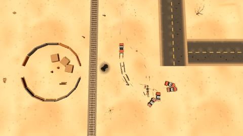 | 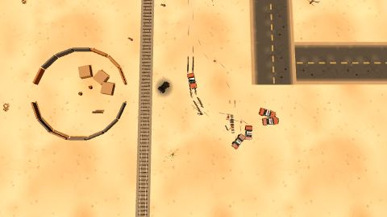 | 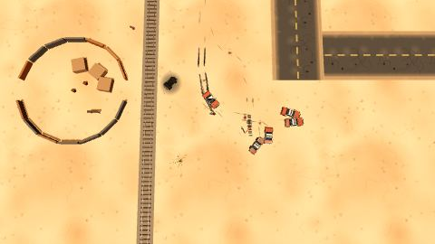 | 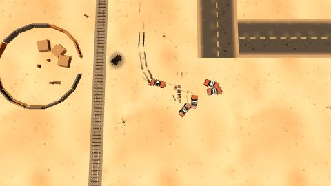 | 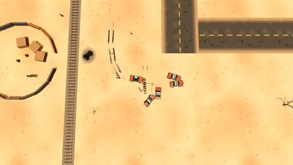 | 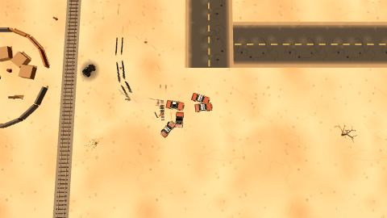 |

**slalom**

| 22.86 m/s | left | right | left | right | out |
|---|---|---|---|---|---|
| 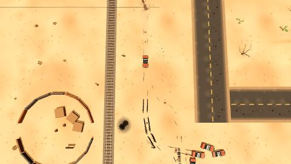 | 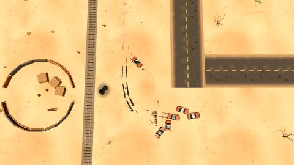 | 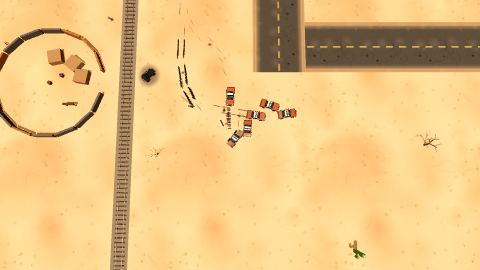 | 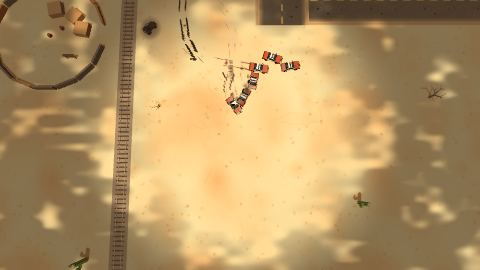 | 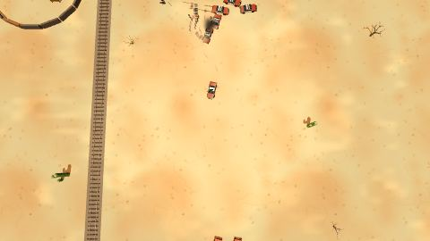 | 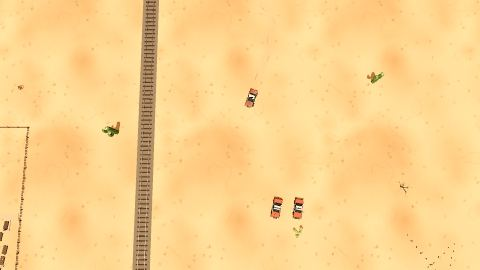 |

**firefight**

| he sees you | 0.3 s | 0.7 s | 1.2 s | 1.8 s | 2.6 s |
|---|---|---|---|---|---|
| 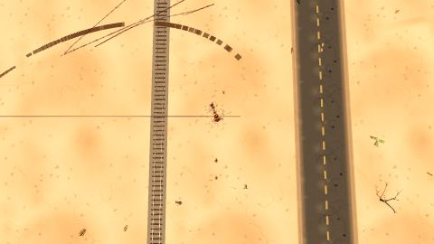 | 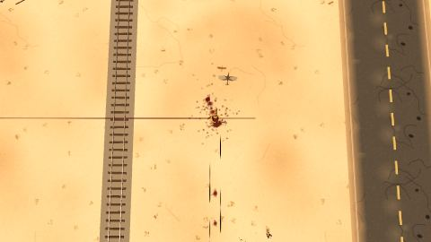 | 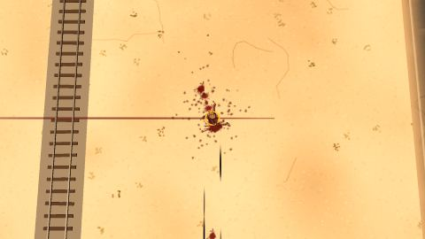 | 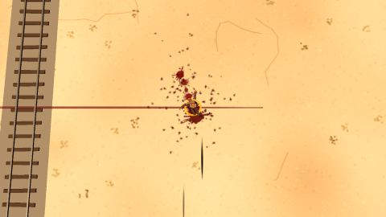 | 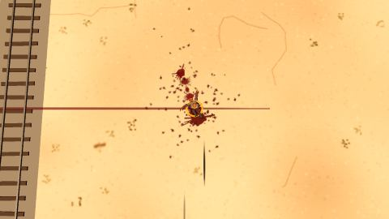 | 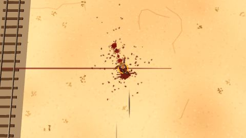 |

