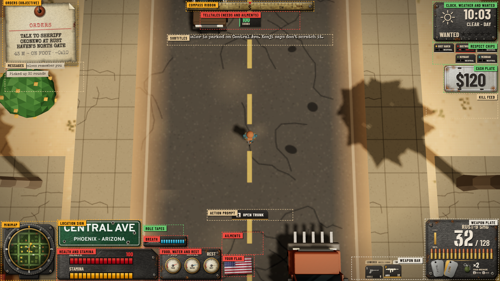
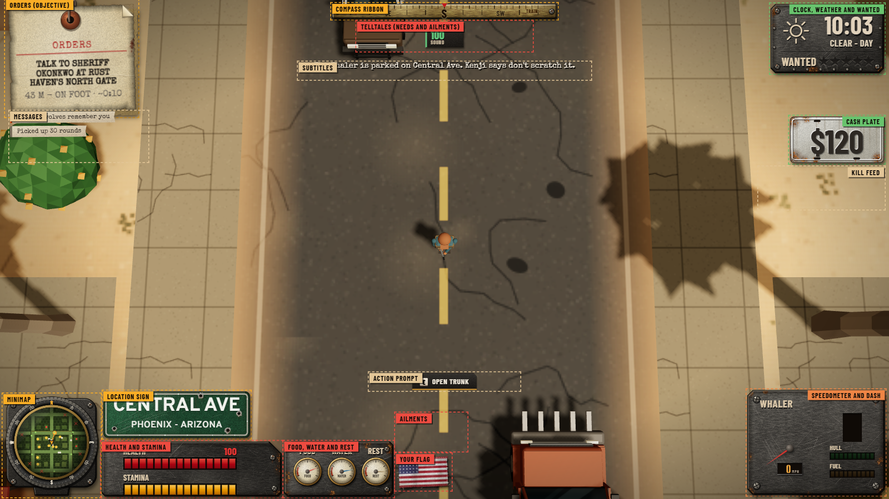
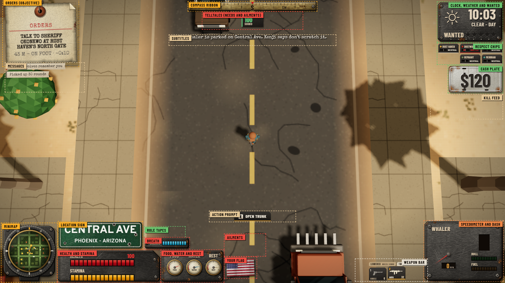
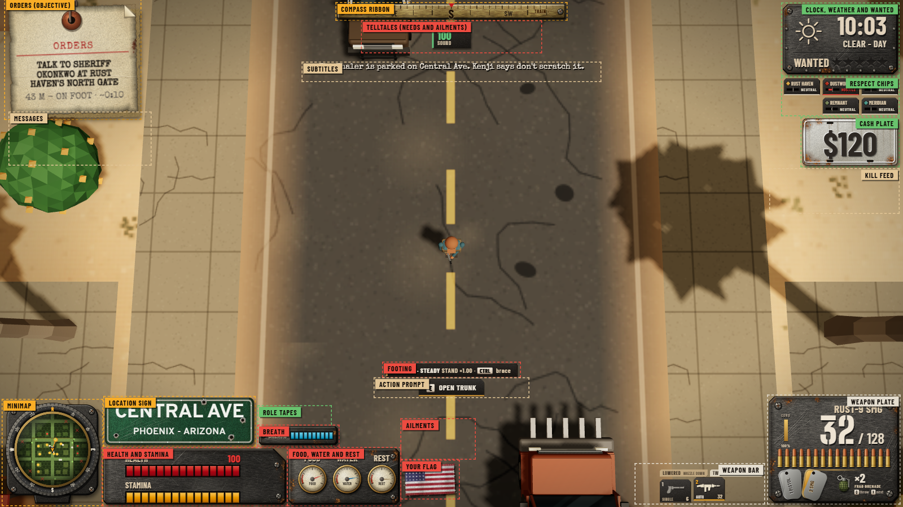
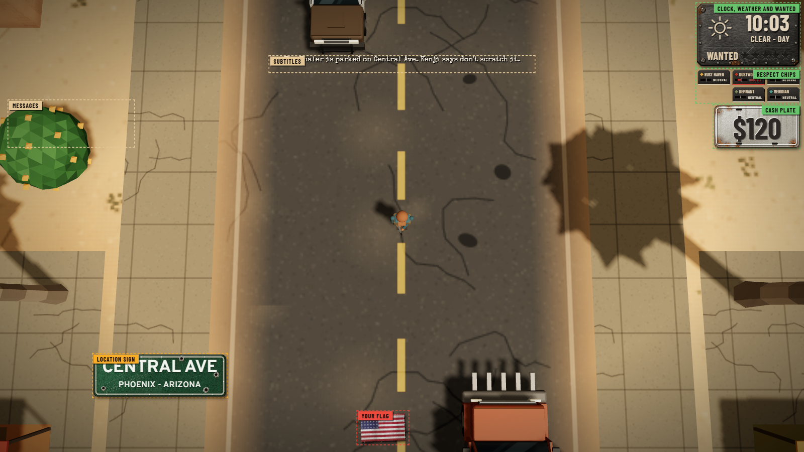
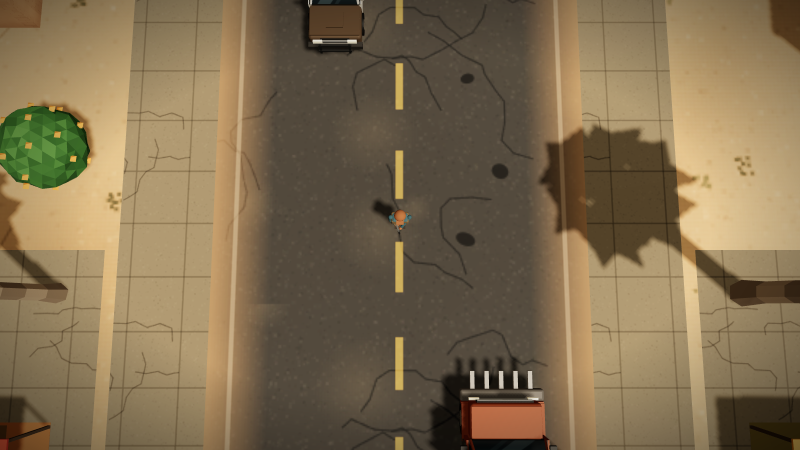
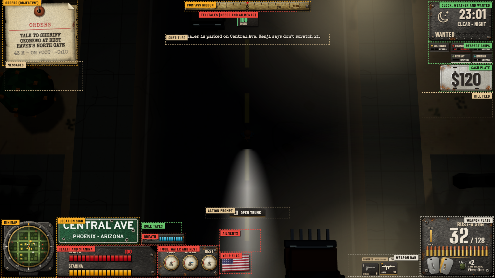
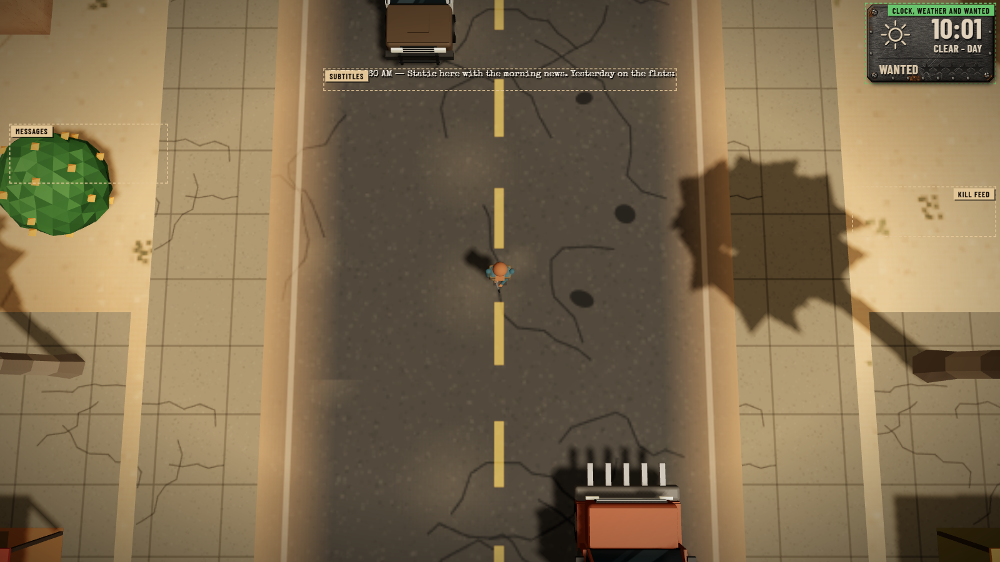
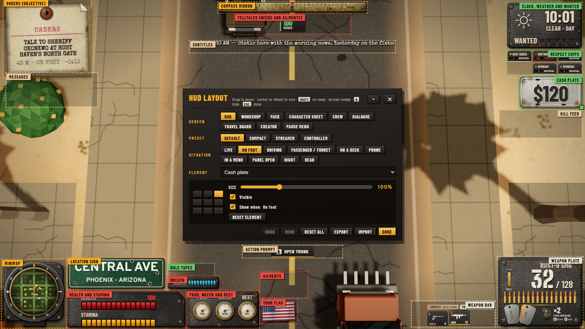

# HUD layout sheet

Generated by `web/tools/hud-sheet.mjs` from the game at 1600x900 (docs/design/WEB_UI_EDITOR.md). Rows: `web/src/data/hudlayout.js`.

## The elements (the standard names)

| id | name | hangs from | On foot | Driving | Passenger / turret | On a deck | Prone | In a menu | Panel open | Night | Dead |
|---|---|---|---|---|---|---|---|---|---|---|---|
| `minimap` | Minimap | bottom left | ● | ● | ● | ● | ● |  |  | ● |  |
| `sign` | Location sign | bottom left | ● | ● | ● | ● | ● | ● |  | ● |  |
| `compass` | Compass ribbon | top centre | ● | ● | ● | ● | ● |  |  | ● |  |
| `objective` | Orders (objective) | top left | ● | ● | ● | ● | ● |  |  | ● |  |
| `clock` | Clock, weather and wanted | top right | ● | ● | ● | ● | ● | ● |  | ● | ● |
| `respect` | Respect chips | top right | ● |  | ● | ● | ● | ● |  | ● |  |
| `cash` | Cash plate | top right | ● | ● | ● | ● | ● | ● |  | ● |  |
| `killfeed` | Kill feed | top right | ● | ● | ● | ● | ● |  |  | ● | ● |
| `feed` | Messages | top left | ● | ● | ● | ● | ● | ● |  | ● | ● |
| `status` | Health and stamina | bottom left | ● | ● | ● | ● | ● |  |  | ● |  |
| `needs` | Food, water and rest | bottom left | ● | ● | ● | ● | ● |  |  | ● |  |
| `flag` | Your flag | bottom left | ● | ● | ● | ● | ● | ● |  | ● |  |
| `ailments` | Ailments | bottom left | ● | ● | ● | ● | ● |  |  | ● |  |
| `telltales` | Telltales (needs and ailments) | top centre | ● | ● | ● | ● | ● |  |  | ● |  |
| `roles` | Role tapes | bottom left | ● |  | ● | ● | ● |  |  | ● |  |
| `breath` | Breath | bottom left | ● |  | ● | ● | ● |  |  | ● |  |
| `footing` | Footing | bottom centre |  |  |  | ● | ● |  |  |  |  |
| `weapon` | Weapon plate | bottom right | ● |  | ● | ● | ● |  |  | ● |  |
| `weaponbar` | Weapon bar | bottom right | ● |  | ● | ● | ● |  |  | ● |  |
| `reticle` | Reticle | the pointer | ● | ● | ● | ● | ● |  |  | ● |  |
| `speedo` | Speedometer and dash | bottom right |  | ● | ● |  |  |  |  |  |  |
| `prompt` | Action prompt | bottom centre | ● | ● | ● | ● | ● |  |  | ● |  |
| `subtitle` | Subtitles | top centre | ● | ● | ● | ● | ● | ● |  | ● | ● |

## The shots

- **situation-on_foot.png**: SITUATION ON FOOT: walking the street in daylight. Default, edit mode, names on.

  
- **situation-driving.png**: SITUATION DRIVING: at the wheel: the dash replaces the gun plate. Default, edit mode, names on.

  
- **situation-passenger.png**: SITUATION PASSENGER / TURRET: a passenger seat or the roof gun: your gun and the car's dash. Default, edit mode, names on.

  
- **situation-deck.png**: SITUATION ON A DECK: riding a pickup bed, a van, a boat or a roof: the footing chip matters. Default, edit mode, names on.

  
- **situation-prone.png**: SITUATION PRONE: flat on the ground. Default, edit mode, names on.

  
- **situation-menu.png**: SITUATION IN A MENU: the pause menu or the map is open: only where and when. Default, edit mode, names on.

  
- **situation-panel.png**: SITUATION PANEL OPEN: the workshop, the pack, the sheet, the crew or a travel board fills the middle: the HUD steps out of its way (a row that should stay lists panel). Default, edit mode, names on.

  
- **situation-night.png**: SITUATION NIGHT: on foot after dark (the same set as on foot; check it reads in the dark). Default, edit mode, names on.

  
- **situation-dead.png**: SITUATION DEAD: down: what killed you and the clock. Default, edit mode, names on.

  
- **editor-panel.png**: THE EDITOR: F6 or EDIT HUD LAYOUT in the pause menu. Cash plate selected (its grip, the anchor grid, size, visible, situation).

  
