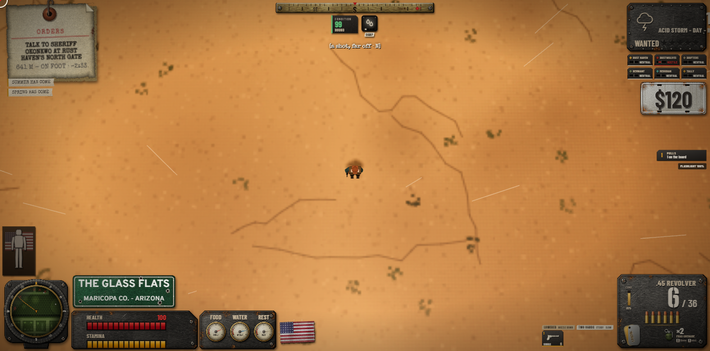
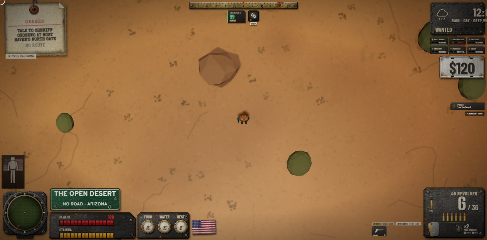
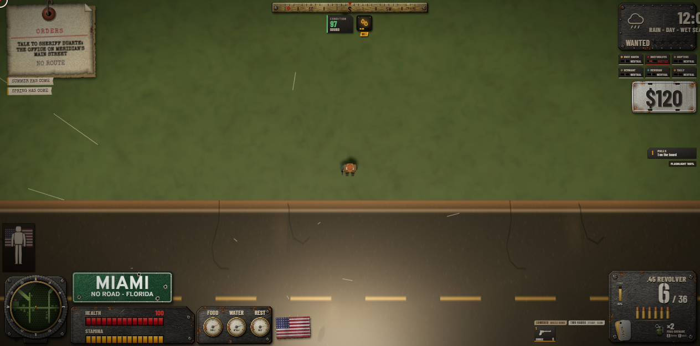
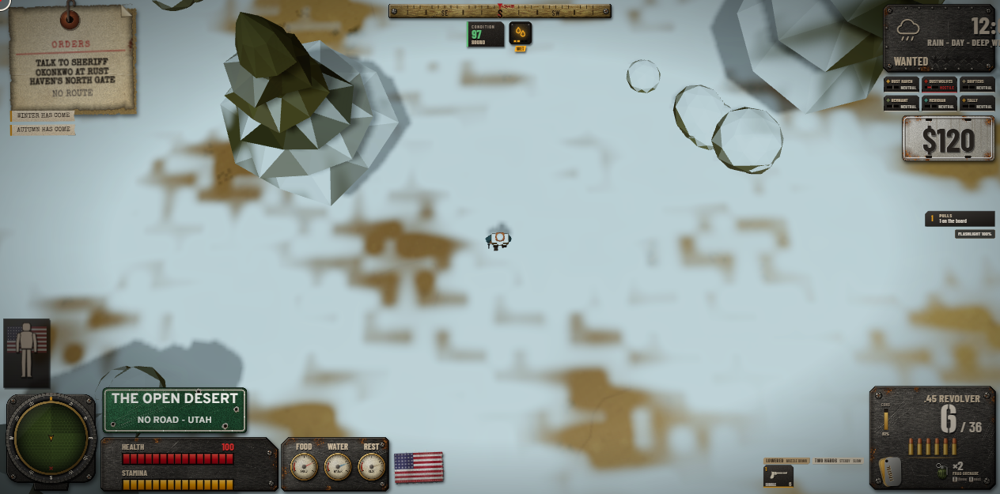
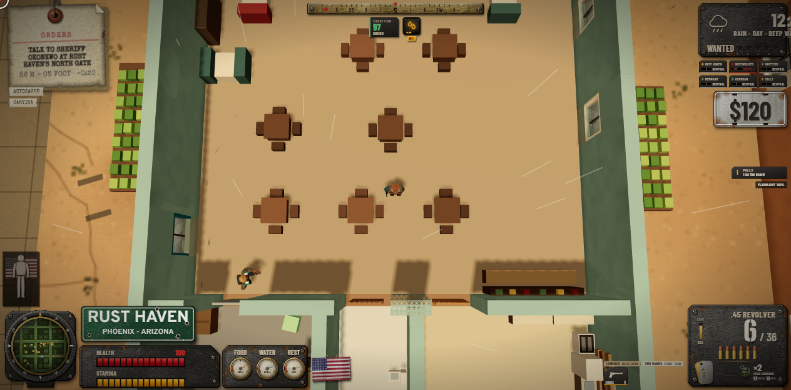

# Weather & seasons audit (web build)

*2026-11-13. Robert 11-12: "fix the world map and accessibility and weather and seasons." This covers weather and
seasons. It was played on `origin/integrate/deathlands` at `db4006f9` (seasons landed, with today's mountain-pass fix). The
probe that made every number and picture here is `web/tools/weather-audit.mjs` (rerun it to check a fix). Its raw output
is `docs/renders/web/weather-audit/audit.json`, and the pictures sit next to it.*

## How it was played

For each of four places I set the calendar to the middle of each season at noon. At each stop the probe read what the game
holds: temperature at 14:00 and 05:00, day length, snow, the road, and the weather roll (400 draws). It also read the radio
forecast. It then made the season's likeliest wet weather fall and took a picture. After that it probed the suspected
faults directly.

**The playable world is smaller than the climate tables.** The streamed world is a 45 km disc round Phoenix plus the I-10
and Florida corridors. The rest of the map, including the Rockies passes and the true far north, is pushed back to the dust
wall on arrival. So the four places are:

- **Phoenix:** the Glass Flats (250, 430).
- **The mountain pass:** the **Mogollon Rim** (AZ-87), the one pass of `PASSES` inside the playable world.
- **The Florida coast:** Miami.
- **The far north:** the dust wall due north of Phoenix, at latitude 38, the edge of Utah, in the Basin and Range climate zone.

## What the game does, season by season

### Phoenix desert (Glass Flats)
| season | day mean | noon / dawn | day | snow | road | weather it rolls: clear / rain+overcast / storm / dust / fog / ash / snow | radio says |
|---|---|---|---|---|---|---|---|
| winter | 13.1 C | 23.2 / 2.6 C | 10.1 h | none | clear | 38 / 45 / 4 / 4 / 8 / 2 / 0 % | "clear skies within 12 hours, **and a hard cold**" |
| spring | 22.8 C | 35.5 / 9.3 C | 12.9 h | none | clear | 51 / 24 / 3 / 18 / 4 / 1 / 0 % | "a clear day within 12 hours" |
| summer | 35.9 C | **52.5** / 18.5 C | 13.9 h | none | clear | 27 / 34 / 18 / 16 / 2 / 5 / 0 % | "rain moving in within 12 hours" |
| autumn | 26.4 C | 40.2 / 11.8 C | 11.1 h | none | clear | 56 / 21 / 3 / 12 / 3 / 6 / 0 % | "a clear day within 12 hours" |

*Phoenix in summer under its likeliest wet weather, the monsoon storm (the HUD calls it an ACID STORM). The streaks are
barely there and the light and ground stay bright.*

### The Mogollon Rim pass (AZ-87)
| season | day mean | noon / dawn | day | snow | road / pass | rolls | radio |
|---|---|---|---|---|---|---|---|
| winter | 12.2 C | 22.3 / 1.7 C | 10 h | none | clear, **open** | 38 / 45 / 3 / 5 / 7 / 3 / 0 % | "clear skies, and a hard cold" |
| spring | 21.8 C | 34.6 / 8.3 C | 13 h | none | clear, open | 48 / 30 / 3 / 16 / 2 / 2 / 0 % | "a clear day" |
| summer | 35.0 C | **51.6** / 17.5 C | 14 h | none | clear, open | 30 / 35 / 16 / 19 / 0 / 2 / 0 % | "rain moving in" |
| autumn | 25.4 C | 39.3 / 10.9 C | 11 h | none | clear, open | 58 / 18 / 3 / 13 / 4 / 6 / 0 % | "a clear day" |

*The Mogollon Rim in deep winter: plain sunny desert. The real Rim is a pine forest about 2,000 m up and snowed in.*

### Florida coast (Miami)
| season | local season | day mean | noon / dawn | day | rolls | radio |
|---|---|---|---|---|---|---|
| winter | DRY | 21.3 C | 26.8 / 15.6 C | 10.6 h | 47 / 31 / 2 / 0 / 17 / 3 / 0 % | "a clear day" |
| spring | DRY | 21.3 C | 26.8 / 15.6 C | 12.7 h | **0 / 26 / 74** / 0 / 0 / 0 / 0 % | "rain moving in" |
| summer | WET | 29.1 C | 36.9 / 20.9 C | 13.4 h | 20 / 51 / 18 / 0 / 9 / 2 / 0 % | "rain on the way" |
| autumn | WET | 29.1 C | 36.9 / 20.9 C | 11.3 h | 20 / 50 / 18 / 0 / 11 / 2 / 0 % | "rain moving in" |

*Miami in the wet season, raining: a handful of thin streaks. The road and grass don't read wet, and there's no sound
that tells you it is.*

### The far north of the playable world (latitude 38, Utah)
| season | day mean | noon / dawn | day | snow (pack / shown) | road | rolls | radio |
|---|---|---|---|---|---|---|---|
| winter | -2.5 C | 7.5 / -13.1 C | 9.7 h | 0.48 / 0 | clear, grip 1 | 17 / **72** / 3 / 0 / 8 / 0 / **0 snow** | "snow within 12 hours, and a hard cold" |
| spring | 9.1 C | 21.9 / -4.4 C | 13.1 h | 0 | clear | 49 / 25 / 2 / 19 / 3 / 2 / 0 % | "a clear day, and a hard cold" |
| summer | 25.1 C | 41.7 / 7.7 C | 14.3 h | 0 | clear | 57 / 24 / 2 / 12 / 2 / 5 / 0 % | "clear skies" |
| autumn | 13.5 C | 27.3 / -1.0 C | 10.9 h | 0 | clear | 56 / 24 / 2 / 9 / 3 / 7 / 0 % | "a clear day" |

*The far north in winter: snow on the ground, -3 C, and the HUD says RAIN. The rain it rolled at noon keeps falling into a
-13 C night.*

## What is wrong, worst first

**1. The weather is one sky for the whole map.**
- **What happens:** `sky.weatherKey` is a single global state. It is rolled every 3-8 real minutes from the odds of
  wherever the player is standing at that moment, and everyone on the map is under it.
- **Example:** raining in Phoenix, teleport to the snowy north, and it is still the same rain (picture above).
- **What the design said:** `docs/design/WEATHER_AND_SEASONS.md` §3.1-3.3 specifies storm systems: a centre, a radius, a
  drift, a lifetime, spawned deterministically by day and hour from regional climate rows, and sampled for local
  intensity. None of that was built in the web game.
- **What follows from it:**
  - A front never moves across the map.
  - You can't drive out of the rain, or see weather coming on the horizon or the map.
  - "Raining in Phoenix while dry in Tucson" can't happen.

**2. Two players in the same spot get different weather.**
- **What happens:** the weather is `Math.random` on each page. Neither the weather nor the clock or the season rides the
  shard (`net/shard.js` and `server/shard.mjs` carry no sky, weather or calendar).
- **What follows:** two friends side by side see different skies, at different hours, in different seasons. The seasons
  file says it outright: the calendar "moves only while a page simulates".

**3. Rain falls inside buildings.**
- **What happens:** the rain is a box of streaks that follows the camera. Nothing tests for a roof. Standing in the Rust
  Haven cantina in the rain, 1,624 streaks fall on the dining room floor.
- **The sound does the same:** the rain bed plays at the same volume indoors as outdoors. There is no "on the roof" layer.

**4. Weather barely changes how anything plays.**
- **What does change:** rain and storm only touch the road grip (wet 0.88, the same for both), wetting your skin, a
  witness's view (`deeds.js`), tracks fading, and animals.
- **What doesn't:**
  - **AI sight and hearing ignore weather completely.** Nothing in `ai.js`, `tactics.js`, `reactions.js` or `zombies.js`
    reads fog, rain, dust or storm. A raider sees you as far in a dust storm or fog as on a clear noon, and rain doesn't
    cover your footsteps.
  - **A storm does nothing a rain doesn't**, apart from a lightning flash and a synthesized thunder burst. There's no
    wind push on cars or bikes, no harder sight loss, and no hail.
  - **Wind only exists as dust or ash particles.** No storm or blizzard has a wind sound.

**5. Season road grip is read at the player and applied to every car.**
`vehicles.js` multiplies `g.seasons.grip` (the road under the player) into every vehicle. A car in Florida gets the
player's Utah ice. Wet-road grip comes from the one global rain the same way.

**6. Rain or snow is decided by the air at the moment of the roll, then kept.**
- **What happens:** `kindFor` turns rain into snow only by the air temperature at the moment of the roll, then the result
  holds for up to 8 minutes.
- **The far north's winter:** 72% rain or overcast and **0% snow**. The roll happens at a noon of 7.5 C, then the rain
  carries on into a -13 C night.
- **The other way round:** snow rolled at dawn would carry on at noon. The type never follows the air as it changes.

**7. The weather odds go negative at a season edge where the season wraps the new year.**
- **Where:** in the Florida dry season and the California wet season.
- **Why:** `oddsAt` takes the position inside a season that wraps the new year wrongly (`ff` should be `f + 1` when `f` is
  before the season's start). The boundary blend then extrapolates, and CLEAR comes out at **-1.67**.
- **Result:** Florida's dry spring rolls **74% storms and 0% clear**, the exact opposite of a dry season.

**8. The desert's daily swing is too wide.**
- **Phoenix:** summer reads **52.5 C** at 14:00 and 18.5 C at dawn. The real figures are about 42 C and 29 C (the record
  is 50 C). Winter dawn reads 2.6 C, where the real figure is about 7 C.
- **Why:** the base swing (data/survival.js `CLIMATE`, a 17.5 C half range) is applied in full in summer.
- **Florida does the same:** its wet season swings 21-37 C, where the real range is about 26-33 C.

**9. The Mogollon Rim is desert.**
- **What happens:** the Rim pass uses Phoenix's zone and only about 1 C less. Its summer noon is 51.6 C, its winter mean
  12 C, and it has no snow. The real Rim is pine forest about 2,000 m up and gets winter snow.
- **Why:** relief at the Rim reads low, and the pass's own `cold: 12` only reaches the pass's snow pack, not its air or
  look.
- **The pass never closes:** its winter cover peaks at 0.17, against a 0.8 closure line. That one may be right for AZ-87,
  but it is never felt.

**10. The forecast is a climate average, not a forecast.**
- **What happens:** `forecast()` returns the most likely kind of the season's odds row, not what is actually coming next.
  The next weather is a fresh random roll.
- **What follows:** the radio can't let you plan. It says "a clear day" and it rains five minutes later.
- **The wording is off too:** "a hard cold" fires whenever the air is 10 C under the desert baseline, so Phoenix's 13 C
  winter gets "a hard cold" every day.

**11. Rain and storms barely read from the camera.**
- **What happens:** the streaks are thin 2.2 m lines at 45% opacity, seen from 30-40 m above, so a downpour is a few
  scratches.
- **Weak cues:** the light dims only through the sun's intensity, and the colour grade then lifts it back. Wet ground is
  a global tint on the terrain material, with no puddles and no shine on roads that you can see from up there.
- **In the pictures:** Phoenix's monsoon storm and Miami's wet-season rain both read as a sunny day.

**12. A front arrives everywhere in about six seconds.**
A weather change eases the whole sky over about six seconds (fog: 0.011 → 0.025 in six seconds), everywhere at once. With
no systems (item 1), there is nothing to see coming.

**13. Thunder is synthesized and placeless.**
Each lightning flash queues a synthesized low burst 0.4-2.2 s later. It plays at the same volume with no direction and no
distance, and there are no recorded takes. Storm audio is "presentation only" in the design too, but the design wanted it
placed at random bearings.

**14. Smaller items.**
- **The labels:**
  - The STORM row is labelled **ACID STORM** everywhere, including the Arizona monsoon and Florida's afternoon storms. The
    burning rain is its own row (SICKSKY), so the plain storm shouldn't be acid.
  - ASHFALL rolls 2-7% of the time everywhere, including Miami, with no volcano or fire to explain it.
- **The seasons themselves are fine:**
  - The day length tracks latitude correctly: Phoenix winter 10.1 h and summer 13.9 h, against a real 10.0 h and 14.3 h.
  - Seasons don't change in one frame. The odds blend, and the snow pack and the leaves ease.
  - After a jump (teleport) the shown snow lags behind the pack for a few game hours. That's acceptable.
- **Florida's temperatures:** winter and spring are identical, and so are summer and autumn. The warmest day sits at the
  summer/autumn line (`warmest: 0.5`), so the curve mirrors across it. Florida's real peak is early August (about 0.42).
- **Farming:** it isn't on integrate yet (it lands from wave 2). `growthFactor` and `plantingWindow` have no consumer
  here, so crops follow the season only once that lands.
- **Sizes:** checked against the compressed map. A world kilometre is about 12 real kilometres, at about 9.2 km of world
  a degree. Most sizes are sensible: the rain box (110 m), the snow read radius (900 m, about 11 real km), the fire (7 m)
  and the passes (now scaled by `STREAM.K`). The one sized wrong is the design's storm radius (2.6 km "at 60x"): built at
  this map's 12x, a storm would be the size of a county, not a state. I resized it in the fix.

## What I will fix, in this order

1. **Weather by region (`feat/web-weather-region`).**
   - **Storm systems:** a few systems with a centre, a radius, a drift and a lifetime, spawned deterministically from the
     world clock and the regional odds, the same on every page. A front can be seen coming and driven out of.
   - **Driven by the air at your spot:** the sky's targets, rain or snow, and fog follow the local intensity and the
     local air.
   - **Roofs:** no rain indoors, and a roof layer for its sound.
   - **Grip:** wet grip and season grip read at each car.
   - **Feel:** rain, snow, fog and dust cut AI sight and hearing.
   - **The forecast:** the radio reads the actual systems ("rain moving in from the west in about two hours").
2. **The climate rows (`feat/web-weather-climate`).**
   - The negative odds.
   - The desert swing.
   - The Mogollon Rim's air and snow.
   - Florida's warmest day.
   - The "hard cold" wording.
   - The monsoon not called acid.
   - Ashfall only where it belongs.
   - Rain or snow re-decided as the air changes.
3. **The look and sound (`feat/web-weather-sound`).**
   - Rain and storm that read from above: darker light, a wet sheen.
   - An ElevenLabs pool: rain on open ground, rain on a roof, wind, and distant and close thunder, placed by bearing.
     Made offline; nothing generated at play time.

Each of the three ships with checks that stay green in deep winter and high summer, before and after pictures on the NAS,
and a review. All three are on integrate, with no merge.

**For the map/roads session:** teleports outside the 45 km disc and the corridors are pushed back to the dust wall. The
place signs at the Utah edge read "THE OPEN DESERT · NO ROAD - UTAH" while snow lies on the ground.
