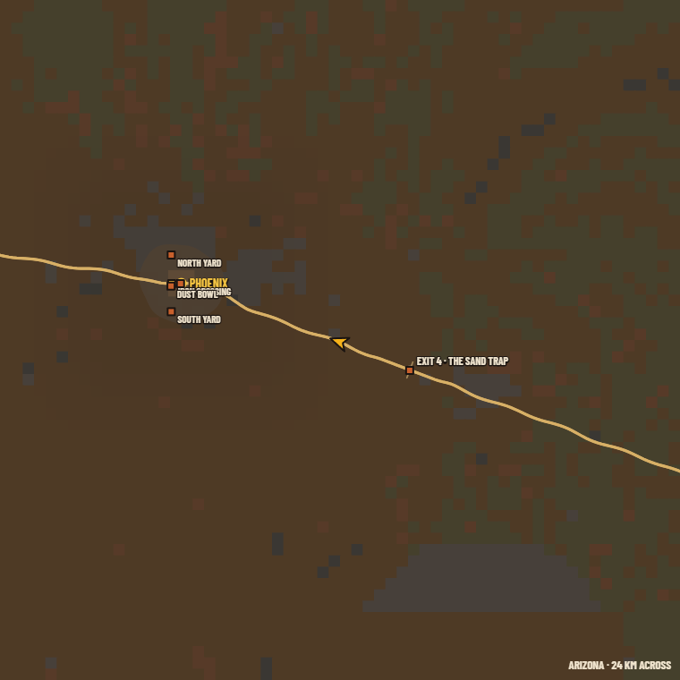
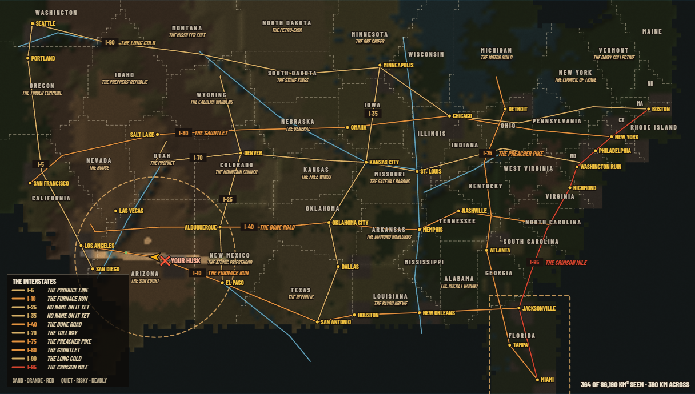

# WORLD MAP STATUS (DSOA web)

**Branch:** `feat/web-world-map` (off `integrate/deathlands` 2b93cc0f) · **Worktree:** `.claude/worktrees/web-world-map`
**Last pass:** 2026-11-12, pass 1 (built and hand-tested; full battery running) · **Bus:** `alpine-swift-dsoa`

## What "the world map" means here

Press **M** in the game and you get the big map. Before this work it had three views, picked by where you stand:
Rust Haven (the Phoenix island), the Phoenix metro (3.8 km), and the area 24 km round you. It did **not** have the country.
The design (`docs/design/WEB_STREAMING.md` §3.9, §4 F13) promised a **continental atlas** (the whole Divided States, state
borders, rivers, the interstates with their nicknames, towns, exits, a fog over places you have never been) and it was never
built. That atlas is this job. Design doc: `docs/design/WEB_WORLD_MAP.md`.

Out of scope (feature freeze, WEB_DEPTH_PLAN §10 row 6): stash maps, notes and shared map pins. Opening the country to drive
past the dust wall is world-tools work, not this map.

## Before / after

| Before (the only map out of town: 24 km, blocky) | After (M, then Tab: the whole country) |
|---|---|
|  |  |

Zoomed in after a real 60 s drive east out of Phoenix: the fog is lifted along the road you drove and round Rust Haven, nowhere
else (`../renders/web/worldmap/11-fog-after-drive.png`).

## Checklist

| # | Item | Proof | State |
|---|---|---|---|
| 1 | A COUNTRY view on the big map: the whole country painted once (land by biome, hill shading, the sea) | screenshot 07; selftest `the atlas paints the whole country once` (47 ms) | **done** |
| 2 | State borders, each state's name and who rules it; the map title names your state and ruler | screenshot 07 (in Florida the title read FLORIDA · THE SWAMP KINGDOMS); selftest: all 48 states have a ruler | **done** |
| 3 | Rivers and the 10 interstates coloured by danger, every nickname in a key | screenshot 07 (key bottom-left) | **done** |
| 4 | Cities always; holdouts, exits and bases only once you have been near (law 6) | selftest `show only where you have been`; zoomed shot shows exits only on the driven stretch | **done** |
| 5 | Fog of where you have been, 1 km cells, saved with the game | real drive: 0 → 42 km² seen; quick save → wipe → quick load: 39 → 39; selftest round trip | **done** |
| 6 | You (arrow), your husk, your waypoint, the dust wall and Florida's box | screenshot 07 | **done** |
| 7 | AREA / COUNTRY tabs, Tab key, wheel zoom, drag pan | tapped by hand in a real tab: M, Tab, COUNTRY tab, wheel, drag, AREA tab, M all did the right thing; selftest | **done** |
| 8 | Click the country sets a waypoint; right-click clears | by hand: clicked Miami → ring + "16.2 KM"; right-click cleared it; selftest (El Paso within a cell) | **done** |
| 9 | Agent command `atlas` + COMMANDS regenerated (268 commands) | `node tools/dl.mjs atlas` output in pass 1 | **done** |
| 10 | Speed: paint once (47 ms), nothing per frame when closed | selftest: 10,000 fog updates standing still under 5 ms | **done** |
| 11 | No purple; IP lint 0 deny | selftest pixel scan 0 purple samples; `ip-lint: 0 deny, 15 review` (the 15 are old, not in map code) | **done** |
| 12 | Design doc `WEB_WORLD_MAP.md` (8 sections) + back-references in WEB_STREAMING §3.9 and INDEX | files | **done** |
| 13 | The game's batteries green in a foreground window: worldmap 10/10, qol 15/15, then the full selftest | full run started 2026-11-12 | **running** |
| 14 | PR into `integrate/deathlands` with an independent review PASS | | left |

## Not done / known limits

- Zoomed all the way in (8×), the painted land is soft: the country sheet is 6 px per 500 m cell. Past about 4× the AREA view
  is the better map, and it is still one Tab away.
- Fog only lifts by going there. Being told about a place (a bar's gossip, a found road map) does not uncover it yet.
- When you stand in Phoenix your arrow sits on the PHOENIX label, so that one city name is hidden under you.

## Passes

- **Pass 0 (2026-11-12):** read the handoff, the plan and the four newer branches (storeys, holdouts, carousel, room scan:
  none touch the big map). Found the gap. Wrote this checklist.
- **Pass 1 (2026-11-12):** built the COUNTRY view, the fog and its save, the tabs, zoom, pan, click-to-waypoint, the title, the
  `atlas` command, 10 checks, the doc. Fixed what the pictures showed: labels printing over each other (now placed by
  importance, none overlap), the I-10 shield on Phoenix, a garbled dash in Chicago's name, the card squeezing the map in a
  small window, Miami cut off at the sheet's edge. Commits 04e4dc82, 6a27e114 (pushed).
