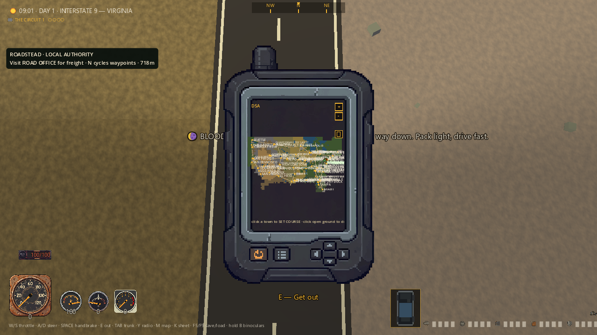
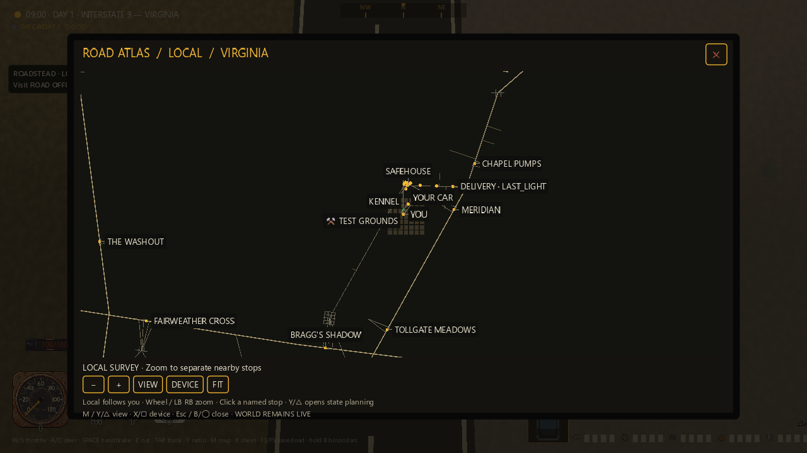
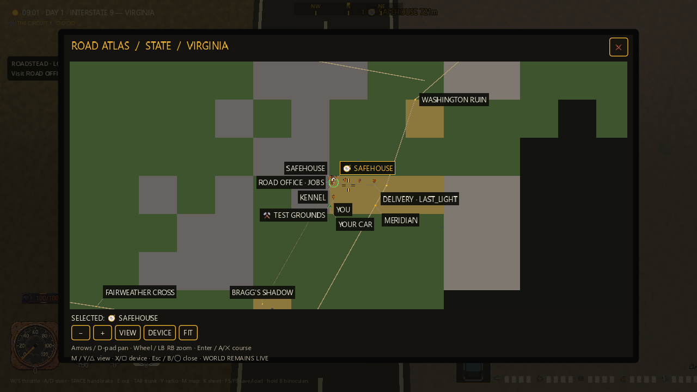
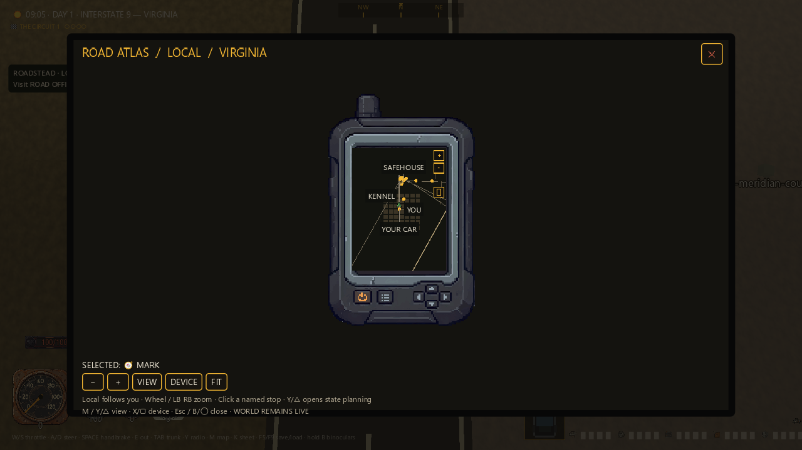

# Road atlas — screenshot-led repair

Seven new, actual game captures follow a repair to the existing M map. This is
an isolated source milestone, not a new Windows release or a finished USA/MMO.
The [20-piece game gallery](MERIDIAN_GAME_GALLERY_2026_09_06.md) covers the larger
world, houses, menus and four cartridge formats; the [driver dossier audit](CHARACTER_SHEET_VISUAL_AUDIT_2026_09_06.md)
records the earlier character-screen repair.

## Judgment against the spec

The previous tiny device LCD made nationwide planning hard to read. Its labels
collided, visible names were not reliable click targets, and map input could
reach gameplay. The replacement uses the existing amber/bone/ink language and
the master spec's full-screen planning role: a wide default atlas with a stable
header, selected destination, visible controls and explicit close button.

The original GPS and portrait phone remain available, with their original art
and proportions. All three displays use the same map data and course-setting
path. This pass does not change road topology, world scale, region content,
cartridge aspect ratios, or the existing local/state/country cycle. The only
map-data text change repairs the garbled dash in Chicago's name.

My verdict after inspecting every final frame: route planning is substantially
more readable and usable, but it is not finished cartographic art. The coarse
biome tiles still look like a development map; local views have large empty
areas, the device shells sit in an oversized empty reading frame, and the
smallest country view must omit many labels to keep the remaining ones legible.
Zooming/panning exposes additional stops. The spec's known/driven-road knowledge
layer is not implemented by this repair. Better authored geography, a stronger
map legend and discovery presentation remain necessary.

## What was fixed

- Measured label bounds, collision avoidance and deterministic priorities replace
  overlapping text. Labels are kept inside the LCD; selected destinations get
  priority. Their actual drawn rectangles select their stored world targets,
  including displaced labels, through the existing course setter.
- The frame and controls resize within viewport gutters. Wide planning is the
  default; DEVICE cycles wide atlas → GPS → phone → wide atlas.
- A visible red close control, raw Esc/B/◯, mouse controls and controller hints
  expose the existing navigation. Toolbar actions return focus to the map.
- The map owns gameplay input while open and retains closing gestures until
  release. Foot movement, driving and mounted movement/fire cannot leak through.
  Existing pending attack/whistle/interact gestures are canceled on entry.
- Character creation/death cannot acquire an overlapping map. Actual death
  dismisses it. Controller disconnect clears only that controller's held close
  gesture, never an unrelated keyboard release guard.

The world remains live: the map is not a pause menu. LOCAL follows the player;
it supports zoom and clicking named stops. Y/△ or VIEW opens STATE planning.
STATE and COUNTRY support arrows/D-pad panning, wheel/LB/RB zoom, and Enter/A/✕
to set a course at the crosshair. M cycles local/state/country/off; Y/△ cycles
views while open, X/▢ changes the display, and Esc/B/◯ closes. The physical
close button follows Godot's normal activation-on-release behavior.

The debugging and test-driven-development skills kept this a bounded repair:
observed screenshot/input failures were reproduced before the behavior changes,
and the final changes preserve the game's existing geography and action paths.

## Before — country view

The original 1280×720 capture shows the country squeezed into a tiny GPS. This
is the unchanged-source baseline, not a reconstruction of the old appearance.



## After 01 — local survey

Safehouse, kennel and nearby stops can be read without overlapping the player
marker. The correct local-specific instructions are visible. Sparse local map
content remains a presentation weakness.



## After 02 — Virginia

State planning now has a usable canvas, named roadsides and a visible selected
destination. The blocky biome field and duplicate ordinary/selected safehouse
labels are still visually rough; neither is concealed by the new framing.



## After 03 — Divided States

The continental route network and major cities are readable in one view.
Small exit names are suppressed at this scale. The existing simplified country
shape is retained; this is not proof of complete nationwide world content.

Subsequent PDF-packaging verification found an internal compressed-data checksum
error in this PNG, in both the original build capture and its published copy.
Some viewers display it, but Pillow full decoding and Node zlib reject it.
The container CRC/header check alone had not detected this. The original remains
untouched; the portable review pack and gallery instead use the valid, separately
captured course-planning frame04 below. This is not a repaired/reconstructed image.


## After 04 — course planning

Actual input zooms and selects the center target. Its highlighted label clears
the crosshair; Chicago's punctuation is repaired. Thin roads and blocky terrain
still need a more finished cartographic treatment.


## After 05 — scavenged GPS

The original rugged GPS art and its narrower LCD remain intact. Named nearby
stops fit without colliding. The device is intentionally smaller than the wide
planning view, but the large empty outer frame needs further art direction.



## After 06 — portrait phone

The phone keeps its portrait proportions and shares the course/label engine.
The surrounding empty frame and plain local map are still unfinished; the
different aspect ratio is real, not a stretched copy of the GPS.


## After 07 — compact country view

At a real 960×540 logical and physical viewport, close/navigation controls stay
inside the frame and labels remain readable. Many minor labels are omitted
instead of shrunk. This is a usable compact fallback, not comprehensive
low-resolution UI or physical handheld certification.


## Capture provenance

The seven final PNGs and manifest are byte-identical copies of final GPU run
`build/atlas-readability-0abb663459514eea982783a78393c4e5/`; every copied file's
SHA-256 was compared to its source. Frames 01–06 are 1280×720 physical pixels
with the game's 1920×1080 logical viewport. Frame 07 is 960×540 both physically
and logically. These are unretouched renders, not generated art or composited UI.

The map is opened and operated through injected real keyboard, pointer and pad
events. The photography starts at the real fresh-game highway location; the
clock is not held and the player is not teleported between these map captures.
Later regression fixtures stage foot/horse positions and injuries separately.
Pad-event coverage is not a physical controller hardware test. The 60 FPS cap
is a runner setting, not a measured performance claim.

The seven baseline files are preserved from
`build/atlas-readability-733268f1c4ae40b09a01611bc0e316d7/` (21 passes / 23 failures).
Its filenames express intended test steps: before/05 and before/06 are both
still GPS because the requested switching inputs failed in the old code. They
must not be labeled successful baseline GPS/phone transitions. Before 01–03
are the direct unchanged-source local/state/country comparisons.

## Verification and review

All final runs use the exact final source and fresh isolated APPDATA and
LOCALAPPDATA roots under this checkout's build directory. All owned processes
terminated with exit 0; no timeout occurred. Runner metadata and complete logs
remain in the evidence directories below.

| Final check | Assertions | Evidence under `build/` | Diagnostics |
|---|---:|---|---|
| Atlas GPU + seven captures | 76/0 | `atlas-readability-0abb663459514eea982783a78393c4e5` | Clean |
| Atlas headless | 47/0 | `atlas-readability-bb1f95cd99754526917916157111f6b5` | Clean |
| Map navigation | 12/0 | `atlas-readability-29c7d736a02d484597cc46e3d0c5d2b6` | ObjectDB / 2 resources at exit |
| Map data and display cycle | 46/0 | `atlas-readability-1fb17ccfbacf4badaa72842c744e01fb` | Clean |
| Horse mechanics | 29/0 | `atlas-readability-f65fef1919bc474f92bad4ff0de3efbb` | ObjectDB / 4 resources at exit |
| Character dossier | 56/0 | `atlas-readability-c6e889d5bfd149c69faf9b8c078d0924` | Clean |

That is 76 GPU and 190 headless assertions, not a pristine combined diagnostic
gate. Earlier clean navigation/horse runs do not erase the final exit warnings.

The expanded review regressions first failed 66/5 at
`atlas-readability-54d427c5446d4c8c94cd1e28491d4612`, exposing label selection,
Chicago text, unrelated-device disconnect, and mounted move/fire leakage.
Additional rendered target/focus checks failed 72/4 at
`atlas-readability-93f7d0f2a041432a9c1413953b240c6a` before the last repairs.
An earlier 62/5 run also had a fixture script error from checking a nonexistent
weapon field; it is not clean evidence. The fixture now checks the actual `mag`.

The final toolbar check initially sampled focus before Godot dispatched the
button release. A temporary trace proved release callback and canvas focus
occurred on the next process dispatch. The helper now awaits that dispatch,
then physics ticks; assertions were retained. The older horse regression had
the same issue at two real-interact mount taps (26/3 before, 29/0 after adding
process-frame waits). No mount assertion was removed or replaced with a direct
mount call. Temporary instrumentation was removed before the final runs.

Independent read-only review approved the bounded source repair with no
remaining critical, important or minor findings. Its earlier mounted-input,
disconnect, label-hitbox, centered-label, device-icon and local-hint findings
were resolved; it independently inspected the final logs and retained both
exit-diagnostic caveats. The primary task inspected all seven final images.

Repeat only with the isolated driver (PowerShell 7):

```powershell
pwsh -NoProfile -File tools/atlas_readability_check.ps1 -Capture
pwsh -NoProfile -File tools/atlas_readability_check.ps1 -Scene map_nav_sim
pwsh -NoProfile -File tools/atlas_readability_check.ps1 -Scene map_sim
pwsh -NoProfile -File tools/atlas_readability_check.ps1 -Scene horse_sim
pwsh -NoProfile -File tools/atlas_readability_check.ps1 -Scene character_sheet_sim
```

## Still open

This source repair has not been repackaged into the older Windows ZIP, merged
or publicly deployed. Lighting, authored world layout, content depth, cartridge
presentation, public authenticated MMO infrastructure and wider regression
failures remain separate work. Passing this focused gate does not certify them.

The earlier [test-save incident](TEST_SAVE_ISOLATION_INCIDENT_2026_09_06.md)
remains unresolved: preserved affected files are not recovered pre-test saves.
No current run touched that normal profile. The original playthrough has not
been recovered, and the full-game goal remains active.
