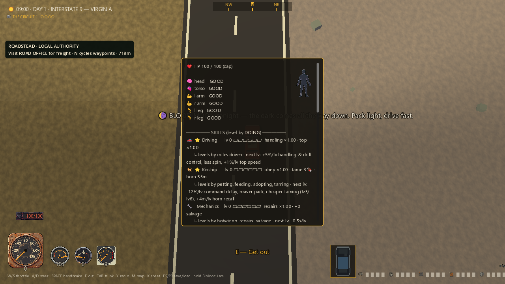
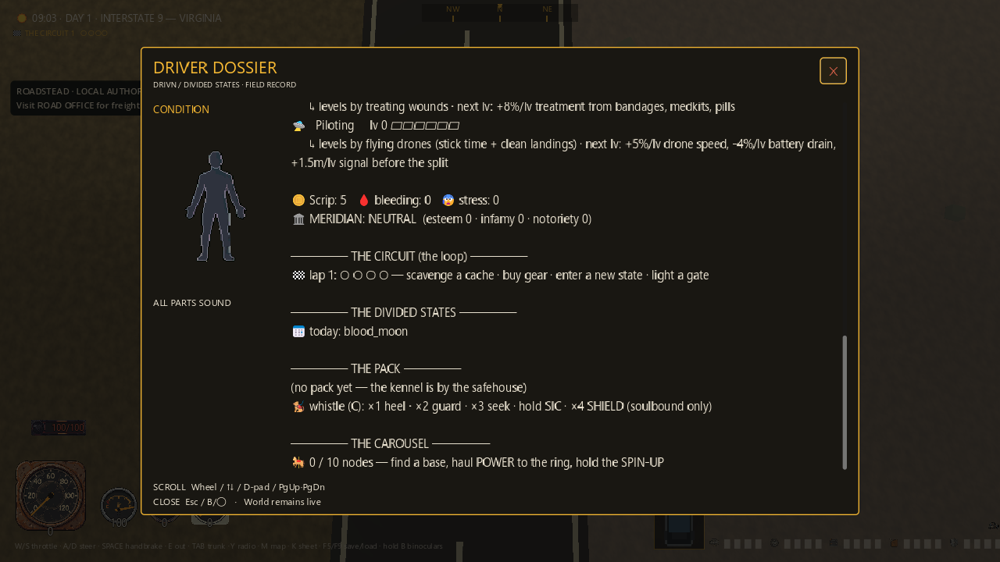
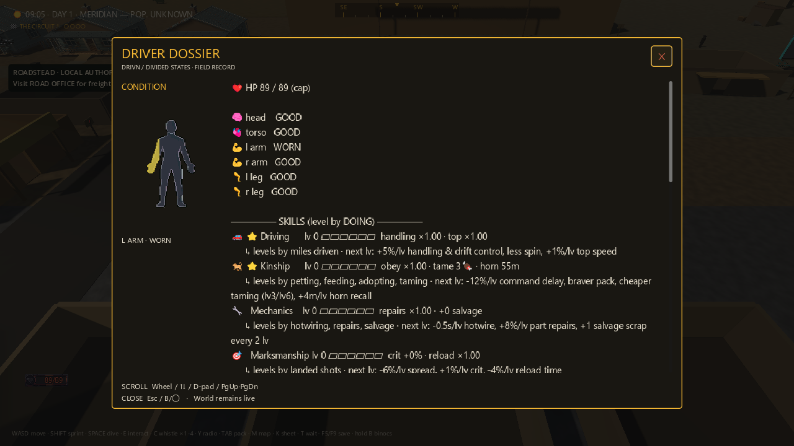
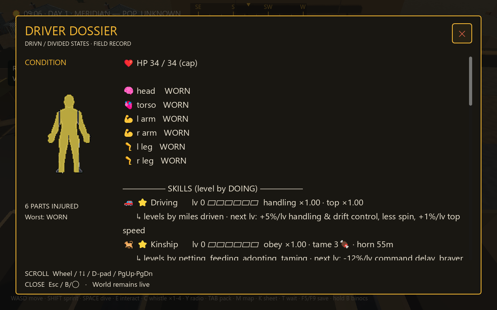
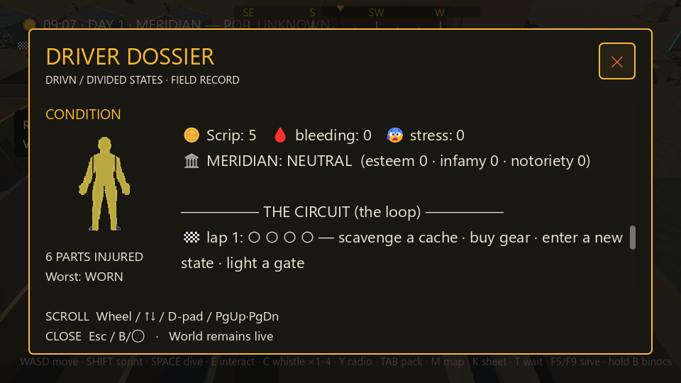

# Driver dossier — screenshot-led repair

This is a verified repair to the existing K character sheet, not a finished
RPG interface, full-game certification, or new Windows release. The
[20-piece game tour](MERIDIAN_GAME_GALLERY_2026_09_06.md) still shows the larger
world, homes, roads, menus and four cartridge formats.

## Judgment and changes

The old sheet was a narrow, translucent text column with its wound diagram
overlapping the text and no visible close control. Actual input tests also
showed that interactions and held driving controls could reach the game behind
it. The replacement keeps the existing character/world record and equipment
systems intact; it presents that record as a wider amber/bone/ink field dossier.

The fixed wound column is separate from the scrolling text. The header has a
visible close button; Esc, pad B/◯, and the rebound sheet action also close.
Opening gives the close button controller focus; A/✕ activates it. Wheel,
arrows, D-pad, Page Up/Down and Home/End navigate the record. Closing gestures
remain blocked until release so B does not also crouch the character. Losing
focus or disconnecting that controller clears the release guard. Keyboard
releases ignore changed modifier masks; axis releases recognize neutral input
and retain device identity.

The sheet now participates in the existing held-input gate without pausing
the world. It cannot stack over the backpack or the existing gated modals/map.
Character creation and death also exclude opening. Pending fire, whistle and
interact holds are canceled on entry, without dispatching their tap actions.
Death presentation dismisses it. A dedicated presentation layer keeps the
road-job status card behind the opaque dossier instead of across its header.
The layout resizes while open and keeps a six-injury summary above the footer.

My verdict: clearly more readable and usable, with the spec's shared controls
and palette. It still has long prose rather than a polished categorized RPG
record, the existing body silhouette is basic, and data is still a snapshot
refreshed on opening. Those are remaining design/art tasks, not hidden claims
that this screen or the whole game is AAA.

Design/debugging/TDD skills drove a bounded repair to the existing flow, with
real failure reproduction before each behavior change. The user had already
delegated design choices and requested autonomous implementation.

## Before

Original 1280×720 frame, taken before the production edits. Text, body diagram,
and background compete; close and navigation are not discoverable.



## After — normal dossier

Clear header, fixed condition illustration, usable record width, and persistent
close/scroll instructions. The surrounding world remains visible but subordinate.


## After — world records

Real End-key navigation reaches the Circuit, Divided States, pack and Carousel
records. Nothing was cut from the original record to make the panel fit.



## After — wounded arm

The staged injury is visible on the actual body diagram and named in text.
The fixture respects the character's reduced HP cap; no synthetic HUD was used.



## After — 1280×800 compact viewport

Six staged injuries remain readable without overlapping the footer. Longer
skills scroll instead of expanding the panel past the screen edge.



## After — 960×540 stress case

The diagram shrinks; the close control, summary and navigation stay on screen.
This demonstrates resizing and clipping behavior, not Steam Deck certification.



## Verification

Run from the isolated checkout with PowerShell 7:

```powershell
pwsh -NoProfile -File tools/character_sheet_check.ps1 -Capture
pwsh -NoProfile -File tools/character_sheet_check.ps1
pwsh -NoProfile -File tools/character_sheet_check.ps1 -Scene bodydoll_sim
pwsh -NoProfile -File tools/character_sheet_check.ps1 -Scene title_modal_sim
```

Every invocation creates fresh explicit APPDATA and LOCALAPPDATA under its own
build directory, rejects reparse ancestors, records the child PID/exit, and owns
only that child. The new sim refuses non-build profiles before loading main.
Tests use actual dispatched controls, held input, real UI hit-testing and
rendered rectangles. Positions and wounds are explicitly staged fixtures;
disconnect notification is injected at the real Input signal boundary, not a
physical controller-unplug certification. Death checks cover the actual HUD
presentation and a lethal wound through the real death signal, followed by K;
they do not claim an enemy combat/death playthrough. Pending attack and whistle
transitions are exercised through actual input; passenger/drag hold cancellation
is code-reviewed but does not have a dedicated transition sequence in this sim.

Final current-source results (all exit 0, no timeout; diagnostics noted below):

| Check | Assertions | Evidence under `build/` |
|---|---:|---|
| Dossier with five GPU captures | 67 / 0 | `character-sheet-b633dddc6db74e6086ad6147fe0d5ea1` |
| Dossier headless | 56 / 0 | `character-sheet-172831324b73472996573079967699c6` |
| Existing wound/body-doll integration | 14 / 0 | `character-sheet-85b7ea0325b2486ca533349ec3fe06f9` |
| Existing title/Controls/Options modal integration | 49 / 0 | `character-sheet-cbc892566dcb4eabb76fbb73850bb4ea` |

This is 119 focused headless assertions plus the GPU run, not the whole suite.
The dossier GPU/headless and title runs have empty stderr. The existing body-doll
scene passes its assertions but reports an ObjectDB leak and three resources
still in use on exit (240 bytes of stderr). Earlier body-doll run
`character-sheet-6b1541f51a4a4a778040d4482e42c75f` was clean; the final diagnostic
is retained and remains unresolved, not hidden by the earlier pass.

The fifteen before/intermediate/final PNGs and three manifests were copied byte-for-byte and
SHA-256 compared with their source outputs. The three normal after views are
1280×720; compact views use the named physical and logical sizes. Captures are
original Godot 4.5.1 Compatibility renderer output on RTX 4090, never retouched.

Failure trail, preserved rather than overwritten:

- Baseline `character-sheet-dd2e2f1e25764ed0a6f22290e7fc1f86`: 20/22. Later
  baseline frames also show consequences of the missing input ownership;
  they are not controlled pose-for-pose comparisons. The first frame is the
  direct before view above.
- An implementation startup error used a non-static audio method as static:
  `character-sheet-3cfa06dd21d74886b51207a59d98e598`. The exact owned PID was
  stopped after parser diagnostics (recorded exit -1), and the existing main
  audio instance replaced the invalid call. This is not a clean test run.
- First rendering iteration `character-sheet-c4110dafc70a48a4bbe0766e1baf1148`:
  40/2; pointer injection was corrected to use the viewport's final transform.
- Layer/summary/death RED `character-sheet-2fbfad5971534a588bd14880270529fe`:
  44/4. Compact summary rectangles still failed in the next iteration until
  stale label height and the diagram's vertical budget were corrected.
- Held-B/modal-stack RED `character-sheet-3d560e2275514e909b9f308465dba9c5`:
  39/3, including the remaining compact-height failure.
- Disconnect RED `character-sheet-5b9e95bebdbe4c48bb69325351591019`: 42/1;
  adding the device-specific disconnection handler made that check pass.
- Independent review found pending world gestures, modified/axis close releases,
  and creation/death reopening gaps despite the first passing run. The expanded
  regression reproduced 47/9 at `character-sheet-b69f572aa89f4ede85b7cc25306739b0`.
  Fixing gestures gave 51/5 at `character-sheet-3f5e338925944209beb42151152ef216`;
  fixing opening eligibility gave 53/3 at `character-sheet-3033d58f563b4f7a9c3c33d6982eb425`.
  Release matching then passed; a hardware precondition failed once at
  `character-sheet-aabdc3296b5d4c49af744f40bf8f833e` (55/1). The fixture now waits
  for actual process-frame hardware dispatch before physics assertions and logs
  its precondition. Three subsequent final-source runs show that precondition
  true and all transition checks passing, including a real next punch.

## Still open

Same-seat independent review approved the bounded repair after inspecting the
final production source, red-to-green logs, final GPU evidence and focused red
close control. No critical, important or minor source findings remain in that
scope; the body-doll diagnostic caveat remains unresolved. No export was rebuilt,
no upload/merge was performed, and the older Windows ZIP does not include
this dossier. World art/layout, content depth, cartridge presentation and
authenticated public MMO operation remain unfinished.

The earlier [normal-save overwrite](TEST_SAVE_ISOLATION_INCIDENT_2026_09_06.md)
is still unrecovered. These tests used disposable isolated profiles; passing
them does not restore the original playthrough or close that incident.
