# Seattle diamond interchange — screenshot-led repair in progress

**Not accepted yet.** Successive sets of unedited game-camera screenshots expose actual
improvements and remaining defects. This is one Seattle interchange, not a
finished United States, release-ready game, or public MMO.

## Current combined-source checkpoint — four drives inspected

Batch `diamond-final-drives-7a501676f7ba4749929d79aa0b44cf15` supersedes the
earlier `cap-fixed-drive-*` results below. All four routes completed on the
shared road-meeting navigation fix plus reviewed parking/barrel fix1498d39.
Every run exits0, has empty stderr and no script/parse/resource diagnostics,
preserves all eleven source hashes and map04D, and finishes at driver/chassis100.
Maximum route deviation is6m against the unchanged8m limit. Simulation and wall
time are reported separately; these are not FPS measurements.

| Route | Checks | Simulation / wall seconds | `road-surface-` evidence suffix |
| --- | --- | --- | --- |
| OFF-R | 28/0 | 99.00 /208.05 | a23d43d18f494657b569b988a9b92052 |
| ON-R | 28/0 | 99.40 /197.94 | d56183f368644b72a81734d6ba615e85 |
| OFF | 24/0 | 72.52 /160.39 | af3b95189c4c420bade84a513f080c3f |
| ON | 24/0 | 73.75 /147.25 | 12e5dd92514949299851d48ff726a94d |

All24 original1280x720 PNGs were personally inspected in the four
`meeting-fixed-drive-*` folders (7+7+5+5 images). They are exact copies with
per-file hashes, manifests and eleven-source provenance. The shared observer
opening, per-route starting pose and11:00 clock are staged. Movement after
DRIVE START uses actual bound pad inputs, never pose/velocity writes. The
source set was captured before the navigation review commit, explicitly recorded
by hashes rather than retroactively relabeled with a later HEAD.

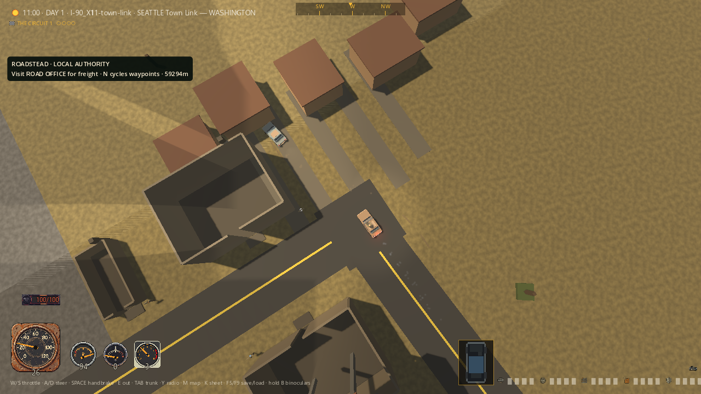

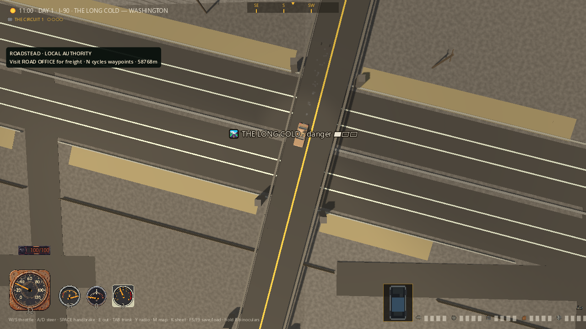

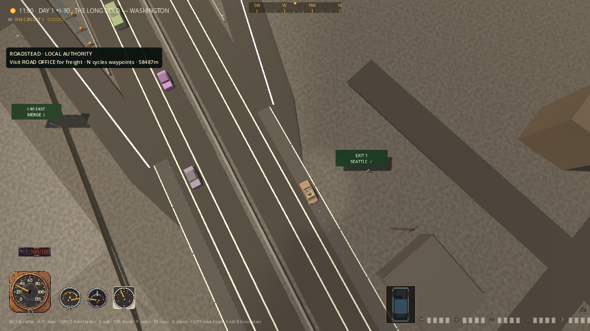

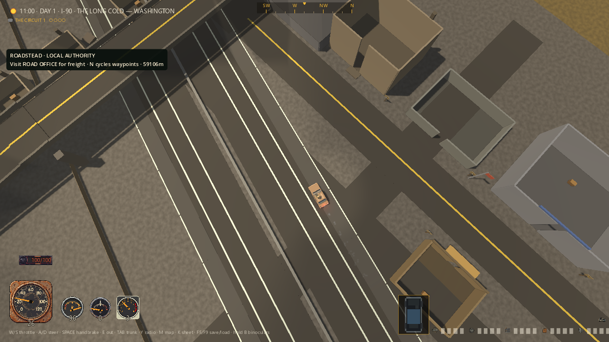

**My visual judgment:** the continuous ramps, separated crossing, signs and
clear highway continuation are substantial functional repairs. This still does
not feel like the finished world spec. The opposite-side crossing shows broad,
star-like paving and disconnected-looking old street strips. Grass/urban ground
meet at obvious rectangular seams, shoulder triangles remain conspicuous, and
ruins read as plain boxes. Internal road IDs, tiny HUD copy, empty-looking item
pips and a58–59km office objective further undermine the scene. Those are open
visual/layout defects, not accepted polish simply because the drives pass.

Navigation regression is461/0 on the unchanged corrected-RED test, with all four
original J135 endpoint pairs using legal alternatives (no endpoint substitutions).
Compatibility is now complete: ports60/0, junction-law11/0, city35/0,
navigation-walk10/0, lanes28/0, atlas47/0 and exit geometry7/0. The latter's
`connectivity-exit_geometry_sim-80f6b479798a46babd837296ed60c593` run checks160
off-ramps, including both explicitly owned Seattle mouths, and preserves all16
source/map hashes. It repairs the legacy test classifier, not the physical
thresholds. Earlier5/1 remains the before-fix evidence. Independent navigation
review and final visual/milestone acceptance are still pending.

## Earlier checkpoint history — retained, not current-source acceptance

**New screenshot attribution:** the brown shape beside the highway is the top of
a real procedural ruin body (`biome_filler=ruin`), not a separate roof layer or an
authored house requiring relocation. GPU diagnostic
`roof-diagnostic-6c3cb40104744758becdad95aee3cfe8` passes63/0, exits0 with empty
stderr, and preserves all recorded source/map hashes. The selected body measures
9.359934×4.792284×11.34547m, centered at(-56211.19,9.321559,-17947.7), with
actual collider bottom6.9254/top11.7177m. The correctly scaled camera ray hits
its visible top at(-56210.8,11.71765,-17947.9). This reproduces the same driving
stage; camera position differs by0.224m from the older capture, not an identical
camera transform. Original screenshots are unedited.

Its projected highway interval, expanded6m at each end for a full vehicle, is
arc280.825..304.615m. All six lanes have physical floor at144 probes and are clear
through48 contiguous3.6m-high lane-width volumes, all physics layers and no body
exclusions. Initial occupancy and fixed/unknown obstruction are both0. No fourth
building was moved. The blocky ruin remains an art-quality problem, not a proved
lane obstruction. All three new photographs were personally inspected and archived
with exact hashes, diagnostic source, runtime ancestry and logs in `roof-attributed`.

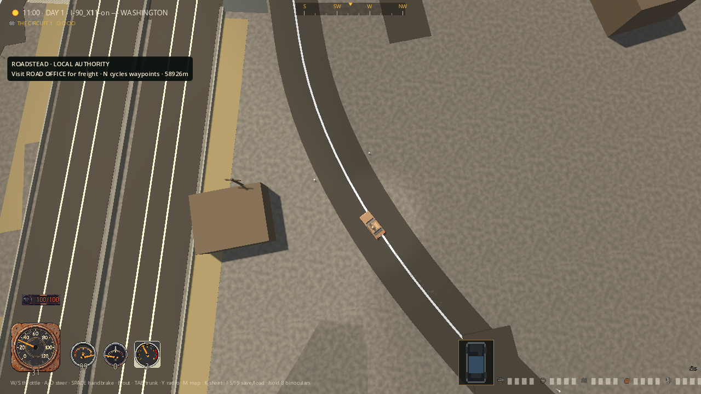

Two earlier diagnostic attempts are not attribution evidence: c4566b3c selected
pavement because viewport1920×1080 coordinates were confused with the1280×720
capture; c2cca482 corrected scaling but failed an unjustified thin-roof assumption.
The final diagnostic measures the actual solid body instead. No production or map
change was made for these diagnostic corrections.

The separate J135 engine diagnostic now demonstrates4/4 actual public routes
across its38.7109375m physical gap. A tests-first, shared geometry-law navigation
correction is authorized; no road/placement/median rebake. Traffic's same-road
parking and per-port barrel fix round remains in progress.

The parking/barrel correction now has covering results: traffic **540/0** in
174.04wall seconds and surface **117/0** in98.98wall seconds, with unchanged
source/map hashes and clean logs. The actual bent-road rejection, legal adjacent-
segment departure, returning-road rejection and all four owned barrel gates pass.
Both runs use opt-in timing instrumentation, with all physical checks and budgets
retained. The first two covering attempts each timed out at180wall; those failures
remain unexplained, and the traffic repeat has only about six seconds of margin.
This is behavioral evidence, not a performance fix or stable timing claim.
Independent scoped review approved both fixes in1498d39. A profiling-off traffic
repeat also passes540/0 in148.54wall seconds. Updated combined-production driving
captures are still required.

The corrected navigation regression first completed456/25 before its production
fix, then **461/0** with the shared road-meeting check. All four original J135
requested endpoints remain reachable through legal alternative routes; none was
moved or substituted. Same-road travel and the owned Seattle departure remain
intact. The test source is unchanged between these runs; correctly unreachable
literal fixtures now skip conditional selected-edge checks, changing the total.
Navigation compatibility/review is still open. One legacy geometry test continues
to identify exits from an obsolete40m anchor radius and consequently misses both
new Seattle mouths; its diagnostic is recorded, not silently declared a pass.

Batch `diamond-final-drives-3d94283201e94b8da069f139cf881eea` completes all four
real-input routes on production traffic88EED43C and map04D. All nine measured
source hashes and live map bytes remain unchanged through every run. Every engine
exits0 with empty stderr and no script/parse/resource errors. Driver and chassis
health are100 throughout the recorded completion results; maximum route deviation
is6m under the unchanged8m gate. Wall time is not an FPS measurement.

| Route | Checks | Simulation / wall seconds | Evidence suffix |
| --- | --- | --- | --- |
| OFF-R | 28/0 | 98.80 /128.87 | b29b6d5f2ddd456aacc537c8c91c7f1e |
| ON-R | 28/0 | 99.58 /130.42 | 6aeb51f35f224e36952abc12fb6ca4db |
| OFF | 24/0 | 72.67 /99.39 | 91444272e22c4551a4bb77831f419475 |
| ON | 24/0 | 73.57 /101.43 | 0ed3c9cfca264109b330f5480197f80e |

Evidence folders use the `road-surface-` prefix. Exact PNG copies and manifests
are in `cap-fixed-drive-off-r`, `cap-fixed-drive-on-r`, `cap-fixed-drive-off` and
`cap-fixed-drive-on`. All24 PNGs were personally inspected. The first image of
each run is the same pre-route observer location; staging and the held11:00 clock
are disclosed. After DRIVE START the car moves using actual bound pad events,
not transform or velocity writes. Traffic, weather, enemies and collision remain.

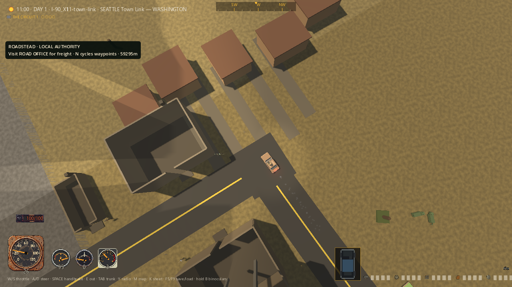

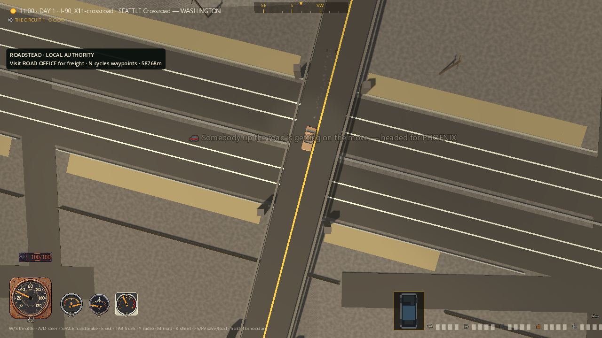

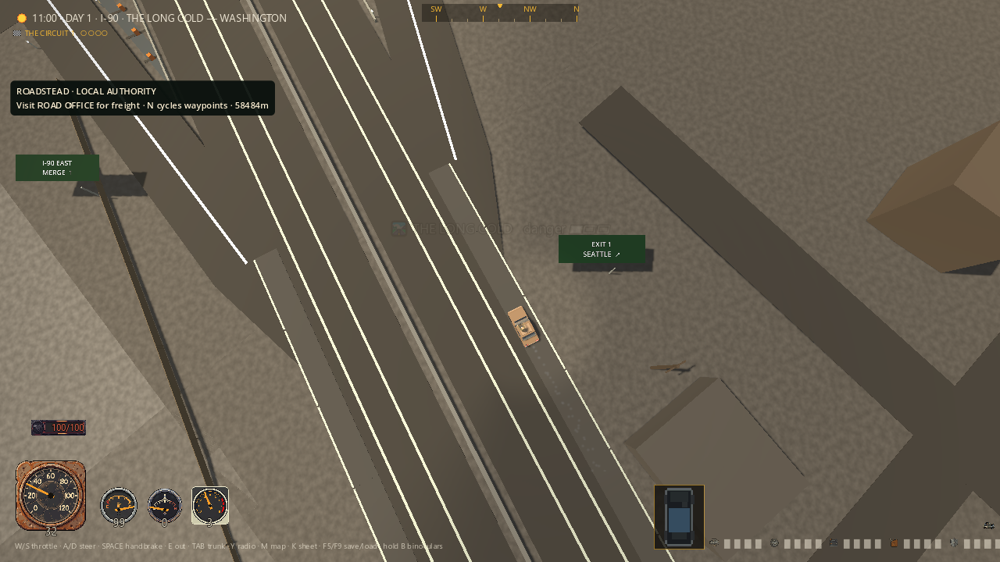

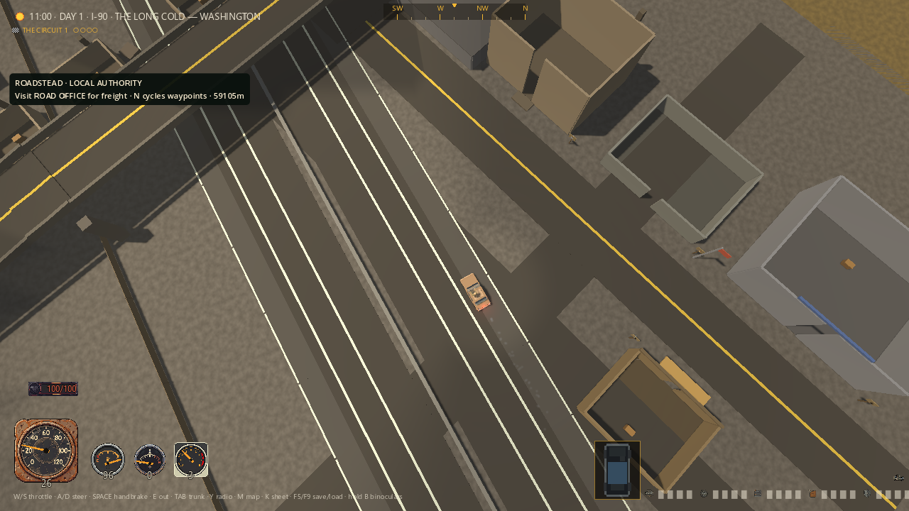

Visual verdict: traversable ramps, readable highway signs, bridge height and a
clear continuation are meaningful repairs. Abrupt biome tiles, repetitive plain
buildings, old street stubs, very small HUD copy and internal road IDs still fail
the intended authored-world presentation. The original20-piece tour and PDF
remain honest earlier comparisons, not secretly replaced by these newer images.

Acceptance remains open. The strengthened traffic matrix first produced411/11
PLUS a freed-instance cleanup error; that run is invalid. Five real fixture cap
cars lacked persistent support after their original chunks unloaded. Actual
support/identity checks and safe cleanup now pass **503/0** in `f50ba1016cdb4c7399126bdf1d76a633`,
105.23wall seconds, clean logs and unchanged9source/map04D hashes. Gravity, cap5,
all actors, real body synchronization and in-lane negative controls are retained.

Broad batch44c44 completes surface108, traffic503, lanes28, junction14, city35,
ramp21 and atlas47 clean. Elevation26 passes assertions but emits an ObjectDB/
three-resource shutdown warning. A same-source verbose rerun26/0 is clean, not
an explanation or fix for that intermittent warning. The batch is not all-green.

The roadside fixture was separately strengthened with full eight-corner projected
chassis hulls, actual finite slab coverage, enclosed holes/order/winding and invalid
geometry controls. Tests first caught each helper defect, including float32 area
cancellation at USA coordinates. The final **GPU59/0** run `0f7db7f25ac64dad9272cddf92eb03a3`
drives42.751m with the entire hull on pavement and four wheel contacts before/after;
logs are clean and map04D unchanged. All480slabs,74post/pole floors and38rail-end
probes remain included. No scenery was removed to make the obsolete off-road
driving fixture pass. All three new unedited screenshots were inspected.

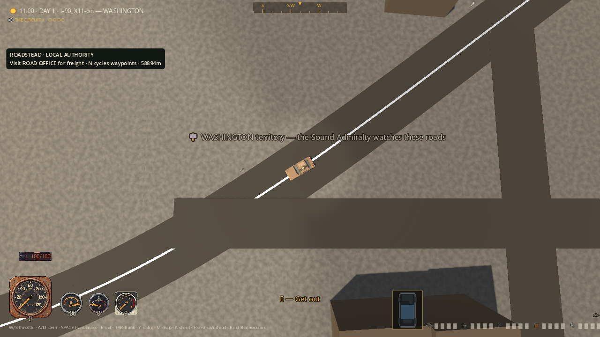

These two images are a local before/after-motion pair, not an art change. The
last frame's brown neighboring roof appears close to/over the highway edge;
actual collider attribution was not established by that ramp drive. The new
roof-attributed diagnostic above resolves its physical clearance, while its plain
art remains weak. J-tee-135 remains physically disconnected pending the navigation
correction. Neither was silently accepted by the four selected driving routes.

Independent Task4 review requires two corrections before acceptance: parking entry
currently excludes the entire serving road, which can permit crossing another bend
of that same road; and barrel coverage checks the total rather than failing for
each missing owned port. Current four ports do visibly/logically have3/3/3/3 barrels;
the issue is the missing per-port regression gate, not evidence of missing current
hardware. Tests-first fixes are in progress. The subsequent roof and J135 graph
diagnostics are recorded above; no fourth building movement is needed and the
navigation extension has an explicit scoped ruling. Small potential miter render/collider discrepancy and
unprofiled parking-query cost are also retained for final milestone review.

## Earlier failed drive — arrived traffic physically blocked the feeder

Curb-policy traffic run `traffic-verbose-edcc1240a4ff476594630e271d8ec627`
passes **291/0**,112.27 wall seconds, exit0, unchanged eight source hashes and
map04D, with empty stderr and no script/parse/resource diagnostic. Both curb
phases, capacity states, real Seattle convoy and invalid-step guards pass. The
earlier intermittent shutdown warning is not explained or claimed fixed.

That result did **not** survive the real drive. Fresh four-route batch
`diamond-final-drives-64fea436cc0d4b268a5f689085f0263d` stops at its first OFF-R
run, `road-surface-160d176346d5401d92a6f7f0b24b67ef`: **27/1**,201.27 wall
seconds,110.02 simulation seconds,197/218 points, driver100/chassis95.4,6m maximum
route deviation and19,803 real input events. Logs are clean; map/source unchanged.
The car negotiates the ramp, sharp turn, bridge and crossing, then contacts a
registered, arrived ambient car in the town-link travel lane at the stock
promotion cap of five. The collider remains at the same position in the95,
100 and110-second overlap probes. This is a physical obstruction, not merely
a visual overlap, and remains under diagnosis. No subsequent direction ran.

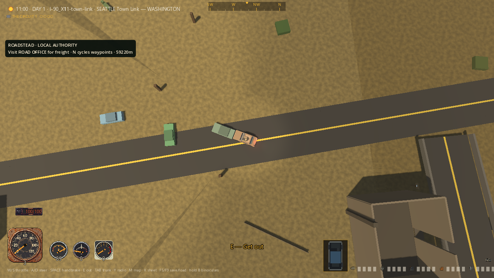

All seven original PNGs were personally inspected, then copied byte-for-byte
with their manifest and provenance into `curb-green-drive-red`. They retain
actual traffic, damage, enemies and weather. The initial Seattle observer shot
precedes route staging and is not traversal proof.

Visual judgment against WORLD_PILLARS: readable road signs and an elevated
crossing now communicate the road hierarchy, but the large empty plots,
repeating box buildings, abrupt terrain tiles and awkward old street ends do
not yet sell "roads are characters" or "buildings tell stories." Tiny HUD text
and internal road IDs also detract from the player-facing presentation. Those
are visible remaining defects, not accepted as a finished post-apocalyptic world.
The legacy J-tee-135 physical/navigation disconnection also remains open.

Compatibility follow-up: seven scenes complete **523/0**, clean logs and
unchanged source/map. The eighth, roadside clearance, incorrectly prints2/0
after a runtime failure casting joined pavement to BoxMesh. It is **invalid**,
not green. A parent-owned literal mesh-footprint adapter then completes34/1:
all480 pavement pieces (448 joined), furniture clearance,74 post/pole floor
probes and38 rail-end probes pass. The old fixed-coordinate driving check
still fails19.562m versus required>30m. That trace now lies53.13m from the
relocated return ramp, so its physical contact and scenario relevance are under
diagnosis. No driving assertion is waived. Atlas compatibility has not yet run.

The two traffic interactions have now been reproduced in a clean tests-first
run, `traffic-verbose-de6795b5412940c3a61bfb8c7a74a32f`: **351/8**,84.29 wall
seconds, unchanged source/map. Public promotion requests before and during
departure reproduce the incorrect arrival; a retained full-cap parked convoy
leader also prevents its follower from completing a distinct safe arrival.
The in-lane stopped-leader negative control passes. A narrow correction is
under covering verification; the failed drive above remains the latest GPU proof.

The first traffic correction passes358/1; the remaining apparent double-parking
is traced to unsynchronized test bodies, not a proven production clearance bug.
Actual physics-server positions remain at zero while node positions are near90km.
Two real physics frames align them. Diagnostic run `5620bfb6b80f4248ac22859574668259`
then passes359/0,83.22 wall seconds, clean logs: the follower chooses a distinct
plot6m from the parked leader and both final physical envelopes are clear.
The fixture is being hardened to require that synchronization consistently.
That stronger matrix is **not green**: run `3a18d800f9124aaa9de1ce5b4daffde9`
prints411/11 and also raises a freed-instance cleanup error. Its real promotion-
capacity cars disappear during later cases, invalidating the claimed full-cap
conditions. Their lifetime/support and fixture interaction are under diagnosis.
The earlier359/0 checkpoint does not substitute for this stronger failing run.

The roadside test's obsolete line is confirmed to hit a lawful off-road pole,
53.13m from the new ON ramp. Its updated actual-input curved-road trace now
passes37/0 in verbose run `62169b47426b46b79cef192bd66110d3`:42.379m travelled,
minimum full-chassis pavement margin2.760m, all480 slab footprints retained,
no roadside overlaps,74/74 grounded posts/poles and38/38 rail-end probes. Geometry,
props and the>30m/240-frame limits are unchanged; bound pad steering replaces a
straight held wheel on the new curve. A GPU image is still required.
The preceding normal startup `78ad0f0a172d4badbb9296f9a6ae14aa` crashed with
Windows access-violation code0xC0000005 before assertions. The same source passed
the verbose diagnostic, but the native crash cause is unexplained and not
claimed fixed. Source/map remain unchanged across both runs.

## Earlier candidate — police-wall clearance verified, traffic review open

The guarded slot7 correction is committed separately as `b3e0578`: only its two
position coordinates change, from `[-56402,-17985]` to `[-56420.75,-18011.5]`.
The nearest feasible 0.25m grid site is 32.462478m away; the smaller 25m search
found no valid plot. Full roof/wall footprint, roads, 124 auxiliary polygons,
neighbors and the 1.8×3m doorway approach remain clear. Its identity, rotation,
profile, services and all other map values—including earlier slots8/26—are
preserved. Independent recursive comparison confirms exactly two changed leaves
and five-byte growth; repeated publication writes nothing. Map SHA is now
`04D975429DD544212438B3D9DAEF96D61E08B5551F19B622FF14A73BDF0135B9`.

GPU run `0eef8a25b3694a209272427a141a3360` passes **120/0**, exit0,
97.91 wall seconds, clean logs and unchanged new map bytes. All five continuing
lane boxes and floor rays pass, alongside the prior road/wet-deck checks. Six
unedited PNGs were inspected and copied exactly into `police-fixed-surface`.
The sixth is an observer-side building view, not the same driving camera as the
original roof finding; the matching ON-route screenshot is still required.
Actual enemies/weather and the visible 78/92 status remain in the photographs.

The revised test-driver corner margin also passes its focused route:
`931511e62d614a28b6a2fd7add54609e`, **28/0**, 104.43 simulation seconds,
137.94 wall seconds, entry 6.656m/s, full route completion and four real bridge
wheel contacts. Driver100/chassis92.9 and a brief traffic delay are retained.
All seven PNGs in `corner-fixed-off-r` were inspected. This run predates the
slot7 map correction and does not settle the earlier permanent traffic-stall
question. Deterministic actual-agent endpoint regression
`f36531e04db9478699029a787c9b7f74` now reproduces it: **43/2**, exit1,
30.12 wall seconds, clean logs and unchanged map. With promotion capacity,
a real car parks across the connecting road; at the stock cap of five, the
arrived ambient collider remains there. Both still block after12 traffic seconds,
with no leader causing the stop. The continuation/arrival path is under repair;
no traffic actor is removed or frozen to make the drive pass. Fresh four-route
proof, compatibility and independent acceptance remain open.

Expanded tests-first run `traffic-verbose-69fc4d7e920341b082e156588f260489`
now executes both connector trips, nearby final arrivals and five real parking
conditions at both capacity states: **129/41**, exit1,87.65 wall seconds, unchanged
map/source and empty stderr. The expected failures establish the missing
continuation, correct deck height, safe parking and unsafe-site waiting behavior.
The test fixtures independently verify their actual floors, slopes and obstacles.
The first production covering run `d1b672a0737440daa29e89cf82aeb27b` now passes
**170 checks with one failure**, exit1,41.58 wall seconds, unchanged map and
empty stderr. Both managed connector trips, actual bridge support, safe parking
and unsafe-site waiting pass. The convoy leader still fails to complete arrival;
this is under diagnosis, not a passed repair. An earlier one-resource shutdown
warning did not recur in these runs; its cause remains unconfirmed. Fresh driving
captures still wait for the completed traffic repair.

The convoy diagnosis is now numerical: its actual pavement support drops85.333mm
at the shoulder. A datum-only correction did not resolve it; the floor itself,
not a temporary chassis offset, accounts for the drop. An explicit single
downward serving-road-to-right-shoulder curb policy of at most100mm is approved,
while6% slopes, larger/untagged/uphill/repeated steps remain forbidden. Expanded
tests-first run `83be314e3c6c4003bbc9b25fec5d2693` completes **272/15**,88.43 wall
seconds, unchanged map and no script errors. It reproduces phase dependence and
missing retry-boundary restrictions. The intermittent ObjectDB/one-resource
shutdown diagnostic recurs. This is failure evidence before curb implementation,
not a clean or accepted repair.

## Earlier candidate — wet-deck fix verified, driving failures retained

`road-surface-6b1a77eb3de841fe96b04afe459a1dfa` passes **116/0** on the
wet-deck correction: exit0, 48.11 wall seconds, no timeout, empty stderr and
unchanged map SHA A840…. The managed ocean fixture now has one physical deck,
both original rails, matching visual/collision ends20.0313m, no floor beyond its
terminal and zero mismatched interior rays. The unmanaged wet control is unchanged.
All five actual Seattle-camera frames were inspected and copied exactly into
`wet-fixed-surface`, with manifest, run result and eight-file source hashes.
These views retain actual health/weather/HUD; this set shows100/100. The synthetic
ocean fixture is measured by runtime probes, not depicted in these Seattle frames.

The new four-route batch stopped at its first route, OFF-R:
`road-surface-7578905f3d2d4a79b008bada569a916b`, **25/4**, exit1,
95.38 wall seconds, clean logs and unchanged map. Advance braking reduced the
sharp-corner entry to7.086m/s, still above the unchanged7m/s gate. The car crossed
the real bridge but later stalled against live traffic at point112/218,
67.48 simulation seconds, driver100/chassis94.9. Its seven exact PNGs/manifest
remain in `braking-diagnostic`; the failed frame was inspected. The speed-margin
and traffic-contact causes are under investigation, not waived or randomly retried.

Inspection also found an apparent roof above the continuing highway in the ON
completion frame. Read-only source geometry identifies `seattle-slot-7`, a police
station, with a wall footprint intersecting the carriageway just beyond the
test endpoint. Runtime regression `0aff44ec519a4bc58f11f5e37a6360eb` confirms
the real side wall and furniture in the lane: **107/1**, exit1, 53.79 wall seconds,
clean logs and unchanged map. All five actual floor rays succeed; the wall remains
after the same60-frame recheck. Its side wall is0.3×3×12m at
`[-56394,8.166666,-17985]`, owned by `seattle-slot-7`. The guarded position-only
correction above now clears the physical continuation, with identity/services/
rotation and the earlier two relocations preserved. The original passed endpoint
did not certify this continuation.

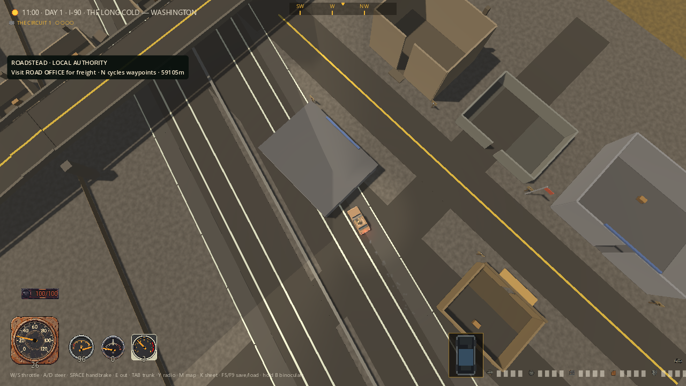

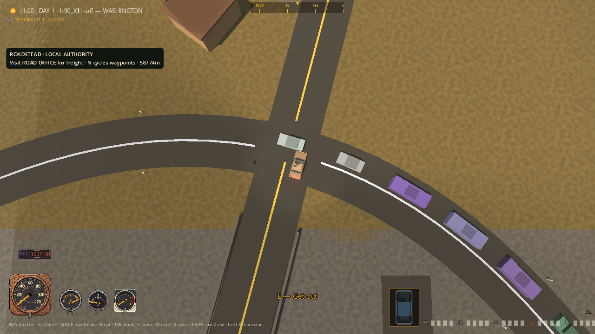

## Earlier checkpoint — expanded clearance and pad repair

`road-surface-74743918a21f4b27900933878a5d2904` passes **107/0**, exit0,
101.46 wall seconds, no timeout or runtime diagnostics, unchanged map SHA A840….
All five unedited game-camera PNGs were inspected and copied byte-for-byte to
`verified-surface`, with manifest, run result and eight-file source hashes.
The retained six-road floors, continuous full-width envelopes, later-streamed
feeder, real bridge headroom, signs and all fixed-obstacle controls pass.
Live road occupants are counted separately; no actor or query layer is removed.

The false J-tee-135 filler is absent in the real streamed-node regression;
valid J-tee-3 retains its original fill. All six pad fixtures now match their
literal expectations, and collision-body counts are unchanged from RED.
The opposite-side driving screenshot below confirms the repaired pad's appearance
from the same route. Three routes passed on this source; OFF-R failed. This is
not four-direction acceptance, and independent review remains pending.

The first frozen-source route, **ON-R**, completes **27/0** in
`road-surface-6502cb24772343e09a2614d2f794a88a`: 98.17 simulation seconds,
191.72 wall seconds, 217 route points and full driver/chassis health.
At 56.03 seconds all four wheels contact the actual crossing deck
(chassis14.921m, deck14.280m). Logs are clean, map unchanged and no timeout.
All seven route images were inspected and copied exactly into `verified-drive-on-r`.
The crossing frame retains traffic below the deck, actual HUD messages and
nearest-2D-road naming; it does not fake a clean scene.

The second route, **OFF**, also passes **22/0** in
`road-surface-dcc8cbe975234489b6daeb16e0cc8eb2`: 71.57 simulation seconds,
158.78 wall seconds, 170 route points, full health, clean logs and unchanged map.
Its five exact copied frames were inspected in `verified-drive-off`.

The third route, **OFF-R**, fails **20/3** in
`road-surface-7a42d5ca577448a28ab2e4e95fdd676b`: the car hits the outside
bridge-approach rail and stalls at point66/218, 41.52 simulation seconds.
Canonical roads remain unchanged, all four wheels have contact and health is
100/100. Comparing the previous successful drive shows a marginal high-speed
corner entry; its later traffic damage did not help this first turn. The
driver's advance braking needs a focused regression, not another lucky retry
or removal of the real rail. The batch stopped; four-direction acceptance is open.

The separately run **ON** route passes **22/0** in
`road-surface-7bebca9af3004c58b898a895d75a6749`: 72.48 simulation seconds,
149.20 wall seconds, 169 points, full driver/chassis health and clean logs.
Its five exact captures in `verified-drive-on` were all inspected. All three
successful checkpoint routes used the same eight source hashes as the failed
OFF-R route. A shared test-driver braking change will require fresh four-route
proof; these checkpoints do not describe that future implementation.

A separate real ocean-chunk regression reproduces duplicate managed wet-road
decks before the fix: `road-surface-c3cd492ff61a4429ad1ca38a747bbe0d` is
**102/4**, with exactly four managed-deck failures. It finds two physical decks,
a three-metre invisible end cap and all nine floor rays above the rendered
ribbon. The unmanaged wet-road control retains one deck and passes. This is
another actual collision defect, not an image-only concern; the later116/0 run
above verifies its focused correction.

### Legacy pad — visual correction, failed drive retained

The same-route mouth frame now clearly shows restored highway paint. Both
images below are untouched game captures; the latter belongs to the failed
OFF-R run above, not a completed route. Its five PNGs/manifest were copied
exactly into `diagnostic-off-r-pad` with failed-run status and source hashes.

Before:

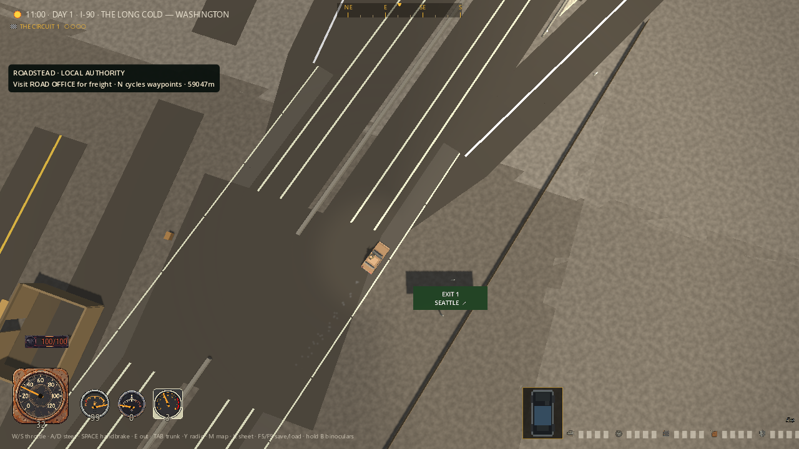

After:

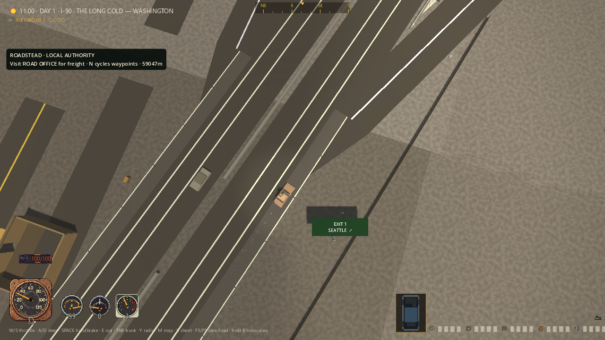

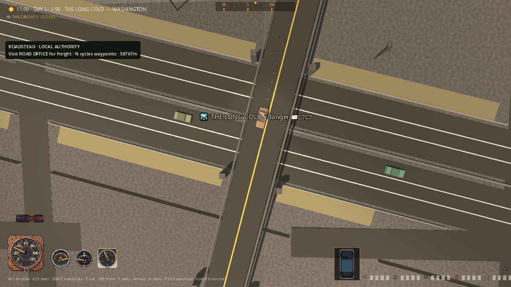

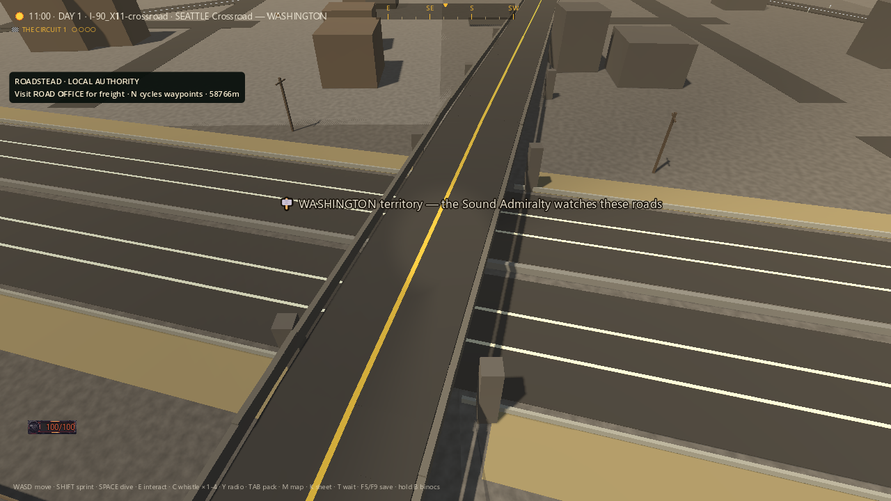

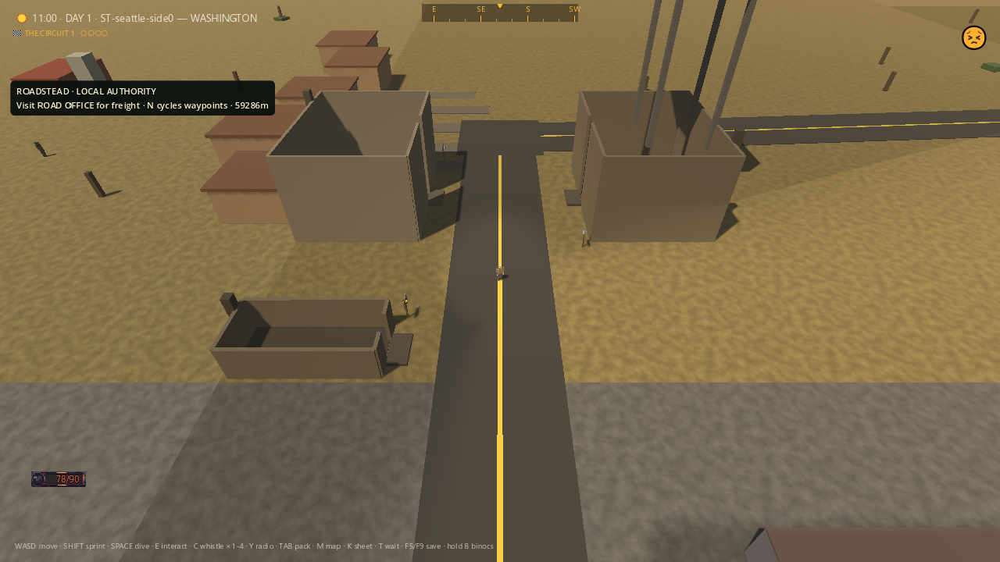

Visual verdict: the road geometry is substantially more coherent, but the world
still reads as a prototype. Hard biome seams, repeated box buildings, sparse
surroundings, visible internal road IDs and tiny HUD text remain. Actual live
damage/weather are retained: this capture set shows 78/90 after the first staged
approach. None of these frames is concept art or a retouched beauty shot.

## Earlier verification after diagnostic capture 3

The latest candidate physical/capture pass is **77/0**, exit 0, empty stderr,
no timeout: `road-surface-c2efa41643dd4b149d400c39dec03da5`. All four actual
frames were inspected and copied unchanged into `candidate-final`, together
with their manifest, run result and eight-file source-hash provenance.

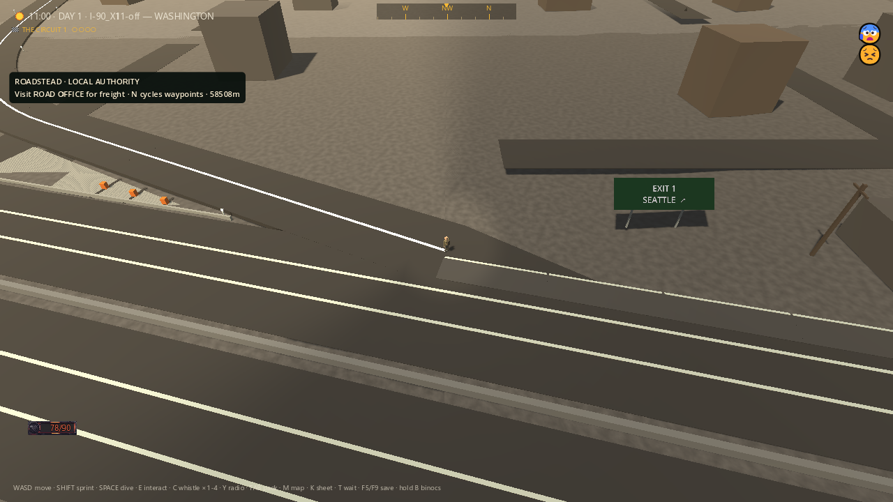

The black triangular patch is gone; the remaining lighter auxiliary strip is
its material difference. The actual triangles now have zero reversed tops or
sides, and all earlier physical checks remain green. This is a bounded road
repair, not final world art: plain buildings, repetitive terrain, raw IDs and
dense HUD still undercut the intended world. Live weather, HUD messages and
damage changed between the staged shots; the visible 78/90 status was neither
reset nor retouched. Holding 11:00 does not mean all gameplay state was frozen.
All four full-route drives and independent review are still pending. The next
opposite-side exit attempt (`road-surface-6e304e369b9e4736bd8e7bb6e5c89bf8`)
fails **19/3**: it traverses the ramp, then strikes the outside bridge-approach
rail and triggers the 12-second stall gate. That is unresolved driving evidence,
even though the static physical/capture checks pass. The retained failure frame
and contact logs are being used to distinguish late steering/braking from
malformed junction geometry. No rail or collision category has been removed.

Follow-up diagnosis: the returning-route helper reversed a shared packed road
array, mutating the in-memory canonical road while leaving its cached segments
unchanged. A new real before/after regression in
`road-surface-65c1703f63e44d108510f1b972956833` fails **2/1** and identifies the
changed feeder points. Disk map bytes are unchanged. The failed on-route frame
(`road-surface-f252022b52074b1e80cac1f81932c524`, **15/3**) therefore depicts an
invalid test state, not proof that ordinary gameplay plants that tree in a road.
The opposite crossing path also reverses a shared row, so it needs a fresh run
after isolating route arrays before attributing its failure to world geometry.
No production foliage change follows from these invalid attempts.

With independent route arrays, the opposite exit-to-town drive passes **27/0**
in `road-surface-9fb668a0e215423ca5007ceff406a9f6`: 104.52 simulation seconds,
210.44 wall seconds, unchanged canonical roads, four actual bridge-deck wheel
contacts, final driver/chassis health 100/94.8, no timeout or diagnostics.
All seven PNGs were inspected and copied exactly into `drive-off-r`.

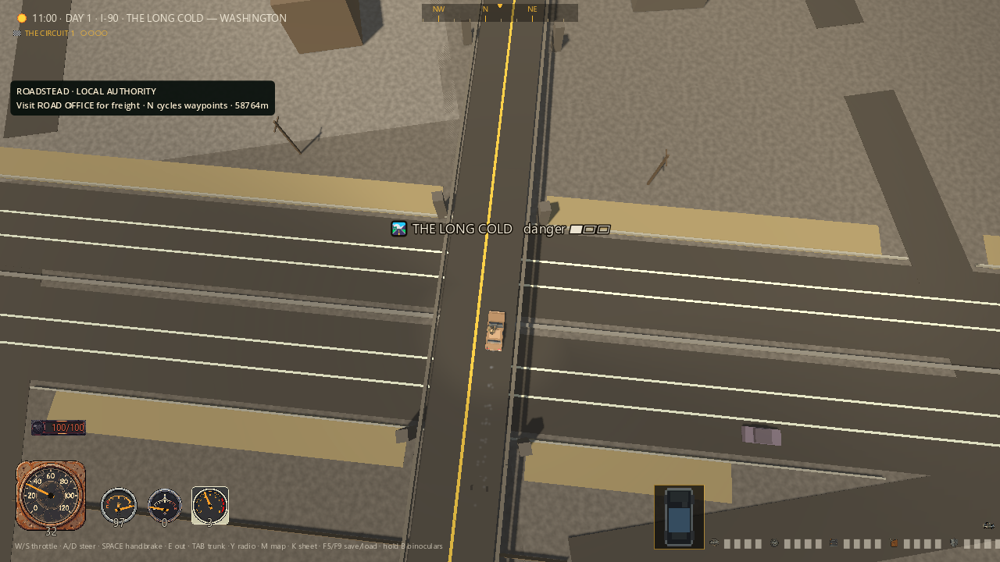

The next corrected on-route still fails **16/3** in
`road-surface-ad1ed1e63dd242b5a9e73c33ca961d88`: the road now renders correctly
but a real `dense_trunk` blocks the lane near `[-56458.77,-18094.05]`.
Canonical road values and disk map bytes both remain unchanged. Thus the earlier
shared-array defect was real but was not the only cause. The discrete clearance
samples missed this narrow object; stronger coverage and a source fix are
required. The 77/0 static result is not a guarantee of continuous unobstructed
road area.

A continuous full-width regression now reproduces the narrow trunk in both the
fully materialized feeder and its normally re-streamed town end. Run
`road-surface-f5f278262d064d5b9d6ce266cff4191a` is **77/3**, with no timeout,
empty stderr and unchanged map bytes. The two tree failures cover 250 boxes over
591.45 m and 78 boxes over 179.38 m respectively; all 78 later-streamed floor
rays pass. A half-metre stationary-trunk control proves the query catches what
the earlier spaced point samples missed. The third occupied box contains a
live enemy, not fixed scenery. No collision category or enemy was suppressed.
The source correction reserves each tree candidate against every nearby road;
the next GPU run (`road-surface-a5eeb952e3eb4e8fb165eb626a83aac3`) confirms both
feeder phases clear of the trunk. It reports **88/2**, not all green: the remaining
occupied boxes contain a real moving traffic car and a live lurking enemy.
All five screenshots were inspected; logs are clean and map bytes unchanged.
The static geometry assertion is being corrected to distinguish identity-verified
live occupants from fixed/unknown obstructions while retaining every query layer,
full-width coverage, negative controls and explicit occupied-box reporting.

The previously blocked town-to-highway route then completes **22/0** in
`road-surface-045f891fcc844882a4c05f80ad6aae37`: 72.12 simulation seconds,
159.62 wall seconds, 169 ordered route points, 12,984 dispatched input events,
driver/chassis health 100/100, no timeout or diagnostics, unchanged map.
All five real frames were inspected and copied unchanged into `drive-on` with
their manifest, run result and eight-file source hashes. This proves the tree
repair through the original driving failure, not just static sampling.

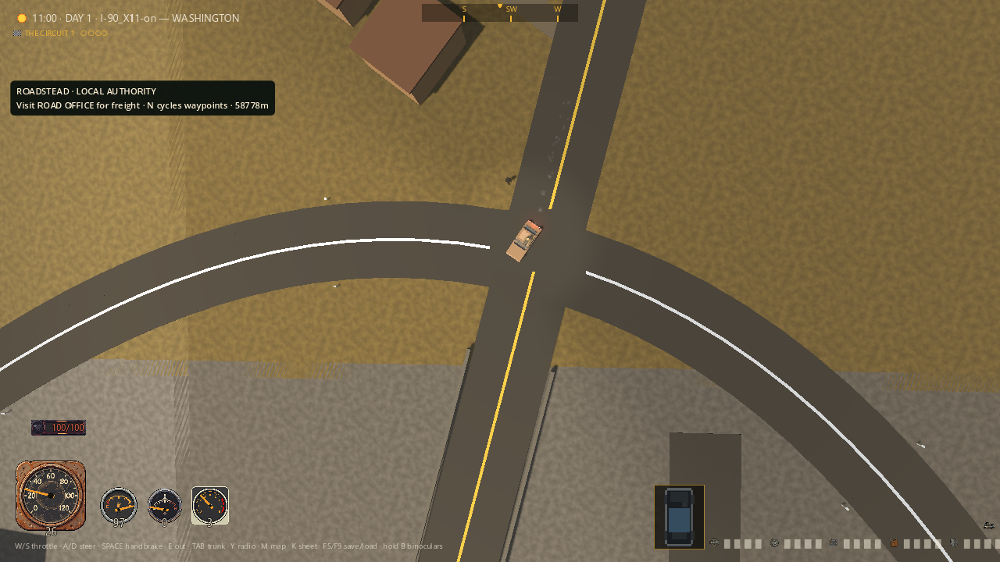

Each drive set's initial `01_seattle_approach` is staged preflight, captured
before the route selector is read; its inherited manifest route label is `off`
even in the other route runs. It is not evidence of travel on that route. The
subsequent named drive frames carry the selected route and actual elapsed time.

The opposite-side approach photos also expose a broad paint-covering square at
retained legacy tee `J-tee-135`: its existing 29.2 m pad is above highway paint,
and its existing `control: gap` interrupts the median away from the managed
crossing. This is not the repaired triangular transfer. The original tee/street
rows and baseline pad renderer are retained; the visible limitation remains
explicitly unaccepted as final city polish.

The focused renderer regression reproduces four failures before the pad fix:
`road-surface-8670f962ebba431ca6e05a30ed00f8cf`, **93/4**, clean runtime logs,
unchanged map and no timeout. The real stale tee plus missing, disconnected and
outside-wide-road fixtures emit false filler; valid, diagonal and inside-wide
fixtures preserve their original fills. A consistent geometric validity guard
is now under GPU verification. The read-only whole-map audit finds 388 meeting
and 141 nonmeeting eligible nodes. Only synthetic visual filler is affected;
this is not a repair of the stale street link, road bodies or navigation data.
The earlier graph work described that existing shortcut as legal based on its
flat/control-gap rows. Physical inspection now disproves that description for
J-tee-135: its street is38.71m away. The legacy fastest-route graph can still
offer this disconnected link. That is an unresolved navigation/data defect,
not evidence against the separately driven managed routes and not a finished
city-navigation claim. Final milestone review must evaluate this limitation.

The first complete real-input off-ramp-to-town drive passes **21/0** in
`road-surface-231282f814344ef7888503e85373070c`: 71.50 simulation seconds,
128.27 wall seconds, all ordered route landmarks and final position/direction,
full driver/chassis health, no timeout or stderr. All five actual frames were
inspected. This supersedes the earlier timeout for that route; it is not all
four routes or a framerate benchmark.

The separately retained restaurant and ruined house now have position-only
corrections of 2.372 m and 1.768 m. An independent recursive comparison confirms
only their four position coordinates changed; IDs, profiles, orientations,
payloads, every other row/field/order, roads, exits and junctions are unchanged.
Repeated publication writes nothing. Original/proposed map bytes and validation
are retained in `build/diamond-placement-repair-fb4bcd55ca704251b71f23056719dc8e`.
Map SHA is now `A840FBECBEA95B7F446813F11862C5ADE5C1FCCEB9361BD1FEE01A3340EBD3C2`.
This corrects two proven obstructions, not a city restamp.

On that map, `road-surface-806588ca565341b084d637696f512fb5` passes all previous
headless physical checks, including the formerly obstructed auxiliary lanes.
Two new rendering regressions fail, for **67/2**: five top triangles and 3,832
side triangles have inconsistent face/normal orientation. This confirms the
dark patch is a rendering defect requiring correction, not acceptable shading.

## Diagnostic capture 3 — repaired floor, two authored obstacles remain

The four frames from `road-surface-2d5826f5d2f64e12a14e09848b95a7bb` were
inspected and copied unchanged into `diagnostic-3`; all four PNGs and the
manifest have matching source/destination SHA-256 hashes. This remains base
`138a1e3` plus uncommitted Task 4 source, not an accepted final snapshot.

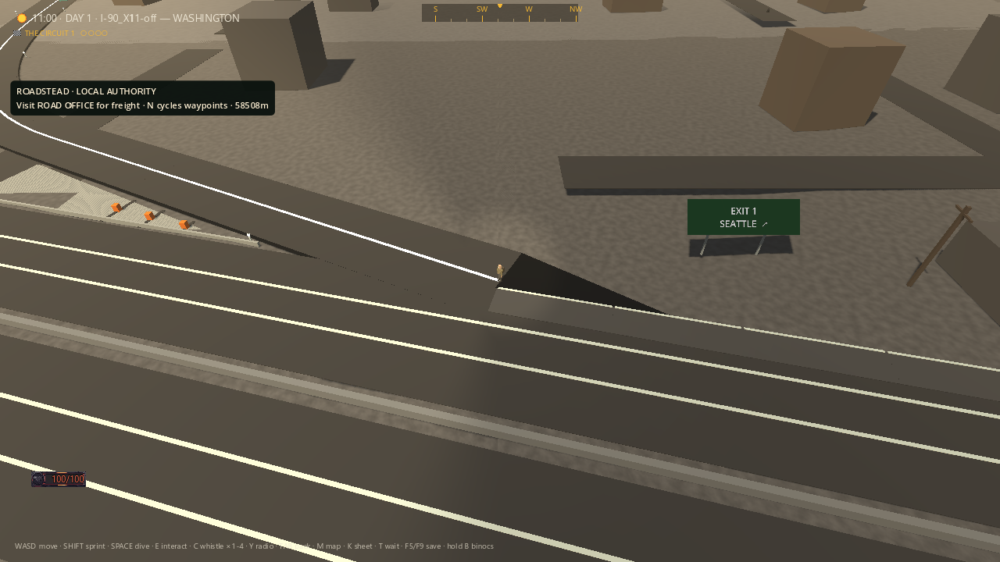

The sign supports no longer pierce the text face. The formerly square mouth
now has a tapered physical transfer. A dark triangular surface patch and a
lighter band are still visible at the join: successful collision checks do not
make those finished-looking art. Repetitive plain boxes and sparse surroundings
also remain below the intended world presentation.

Verification: **73 passed, 2 failed**, exit 1, no timeout, empty stderr,
unchanged map SHA `5CFD9F19ADABC06EAD96F9CE9F7BEAF404C9831D7178EB144EED60EBA2A4A4C3`.
All 6,460 main road-width samples, four 80-point transfer grids and four
auxiliary floors are clear. Two actual placed-building walls still overlap
auxiliary lanes: `seattle-slot-26` (ruined house) and `seattle-slot-8`
(restaurant). Their identities come from collider ancestry, not image guesses.
Position-only corrections are being separately validated; neither is moved in
these captures. Deck-top separation is 6.273 m; underside clearance is 5.753 m.

The [crossing](../renders/diamond-interchange-2026-09-06/diagnostic-3/01_seattle_approach.png),
[town junction](../renders/diamond-interchange-2026-09-06/diagnostic-3/02_crossroad_ground_approach.png)
and [feeder](../renders/diamond-interchange-2026-09-06/diagnostic-3/04_town_feeder.png)
retain the real camera and HUD. Locations are photographically staged, with
clock held at 11:00 and fresh isolated profiles; these are not a continuous trip.

A separate real-pad drive (`road-surface-38a81457fa1c417ca6472f48d8ddee92`)
crossed the repaired join and progressed to point 160/170 at 70 simulation
seconds, 14.12 m/s and full chassis health. Its 180-wall-second wrapper expired
while it was moving, so it is **not a completed route**. The GPU-drive wall
budget is now 360 seconds; the 110-simulation-second route, 130-second scene
watchdog and 12-second stall limit are unchanged. This does not establish
acceptable performance. All four completed routes and independent review remain
required.

## Diagnostic capture 2 — visible improvement, physical acceptance still open

These earlier four frames are from `road-surface-bccfc82862394672bc4092f5483f642a`.
All were inspected. The bent feeder now has a continuous outline and paint;
the exit sign is readable; the exposed tan mouth patch is gone. All twelve
crash barrels are outside the measured road footprints, and each ramp now has
reflector posts. These are real renderer changes, not image edits.

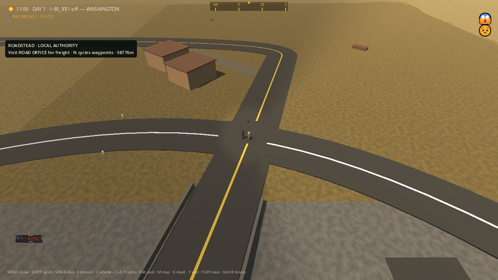

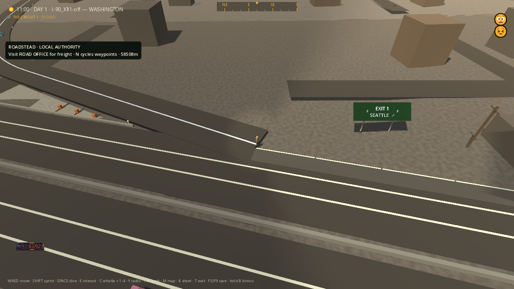

The [crossing view](../renders/diamond-interchange-2026-09-06/diagnostic-2/01_seattle_approach.png)
retains grounded hardware; the [feeder view](../renders/diamond-interchange-2026-09-06/diagnostic-2/04_town_feeder.png)
still shows sparse unfinished scenery. The sign supports appear through the
board face, and the mouth still has an abrupt raised-looking end. These remain
visible repair findings, alongside the broader plain-building/terrain art gaps.

Verification is **64 passed, 7 failed**, exit 1, no timeout, empty stderr and
unchanged map bytes. Joined visible paint/pavement overhang is now 0.0033 m /
0.0464 m; collision overhang is also 0.0464 m, so the new skin does not conceal
the old box-cap collision. However, stricter full-width floor sampling now
exposes 4/2/3/15/14 failed points on the off/on/off-r/on-r/crossroad respectively.
The feeder has no floor misses. These are not waived. Three persistent objects
also remain in auxiliary lanes: one body near off-r and a chest/restaurant at on.

All four auxiliary-lane floor checks now have zero gaps. Naturally moving
traffic clears on the bounded re-probe; the stationary objects do not. All
collision categories remain in the queries and traffic stays active. Actual
underside headroom measures 5.778 m; deck-top separation remains 6.273 m.

The four PNGs, manifest and eight-file source-hash record were copied exactly
into `diagnostic-2`, with matching source/destination SHA-256 for all six files.
The base commit is still `138a1e3`, with uncommitted combined Task 4 changes.
Locations/11:00 clock/zoom remain staged; actual floor heights and the retained
damage indicators differ. This is not a committed or accepted final snapshot.

## Diagnostic capture 1 — inspected, rejected for final acceptance

The bridge rails and supports now meet their intended heights. All 6,460 sampled
points across the full widths of the four ramps, crossroad and feeder have a
physical floor and an unobstructed vehicle-height envelope. The median remains
intact. These measurements do not certify the appearance or a completed drive.

The rendered frames still show malformed curve paint, an unfinished-looking
mouth join and a sign too small to read. Those are repair findings, not polish
claims. A physical input-driven route is being checked separately.

### Highway crossing

Grounded rails and visible columns make this read as an overpass. Plain box
buildings, raw road IDs in the HUD and sparse scenery still undercut the world.

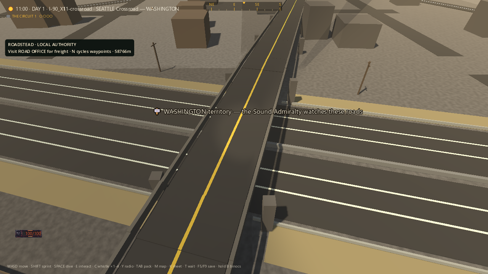

### Town-side junction

The feeder is no longer blocked by generated houses. However, the distant bend
has a sawtooth pavement outline and fragmented yellow paint. That rendering is
not accepted. The staged player's damage/status indicators remain in the image.

### Actual off-ramp mouth

White one-way paint and a striped gore are present. The square-ended ramp edge,
tan shoulder patch, overlapping stripes and tiny edge-on sign still fail the
camera-honest road presentation requirement. The image alone cannot establish
whether the apparent lip blocks a vehicle; the driving test must determine that.

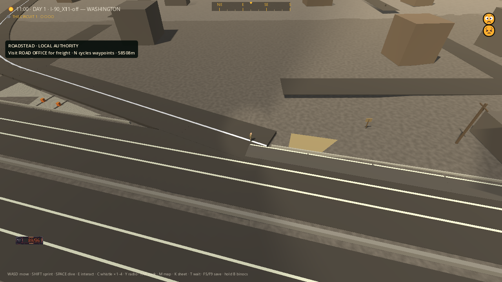

### Town feeder

The carriageway is clear, but the view remains a sparse road through repetitive
terrain and generic props. Physical clearance is progress, not finished world art.

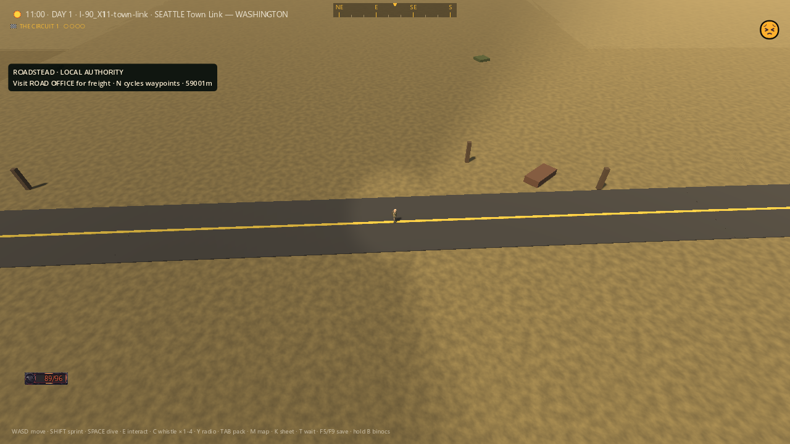

## Evidence and limits

- Run: `build/road-surface-cf97c75f758e445b92bbef190b758e83`.
- Source: base `138a1e3ae9204f6536f8e40f505a4b5e41e7f1d1` plus uncommitted Task 4
  renderer/test changes. This is not a final committed acceptance snapshot.
- Command: `pwsh -NoProfile -File tools/road_surface_check.ps1 -Scene road_surface_sim -Capture`.
- Actual Godot 4.5.1 Compatibility render, NVIDIA RTX 4090, 1280×720.
- Result: **55 passed, 1 failed**, exit 1, no timeout, empty stderr. The remaining
  assertion expects complete crash-barrel groups; actual port counts are 2/2/3/2,
  with zero measured road-footprint overlaps. It has not been waived.
- Deck-top separation: 6.273 m. Measured underside clearance: 5.753 m. They are
  different measurements; neither is described as 6.2 m underside clearance.
- Both save-profile directories were isolated inside that run. The map SHA-256
  before and after is `5CFD9F19ADABC06EAD96F9CE9F7BEAF404C9831D7178EB144EED60EBA2A4A4C3`.
- Four PNGs and their manifest were copied byte-for-byte into `diagnostic-1`;
  source/destination SHA-256 comparisons matched for all five files.
- Camera uses the real game rig. Locations are staged, the clock is held at
  11:00, and zoom is fixed for comparison. These on-foot photographs are not a
  continuous driving trip. Repaired floors change some actual camera heights.
- San Francisco and Atlanta are not geometrically migrated: site conflicts
  remain. Their narrow junction-metadata repairs do not constitute rollout.
- Original player-save recovery remains open. No new Windows package, public
  deployment, authenticated MMO, bus service or helicopter service is certified
  by this road work. The larger mission remains active.

The first resumed input-route attempt (`road-surface-b5f519423aa34af6adc8aa91ff64bc68`)
timed out at the runner's 180-second limit without moving from its starting
position. It retained a clean runtime log and unchanged map, but produced no
completed route assertions. This did not establish that the join itself blocks
the car and is not traversal proof; subsequent diagnostics below identify the
starting obstruction.

A shorter follow-up (`road-surface-d8bfccaf6a95437b819a61a3b2dbf0bc`) exits normally
with **10 passed, 2 failed** after detecting no movement in 12 simulation seconds.
The controller action, vehicle throttle and actual engine force are all active;
missing input is ruled out for that attempt.

The next GPU diagnostic (`road-surface-f9858a0c12b24bf48a1de84047238baa`, **16/2**)
shows the rig perched on a roadside guardrail. Its chassis overlaps that real
body and all four wheels report no ground contact. The expanded physical gate
(`road-surface-11a5c8a8fc6b4b2d91e84dc9728ae8c9`, **46/16**) also exposes floor gaps
or obstructions in every acceleration/deceleration lane and missing reflector
posts. The auxiliary lanes need real floor/reservation repairs; moving the
initial test position alone would not fix them. All these runs retain their
original logs, clean stderr and unchanged map bytes.

The screenshot defects also have a measured failing regression:
`road-surface-cbd952e5fe0f4a1da9fe338e42343b63` reports **47 passed, 7 failed**,
including four unreadable-sign checks and actual paint/pavement mesh overhangs
of 2.8331 m / 0.8943 m. These diagnostic failures precede their rendering fix.

Final comparisons, four-direction drive proof, compatibility checks and
independent acceptance review will be added only when obtained.
