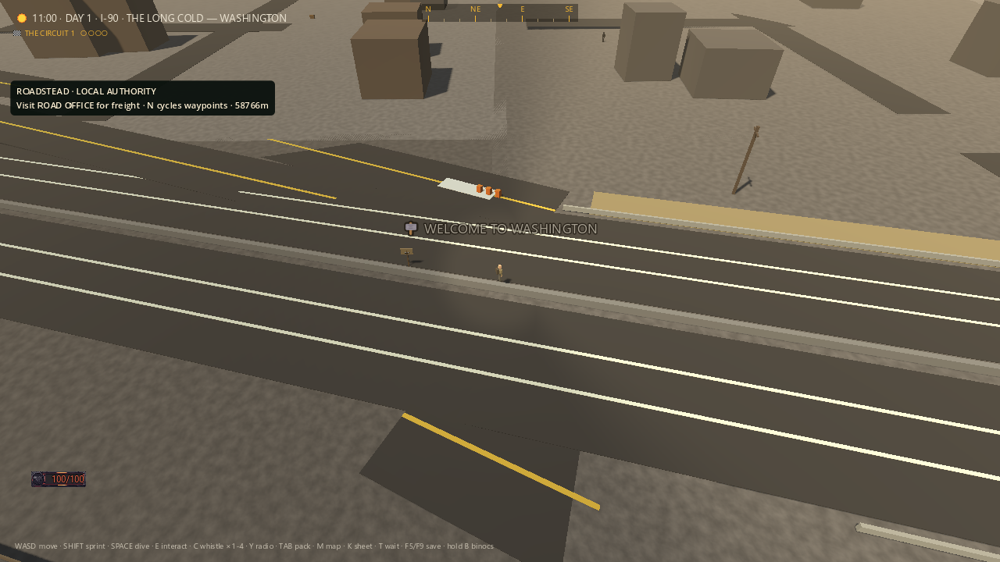
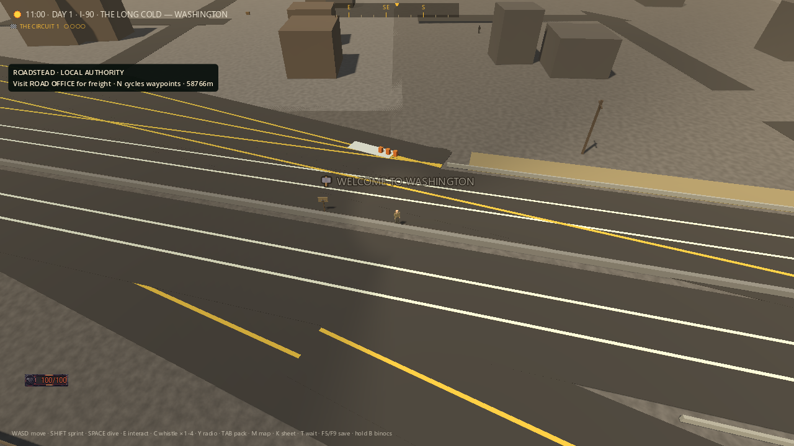
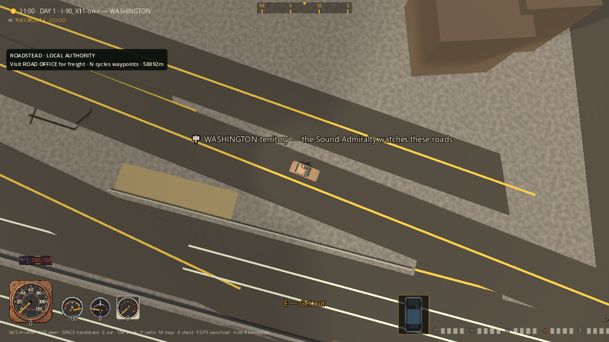
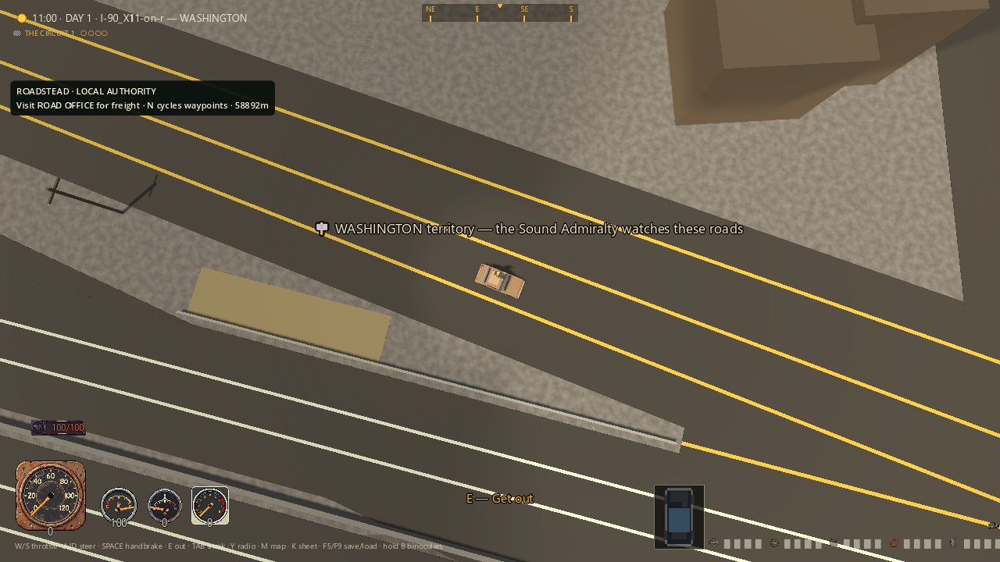
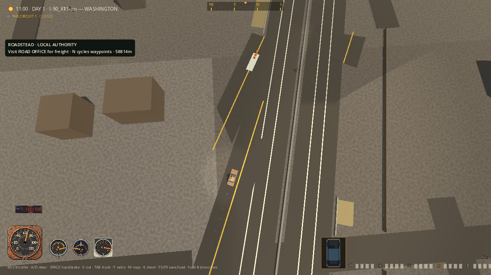
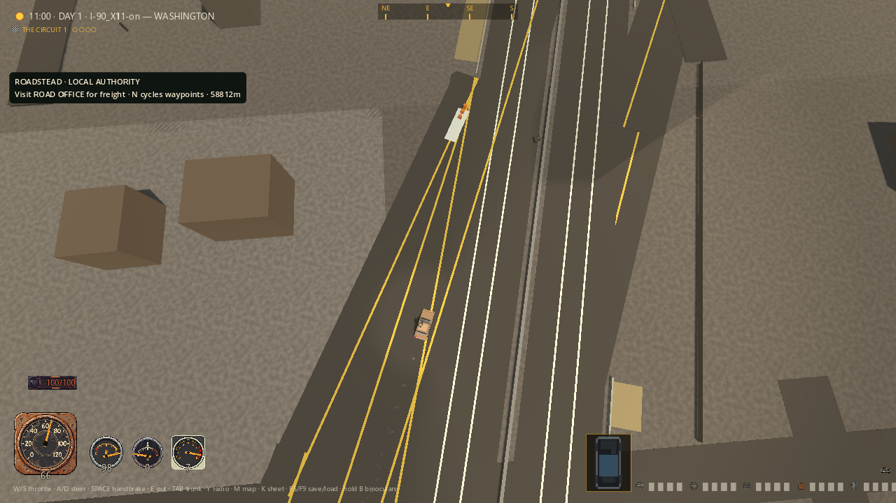
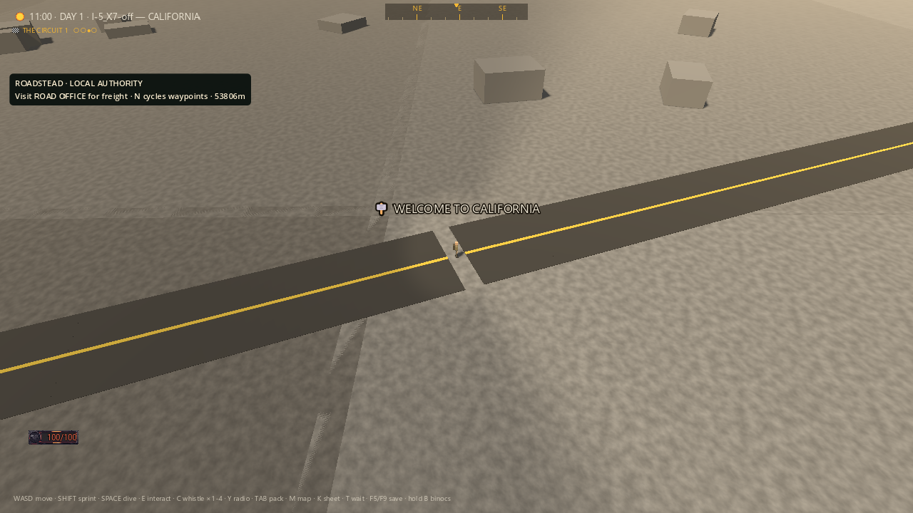
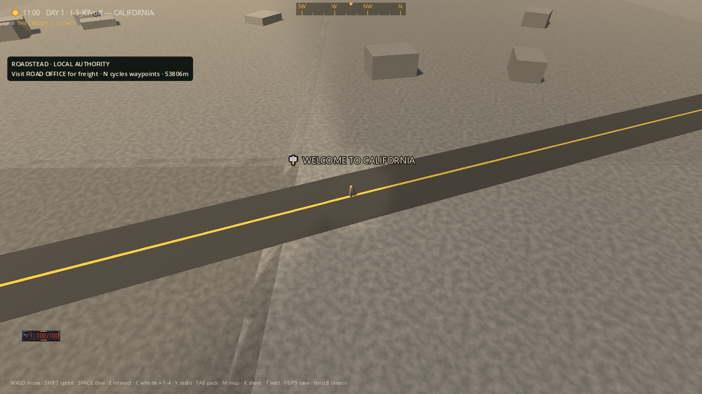

# Ramp surfaces — screenshot-led height and continuity repair

Four before/after comparisons from actual Godot frames: Seattle on foot,
seated on the return ramp, after short real driving, and an I-5 asphalt gap.
This is a bounded repair on `codex/america-foundation`, not a finished
interchange, nationwide driving certification, new export or MMO release.
The [20-piece gallery](MERIDIAN_GAME_GALLERY_2026_09_06.md) covers the other
world, home, menu and cartridge pieces.

## Judgment against the spec

The [American Road contract](../design/THE_AMERICAN_ROAD.md) requires usable
roads, preserved route character and right-in/right-out exits that never open
the median. The previous photographs showed asphalt disappearing under the
terrain. Correcting the height profile exposes the ramps, but also makes their
bad routing more obvious. A surface fix cannot satisfy the interchange contract.

My judgment: the visible I-5 gap is closed and the photographed Seattle paving
is more continuous. The tangled joins, crossing yellow lines, abrupt triangular
ends and physical median crossings still fail the intended world. Anonymous
brown buildings, repetitive ground, conspicuous patch seams, oversized temporary
toasts and internal ramp IDs in the HUD remain unpolished. These are not being
passed off as deliberate post-apocalyptic art direction.

## What changed

- Ramp height now follows its geographic relief field, not its vertex ordinal.
  Unevenly spaced old vertices previously produced the wrong intermediate
  height. On-ramps now join the existing highway elevation at their end; the
  old bake treated every ramp as an off-ramp beginning on the highway.
- Adaptive collinear subdivision follows interior hills, retaining every
  original vertex. It refines quarter/midpoint profile errors above 0.0125m,
  with a 64m maximum span and bounded depth. Heights remain centimetre-rounded.
  This improves the piecewise profile without moving the route in XZ.
- The renderer now retains valid short spans instead of discarding everything
  at or below 4m. The adaptive repair exposed 41 such segments on this map;
  two consecutive 3.9075m I-5 spans left a real gap even with neighboring end
  caps. Only slivers at or below 0.05m are discarded now.
- A selective migration repairs only owned exit ramps. It defaults to read-only;
  explicit writes validate input, preserve unrelated fields, reject stale reads,
  check original-vertex order/grade/idempotence and use an exclusive temporary
  file plus rename. A missing owning highway is explicitly rejected.

The migration changed exactly **207 ramp rows**, adding **3,304 collinear
points**. Independent in-memory review confirmed all original vertices remain
in order, inserted points deviate from their original segments by at most
approximately 8.9e-12m, all non-ramp rows and all non-road data are unchanged,
and no current on/off endpoint is misclassified. Maximum grade is 4.75114394%.
A repeat bake adds zero points and produces identical JSON. Highway humps,
existing junctions, exit IDs/ownership, placements and custom fields survive.
The migration itself checks retained vertices; the separate independent audit
is the evidence for the full-map collinearity bound.

No full junction rebake was used. Ramp XZ topology and `elev_mode: structure`
remain unchanged; terrain was not flattened to conceal the median crossings.
The extra profile geometry has not received a frame-time/streaming benchmark.

The debugging, test-driven-development and review skills kept this work tied
to reproduced geometry/physics failures. Review found the short-span renderer
incompatibility, copied-array ray-exclusion bug and missing-highway guard;
all three were corrected before the final runs.

## 01 — Seattle approach, on foot

Before, from the previous roadside repair: the foreground ramp line and
asphalt disappear into the terrain. After: more of the ramp surface is visible,
but it still overlaps the wrong parts of the highway. The brown massing town
and converging lines are visibly unfinished.





## 02 — Return ramp, seated

The final road is visibly paved around the test car. Grounded roadside
furniture from the preceding repair is retained. The multiple yellow lines
and overly broad converging road shapes still do not communicate a believable
American interchange. No complete exit maneuver is demonstrated here.





## 03 — After actual driving

The final harness drives 72.435m using real E/W input through a staged short
section. The earlier comparison drove 70.902m. Those are separate runs, not
identical trajectories or a full interchange traverse. The final frame exposes
continuous nearby pavement but still shows sharp road joins and sparse scenery.





## 04 — I-5 short-section gap

This pair isolates the renderer integration failure: both frames already use
the new ramp data. Before, two valid short segments are skipped, leaving a
visible break through the asphalt and center line. After, the break is closed.
The three hand-selected gap points now lie inside actual instantiated pavement
polygons. This is visual footprint coverage, not a driven I-5 traversal.





## Evidence, capture limits and safety

All PNGs are unedited 1280x720 Compatibility renders. New exact copies and
their SHA-256 comparisons are retained in
`docs/renders/ramp-profile-2026-09-06/capture-hashes.json`:

- `profile-before`: `build/road-surface-035a2075c1bc440e89f51360233bd150/captures/`.
  This exploratory GPU run has 20/5: three true I-5 failures plus two false
  missing-floor failures caused by the copied-array query bug. Its screenshots
  remain valid visual baselines, not clean test acceptance evidence.
- `profile-after`: `build/road-surface-698b7eeffa544659a1e46f0b5def7e82/captures/`.
  Two final captures, 25/0.
- `drive-after`: `build/road-surface-4197dae915934e0a99f27afe38b12a73/captures/`.
  Three final captures, 36/0. Before-drive comparisons reuse the earlier
  [roadside audit's exact final copies](ROADSIDE_VISUAL_AUDIT_2026_09_06.md).

The locations, clock (11:00) and test vehicle are staged. I-5 is a second
photographic staging, not evidence of driving from Seattle to California.
The old exploratory capture note describes initial staging too loosely; the
final manifest explicitly disclaims continuous-trip evidence. No screenshot
was retouched or replaced with generated art. A 60 FPS runner cap is not a
performance measurement. The earlier roadside audit's temporary edge-floor
probe fixture still applies to the drive scene, and is removed before driving.
The new terrain-only profile scene does not add such a floor.

Every final Godot run uses fresh, explicitly isolated APPDATA and LOCALAPPDATA
directories inside this checkout's `build/`. Process IDs, arguments, stdout,
stderr and terminal results are retained. All final engines terminated without
timeouts; every final stderr log is empty. The prior normal-player save
overwrite is still [unrecovered](TEST_SAVE_ISOLATION_INCIDENT_2026_09_06.md).
These tests do not use or recover that profile.

## Regression results

The Node production-path suite passes **20/20** (four profile cases, three
migration cases, thirteen retained road-clearance cases). The original profile
tests first failed on ordinal interpolation, the on-ramp join and an unsampled
hill. A uniform 16m attempt then failed an independent interior-hill sample;
adaptive refinement resolved it. The missing-highway test reproduced an
incorrect successful write before the guard fix. One preservation fixture's
expected join height was corrected from 3m to the hand-computed 2.89m; that was
test arithmetic, not a production failure.

With ray exclusions corrected but before the renderer fix, the clean headless
RED at `road-surface-62ec727c8da94a1dbf29406ebb856b55` is **18/3**: all five
Seattle terrain groups pass, and exactly the three I-5 footprint points fail.
Final profile coverage is 25/0 GPU and 21/0 headless.

| Final check | Passed / failed | Directory under `build/` |
|---|---:|---|
| Profile GPU, two captures | 25 / 0 | `road-surface-698b7eeffa544659a1e46f0b5def7e82` |
| Roadside GPU, three captures | 36 / 0 | `road-surface-4197dae915934e0a99f27afe38b12a73` |
| Profile headless | 21 / 0 | `road-surface-f30e27eb304049cc96c454d75c98e4db` |
| Road lanes / grip | 28 / 0 | `road-surface-5085eb81ef2243b38a063e7fa9e69221` |
| City exit data / graph | 35 / 0 | `road-surface-e489ca17dc364169be381c27ac2d765c` |
| Runtime road / building clearance | 26 / 0 | `road-surface-787c05696b0f4e49905b6a25626cdafb` |
| Terrain relief | 13 / 0 | `road-surface-d90b8fdcc9b246079d71fbc361249cf1` |
| Exit geometry | 6 / 0 | `road-surface-567a578a7ce843468a32f1126008c4cb` |
| Junction bake | 14 / 0 | `road-surface-203979d319334529a99b3d4a6c193e07` |
| Junction median / gore laws | 11 / 0 | `road-surface-e27536d62483490d8836b95111597162` |
| Exit blueprints / signs | 9 / 0 | `road-surface-e9030819915942b38045a5b49204be38` |
| Town grid | 10 / 0 | `road-surface-f6370c5aa1df49a1ae7c9a696ce87a47` |
| Traffic | 34 / 0 | `road-surface-fb35c17337754b9e9254c8084a0e8a97` |
| Synthetic elevated-road drive | 25 / 0 | `road-surface-72610a8a7bb64591b2fd963ac14d6f85` |
| **Roadside band / billboard** | **13 / 1** | `road-surface-a63450f1750d4b1dbee65a5ab9dff86b` |
| **Broad Seattle obstruction gate** | **15 / 2** | `road-surface-522c4a69e96643c8a352dfa97cea5511` |

The 14-scene headless batch totals **260 passing and 3 failing assertions**
and correctly exits 1. Two GPU scenes add 61 passing assertions, separately
from the Node suite. The billboard failure is the same assertion and 13/1
result recorded in the original `f1290de` baseline and the later `a0ff3cd`
sweep (`docs/verification/roadstead/*results.json`); it is still open.

The broad gate remains stricter than the profile-only gate: it counts median
and other physical obstruction hits, not only terrain. Current counts are:

| Seattle road | Sampled points | Obstructed points | Worst surface excess |
|---|---:|---:|---:|
| I-90 | 258 | 0 | -0.077m |
| Primary off | 69 | 0 | -0.102m |
| Primary on | 113 | 0 | -0.099m |
| Mirrored off | 115 | 2 | 0.735m, physical median |
| Mirrored on | 131 | 1 | 0.785m, physical median |

The earlier broad baseline had 76 obstructed on-ramp samples, 58 mirrored-off
and 49 mirrored-on samples. Adaptive subdivision and short-span rendering
change the sample positions/counts, so these are not identical-point paired
statistics or proof that every metre of every ramp is clear. Every final
sample requires a real floor hit; missing rays cannot silently pass. The
terrain-only path walks past non-terrain bodies with explicit RID exclusions
and leaves the broad gate untouched. The allowed terrain excess remains 0.12m.

The drive scene retains 28 verge runs, 21 fence runs, 70 fence posts, 32
guardrail runs and nine poles, with zero overlaps against loaded road meshes.
All 79 post/pole floor rays and 38 rail endpoints pass, including 11 sloped runs.
Existing optimistic graph/surface-classification assertion names do not prove
that the complete ramp topology is drivable.

The elevation scene temporarily inserts then restores its synthetic road.
The map hash was identical after every final scene:
`4B265697882A207BD60BE14F234952D6540DD7FB2977D1CB20E905C16E89D88F`.
Exact pre/post migration map copies remain in
`build/ramp-profile-migration-24b8d76eb57b4530af02898df74b26eb/`.
The pre-migration SHA-256 is
`F72197AE8D4AD11C6E54E41CC01EF57AEFEF1BC8527A8DCC660B431A742638DE`.

## Review and next work

Independent read-only review confirmed the preservation audit, closed the
three source findings and accepted the final evidence/documents for this
bounded repair, with no remaining critical or important finding. It verified
all 16 final process records and every copied PNG/manifest hash. Its image
viewer failed, so pixel judgment remains with the primary task, which inspected
all seven newly retained PNGs and the previously audited Seattle comparisons.
This does not claim whole-game acceptance.

Next: repair the exit topology and its shared consumers, then prove all four
directions with actual driving and fresh photographs. Preserve stable IDs and
the right-in/right-out median rule; do not cut a median gap to turn a failing
test green. The billboard gate, sparse city art, terrain presentation, public
authenticated servers, content depth and original-save recovery remain open.

Repeat safely with PowerShell 7 from this checkout:

```powershell
node --test tools/mapforge/ramp_relief.test.mjs tools/mapforge/repair_ramp_relief.test.mjs tools/mapforge/road_clearance.test.mjs
node tools/mapforge/repair_ramp_relief.mjs # read-only unless --write is explicit
pwsh -NoProfile -File tools/road_surface_check.ps1 -Scene ramp_profile_sim -Capture
pwsh -NoProfile -File tools/road_surface_check.ps1 -Scene roadside_clearance_sim -Capture
pwsh -NoProfile -File tools/road_surface_check.ps1 -Scene road_surface_sim # still fails median crossings
pwsh -NoProfile -File tools/road_surface_check.ps1 -Scene roadside_band_sim # existing billboard failure
```
