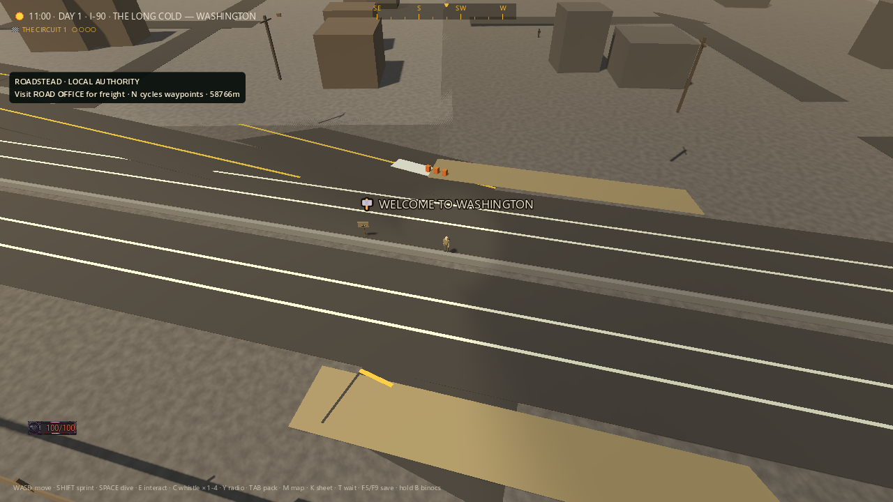
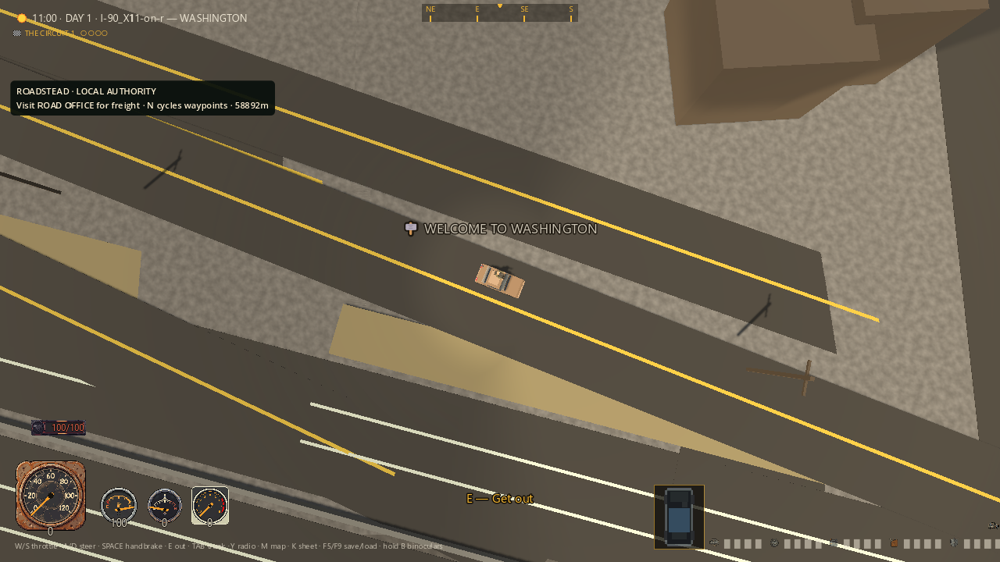
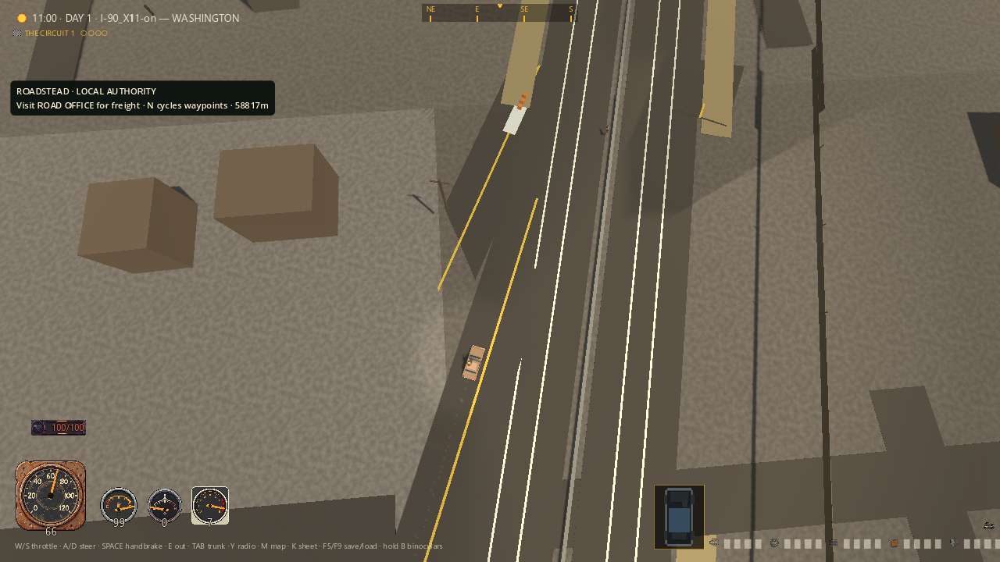

# Seattle roadside — screenshot-led clearance repair

Follow-up: the [newer ramp profile audit](RAMP_PROFILE_VISUAL_AUDIT_2026_09_06.md)
repairs height-related burial and short-span pavement gaps. Its 15/2 broad
gate still fails two median crossings; the historical 9/3 result below is
preserved as the pre-profile baseline.

Three new actual game views, paired with three unchanged-source baseline
captures. This is a bounded scenery-placement repair on `codex/america-foundation`,
not a finished interchange, polished USA, new Windows export or MMO release.
The [20-piece gallery](MERIDIAN_GAME_GALLERY_2026_09_06.md) covers other world,
home, menu and cartridge pieces. The [atlas](ATLAS_VISUAL_AUDIT_2026_09_06.md)
and [driver dossier](CHARACTER_SHEET_VISUAL_AUDIT_2026_09_06.md) have separate
newer screenshot-led repairs.

## Judgment against the spec

The ENGINE and American Road contracts require roads that materialize and
usable exits, with one geometry authority for the road and its consumers.
The old pictures violated even the basic visual contract: utility poles floated,
fences and verge paint continued through other roads, and return ramps appeared
to end abruptly. The first two problems are repaired here. The third is not.

My judgment after inspecting all six images: roadside placement is materially
cleaner, but this interchange still looks unfinished and is not acceptable as
the completed spec world. Ramp paint disappears under terrain, joins fold back
awkwardly, a return route crosses a physical median, and the town is still
mostly anonymous brown massing boxes. Large field/verge rectangles, repetitive
ground texture, patch seams and the sparse roadscape need further art direction.
The road identity HUD also exposes internal ramp IDs rather than a finished
driver-facing address. None of those defects is hidden by this repair.

## What changed

- Pole and fence-post candidates reserve complete road and authored-building
  footprints. Long fence, guardrail and verge strips are cut into clear runs,
  including a half-metre safety gap. Surviving scenery is retained.
- Each strip samples both endpoint heights and pitches to their grade. Pole,
  post, fence and verge heights are applied once, not lifted again by the
  blanket chunk drape. This fixes the double-height floating poles.
- Anonymous town crosses now share one row source for painting, grip and
  advance reservations. Current and neighboring urban streets are reserved
  before furniture is built, independent of their streaming order. The review
  found this omission after the first highway-only clearance check passed.
- Geometry uses the existing road and structure data. No route, placement,
  height row, building identity or RNG draw changed. A real catalog-building
  fixture and existing filler regressions check retained geometry and loot.

The debugging, test-driven-development and review skills kept this repair tied
to reproduced defects and independent geometry/physics checks, rather than a
cosmetic screenshot change.

## 01 — Seattle approach, on foot

Before: poles hang above their shadows and tan verge paint covers ramp mouths.
After: the pole bases are grounded and the paint/rails leave openings. The
foreground ramp still visibly disappears beneath the interstate approach;
the brown box town and abrupt paving edges remain unpolished.




## 02 — Return ramp, seated in the test car

Before: raised poles and a continuous tan strip overlap the roadscape. After:
only clear roadside runs remain, with grounded poles and a visible rail along
the interstate. The converging triangular road shapes and detached-looking
lane line are still defects, not an intended post-apocalyptic road treatment.




## 03 — After actual driving

Both versions drive through this short staged section: the baseline travelled
70.366m and the final rendered check travelled 70.902m. The old pole was high
above the vehicle, so it would be false to claim the baseline car crashed into
it. The final picture shows fewer scenery intrusions but still exposes the
bad ramp geometry. This is not a complete exit traversal or nationwide trip.




## Capture provenance and fixture limits

All six PNGs are unedited 1280x720 Godot Compatibility renders. Baseline copies
come from `build/road-surface-031349519c1641e2868763bfbee3a0ab/captures/`;
the three final PNGs and manifest come from
`build/road-surface-52d97f8cf4e444b78898157be3c1b7de/captures/`.
Every copied file was SHA-256 compared against its source. No retouching,
generated replacement art, or UI compositing was used.

The harness stages the starting Seattle location and a fresh test car, holds
the comparison clock at 11:00, and then injects actual E/W input. The car and
camera continue moving while the final capture is saved, so the manifest's
position is later than the drive-distance assertion. This is documented test
staging, not evidence of driving from Virginia to Washington. The 60 FPS cap
is a runner setting, not a performance benchmark or controller hardware test.

One fence post in the original photographed ring reaches beyond the loaded
floor boundary. For the placement ray checks only, the harness supplies that
missing cell with the production `_relief_floor` builder. It adds no furniture,
does not replace existing floors, and removes the fixture before driving.
This does not prove that the original streamed ring had floor beneath every
distant decorative object. All 79 original pole/post locations must receive a
successful ray hit; missing rays cannot silently pass.

Pole bases must be within 0.25m of the physical floor. Fence stakes may embed
in the triangulated terrain but must not float more than 0.25m and must retain
at least 0.5m visible height. One stake is embedded 0.44m; it is not floating.
The final maximum positive ground gap is 0.010m. Rail endpoint checks cover
38 points on nearby physical rails, including 11 genuinely sloped runs; they
do not certify every midpoint of every strip across the country.

## Verification and independent review

Fresh APPDATA and LOCALAPPDATA roots under this checkout's `build/` were set
explicitly for every final run. All owned engines terminated, with no timeout.
The normal player profile was not used. Complete logs, PID/arguments/profile
metadata and terminal results remain in each evidence directory.

| Final check | Assertions | Directory under `build/` | Runtime diagnostics |
|---|---:|---|---|
| Roadside GPU, three captures | 36/0 | `road-surface-52d97f8cf4e444b78898157be3c1b7de` | Clean |
| Roadside headless | 30/0 | `road-surface-c2701933aa734a5d83a3590706065008` | Clean |
| Runtime filler/footprint | 26/0 | `road-surface-51309cd73f2447e0aa39bd3f3ddf6fd6` | Clean |
| Road lanes and grip | 28/0 | `road-surface-e8cba1ce6cd84eb69c6bd1eecf514b05` | Clean |
| City exit data/graph | 35/0 | `road-surface-5e4f4cf317ba41ed8e3b0d103292e8f3` | Clean |
| Terrain relief | 13/0 | `road-surface-0f029be4a92d4160aabcd23b15a0aea8` | Clean |
| Synthetic elevated-road drive | 25/0 | `road-surface-43f801e6978244c49bc3d11f32965f73` | Clean |
| **Broader Seattle ramp surface** | **9/3** | `road-surface-08aaee7bc0084f4aafae2a65fe1533d4` | No engine diagnostics; three assertions fail, exit 1 |

That is 36 passing GPU and 157 passing focused headless assertions, plus a
separate **failing** ramp gate. The serial batch correctly exits 1. The older
city-exit test's road-classification/graph checks do not detect buried paint
or certify all ramp turns, despite their optimistic assertion wording.

In the final photographed ring, the test observes 28 verge runs, 21 fence
runs, 70 fence posts, 32 guardrail runs and nine poles. Each category is still
present and has zero overlaps with actual loaded highway/ramp/town asphalt
meshes. Ten physical strip fixtures include diagonal clipping, overlapping
exclusions, legal near misses, zero-length input and a real catalog building.

The initial clean baseline failed 15/5. After the first fix, expanding the
test to the original untagged town-street meshes failed 21/5 at
`road-surface-d2df772257454bbb948f8d3c807010c5`, reproducing all five scenery
categories crossing streets. The shared-row repair closes those failures.
Additional grounding diagnostics in `road-surface-17bb0e8a1358456b8e43b08cfc4a4f34`
identified the missing edge floor and embedded stake described above.

Earlier exploratory fixtures had a reused, out-of-range car with non-finite
physics (only that owned process was stopped) and an invalid enum reference;
those are not clean gameplay evidence. Some intermediate headless runs emitted
ObjectDB/two-resource exit diagnostics, including the local-street RED run.
The final runs above are clean; those historical diagnostics are not erased.
The synthetic elevation test temporarily adds then restores a map row; the
map SHA-256 before and after the final batch is identical:
`F72197AE8D4AD11C6E54E41CC01EF57AEFEF1BC8527A8DCC660B431A742638DE`.

Independent read-only source/test review closed the construction-order and
coverage findings, accepted the explicitly limited edge-floor fixture, and
verified the final GPU evidence. No critical or important source finding
remains in this bounded diff. The per-stretch scan of all authored placements
remains a profiling opportunity; no measured streaming-performance claim is
made. The primary task inspected all six retained screenshots.

Repeat with the isolated PowerShell 7 driver:

```powershell
pwsh -NoProfile -File tools/road_surface_check.ps1 -Scene roadside_clearance_sim -Capture
pwsh -NoProfile -File tools/road_surface_check.ps1 -Scene roadside_clearance_sim
# This remains an honest failing gate until the ramp geometry is repaired:
pwsh -NoProfile -File tools/road_surface_check.ps1 -Scene road_surface_sim
```

## Next road milestone and remaining mission

Repair the ramp data/bake authority and route topology, then prove all four
directions with physical pavement probes, real driving and new screenshots.
The current bake interpolates ramp heights by vertex index; the on/mirrored
paths also fold back or cross the median. Do not remove the median merely to
make the test green: the American Road's right-in/right-out law still applies.
Final measured failures are:

- `I-90_X11-on`: 76 of 107 samples obstructed; worst hit was terrain, 0.848m.
- `I-90_X11-off-r`: 58 of 109 samples obstructed; worst hit was terrain, 0.909m.
- `I-90_X11-on-r`: 49 of 121; maximum 1.229m at a physical median barrier.

These are sample observations, not a complete traffic-safety or slope audit.
The terrain-height and topology repairs, world art/lighting, content depth,
cartridge polish, public authenticated servers and wider regression failures
remain open. This source milestone has not been merged, uploaded or added to
the older Windows ZIP. The full-game goal remains active.

The earlier [test-save incident](TEST_SAVE_ISOLATION_INCIDENT_2026_09_06.md)
is still unresolved. Preserved affected files are not recovered pre-test saves;
the original playthrough has not been restored.
