# LASTLINE — main-world screenshot review (candidate checkpoint)

These are original Godot viewport captures of the playable-service integration,
not the earlier asset studio or physical test ground. This audit is **not yet
an acceptance report**. These Task 3 snapshots were captured before the source
commit; their exact source hashes are recorded in each raw result, not implied
solely by the preceding source HEAD. The final six runs match the runtime source
committed as `7c93002ac1e8bf9efe4ba49cd11a8601f2716188`. Independent review remains
pending; the user requested this local checkpoint before that gate.
The wider [20-piece gallery](MERIDIAN_GAME_GALLERY_2026_09_06.md)
also covers roads, homes, RPG panels and cartridge gameplay.

## First actual journey: failed, not an arrival

The first full GPU attempt completed with **16 passed / 3 failed**, exit 1,
empty stderr, and 150.91 seconds of wall time under the original 180-second cap.
Both profile directories were isolated under the worktree's build directory.
The coach reached only 123.627m from its origin during a 135.009-second journey
observation. It did not reach Richmond.

I personally inspected all three original 1793x1009 screenshots. The purchase
and seated-pelvis path worked, but the panel was sparse and the passenger HUD
incorrectly advertised driving controls. The terminal also needed clearer
shelter/boarding presentation and suitable day/night lighting.

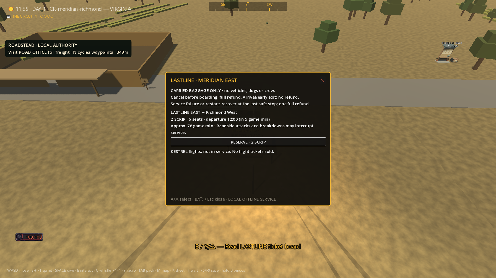

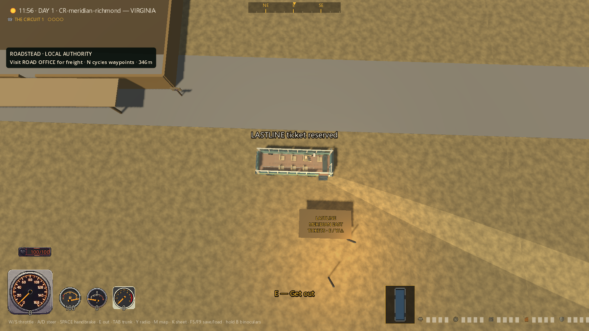

The next frame is a **failed roadside wreck**. Its original harness filename
is `04_arrival.png`; the filename does not turn it into arrival evidence. The
passenger was trapped by an exit rule that assumed every finished service was
at a terminal.

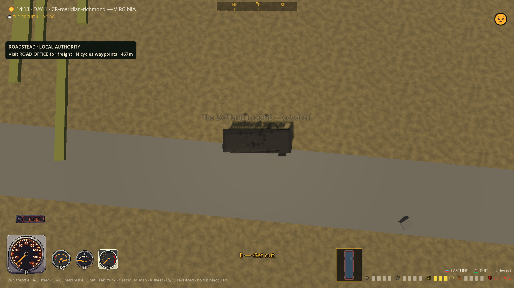

Subsequent damage-source telemetry identified the coach repeatedly roadkilling
its own passenger: the shared car exemption only recognized player-controlled
drivers. Passenger damage fed back into the occupied car. The bounded repair
recognizes the actual occupant while preserving damage against non-occupants
and external combat. Separate emergency work requires a physically stopped,
grounded, clear roadside exit and an atomic refund/save before releasing the
player; it does not teleport the wreck to a terminal.

The original [result](../renders/transit-coach-2026-09-07/first-failed-trip/result.json),
[runtime log](../renders/transit-coach-2026-09-07/first-failed-trip/stdout.log),
[stderr](../renders/transit-coach-2026-09-07/first-failed-trip/stderr.log) and
[environment](../renders/transit-coach-2026-09-07/first-failed-trip/environment.json)
are preserved byte-for-byte alongside the three unedited images. Source run:
`build/transit-runtime-coach-capture-e4c2ab8a307640ce94c9454a2a6d73a0`.

## Interim improvements are not final acceptance

A subsequent headless eastbound attempt physically reached the other terminal
929.646m away in 96.443 seconds with all vehicle components at full health. Its
result remains 17/1: a test sampler spanning an injected-input coroutine counted
11 physics frames as one 2.0017m step. Sampling is being corrected to observe
every physics frame; the 2m movement bound is unchanged. This is not a green
result or a replacement for final visual evidence.

I also inspected all three revised westbound screenshots from
`build/transit-runtime-coach-capture-7645a5ad816f45c7b0e56d5e244a4eb1`.
Amber action styling, a marked bay and passenger-specific hints improve
readability. The KESTREL row is still clipped, failure/restart copy conflates
different recovery rules, and terminal identity still looks too plain. Bright
noon ground wedges require source attribution before treating them as a stop
lighting bug. The actual [ticket board](../renders/transit-coach-2026-09-07/west-obstruction/01_ticket_board.png)
and [boarded view](../renders/transit-coach-2026-09-07/west-obstruction/02_boarded.png)
are preserved for comparison.

The westbound turnaround stopped 28.667m from its initial bay. It remained
undamaged, but failed to arrive: **18/3**, exit 1, 154.37 seconds wall, empty
stderr, both profiles isolated. Richmond fleet placement was explicitly staged
before boarding; the subsequent turnaround used the real drivetrain.

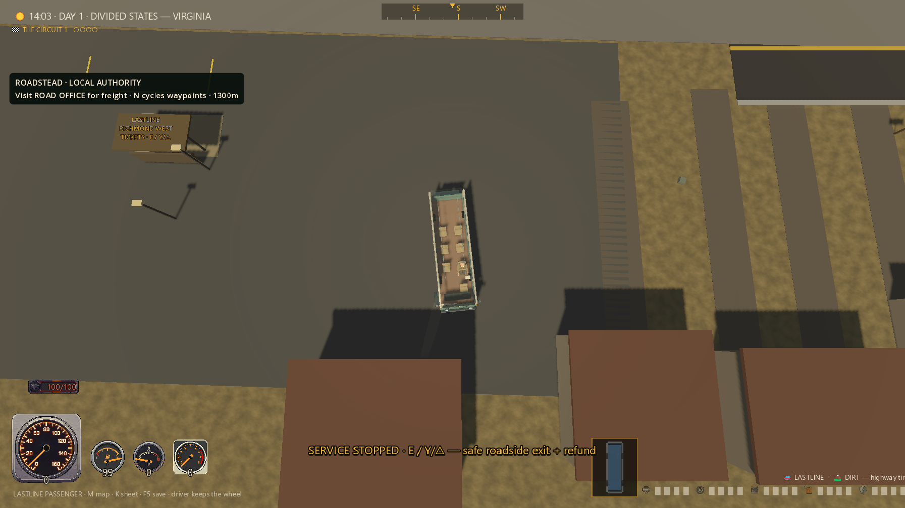

Collider diagnostics attribute the obstruction to an anonymous neighborhood
house at (1309.661, 2.363602, -220.9745), not an authored building. Its roof
overlaps the apron reservation. The corresponding generation path creates
only solid house/roof/driveway filler there, not local actors or loot. The
bounded correction will reserve the assembly footprint after all original
random draws and prune only explicitly tagged intersecting filler in loaded
chunks. Rebuilding live chunks or deleting authored structures is not allowed.
The visible concrete also still reports DIRT; constructed pavement will join
the shared surface registry with lifetime-safe cleanup, not a traction retune.
Neither correction is accepted before its regression and fresh trip evidence.

The second [result](../renders/transit-coach-2026-09-07/west-obstruction/result.json),
[log](../renders/transit-coach-2026-09-07/west-obstruction/stdout.log),
[stderr](../renders/transit-coach-2026-09-07/west-obstruction/stderr.log) and
[environment](../renders/transit-coach-2026-09-07/west-obstruction/environment.json)
are also byte-identical archives alongside all three unedited screenshots.

## First completed westbound journey

The corrected westbound GPU run completes **27/0**, exit 0, empty stderr,
155.33 seconds wall under the unchanged 180-second process cap. Its actual
journey takes 141.195 seconds, reaches 950.141m furthest from the staged initial
Richmond bay, and has a maximum sampled physics-frame displacement of 0.1832m.
The normal world clock advances; the living passenger leaves on foot at
Meridian. A completed-ticket/destination-fleet checkpoint reloads with exactly
one coach at Meridian and the reverse route available.

The internal journey-observation loop changed from 135 to 150 seconds after
an intact headless run reached the final turn but exhausted the former interval.
That failed run is retained as
`build/transit-runtime-coach-headless-272696da4d824d678b12ac0cb7b6744f`.
Neither the 165-second scene
watchdog nor the 180-second process cap was raised; the road route was not
shortened. The old 91-game-minute board estimate is being labeled as a minimum
road-running time, separate from terminal turns and traffic delays.

I personally inspected all four completed-run images. The board now fits its
normal viewport and distinguishes roadside failure from restart recovery. The
cream/green shelter, bench and marked bay are visible. Passenger controls remain
truthful during travel, and normal foot controls return after arrival.

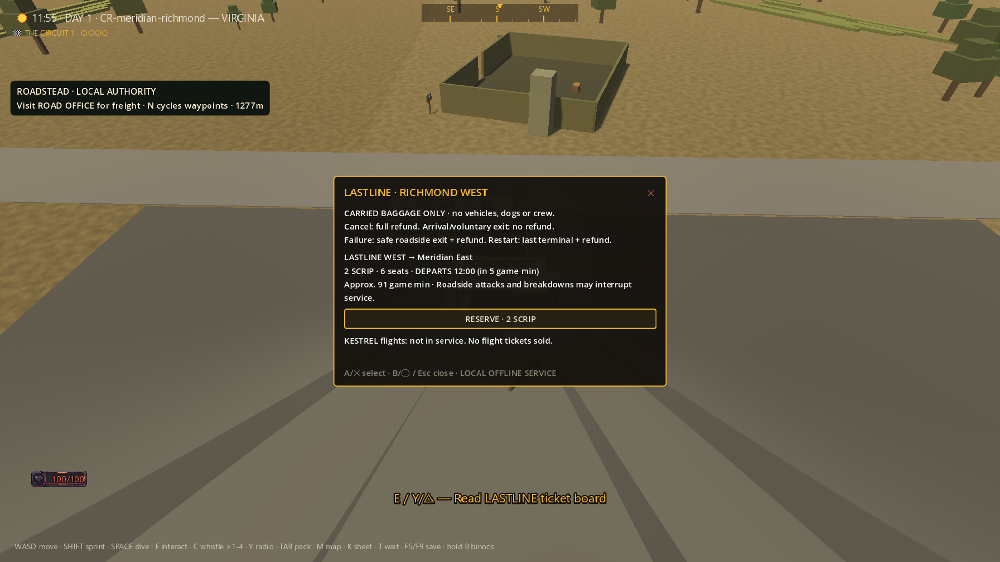

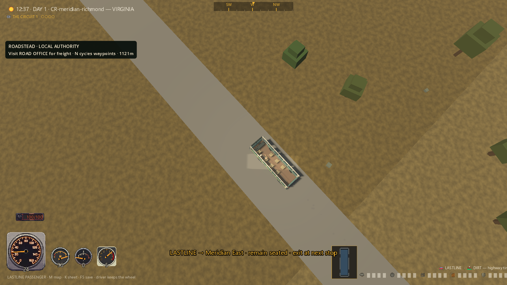

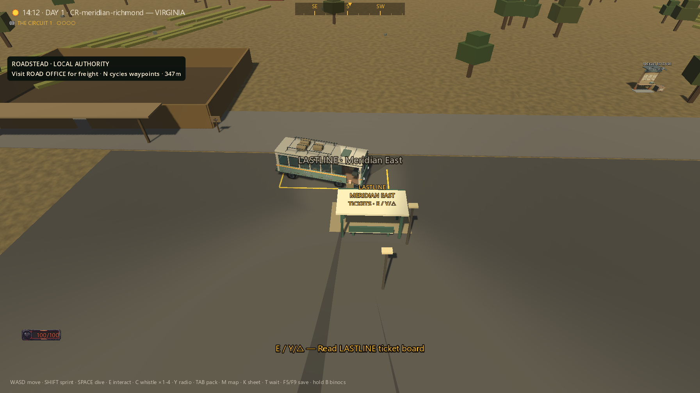

This is a real completed trip, not final visual acceptance. The coach parks
noticeably diagonal within its bay; its heading/whole-body clearance is being
checked. Gray rural road presentation and visible terrain seams remain broader
world-art shortcomings. Attribution now confirms the route is authored gravel:
the existing dashboard labels every non-road surface DIRT. A narrow label fix
is pending; this is not the concrete apron's surface-registration defect, and
neither the authored gravel nor its traction is being changed.
No overall AAA or release claim follows from this passing journey.

All four original screenshots and the [result](../renders/transit-coach-2026-09-07/west-first-complete/result.json),
[log](../renders/transit-coach-2026-09-07/west-first-complete/stdout.log),
[stderr](../renders/transit-coach-2026-09-07/west-first-complete/stderr.log),
[environment](../renders/transit-coach-2026-09-07/west-first-complete/environment.json)
are byte-identical archives of
`build/transit-runtime-coach-capture-8209eb379a6949be87da5fd6a8a8c763`.

## Eastbound completion exposes a queued-notice defect

The expanded eastbound GPU run passes **34/0**, exit 0, empty stderr,
108.91 seconds wall. Actual travel takes 95.302 seconds, reaches 929.502m from
the origin, and has a maximum physics-frame displacement of 0.1820m. New checks
cover an actually denied arrival checkpoint, a blocked exit and subsequent retry,
roadkill against a non-occupant, full parked-body apron containment, a clear
Exit anchor, and a waiting coach remaining grounded after distant chunks unload.
Post-fixture parking error is 1.213m and 5.38 degrees; these figures include
the blocking-obstacle test, not a perfectly aligned showroom placement.

I inspected all six unedited 1793x1009 images. The new board correctly labels
the minimum road-running time and the actual route HUD reports GRAVEL. However,
arrival and the later night fixture still display an old blocked-exit warning
despite correct foot mode. The automatic arrival retry repeatedly queued the
same notice. Functional assertions passing did not make this presentation okay;
service-local deduplication and a notice regression/recapture are in progress.

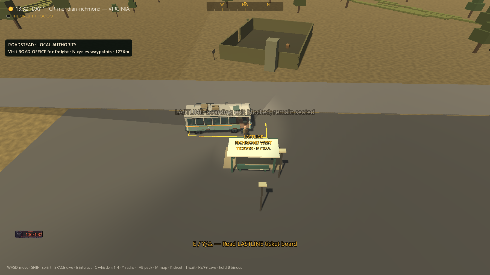

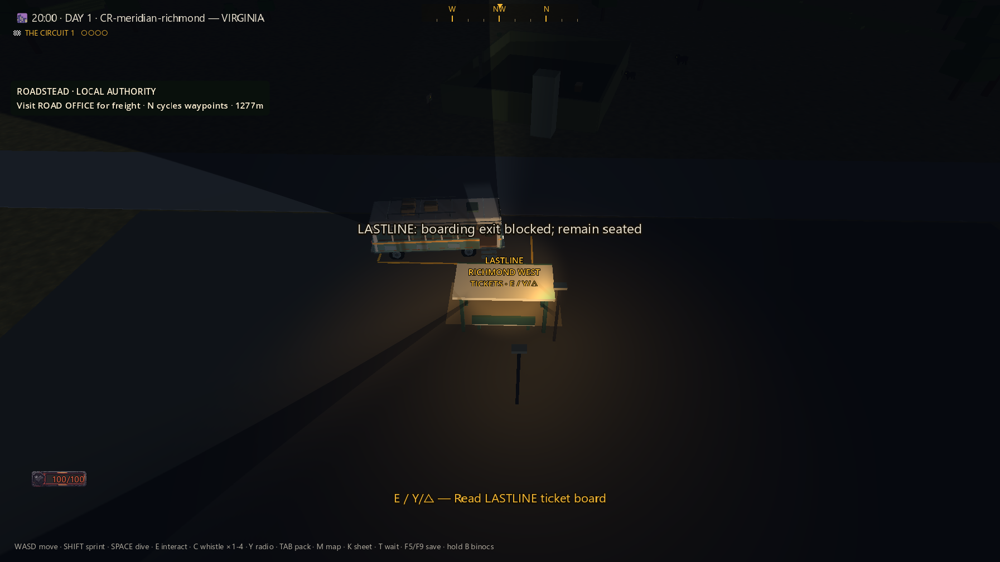

The night image stages the clock to20:00 after the completed real journey; it
is a lighting fixture, not evidence of a night-time trip. Noon telemetry shows
both terminal lamps off and coach headlights off, with visibility-mask strength
0.30000008. The separately labeled
[mask-off comparison](../renders/transit-coach-2026-09-07/east-stale-notice/diagnostic_arrival_mask_off_NOT_journey_evidence.png)
removes the hard ground wedges. That identifies the existing visibility mask,
not terminal lighting; the altered presentation is not traversal evidence.
The lamp-on night view is legible, while surrounding world art remains coarse.

All six images and [result](../renders/transit-coach-2026-09-07/east-stale-notice/result.json),
[log](../renders/transit-coach-2026-09-07/east-stale-notice/stdout.log),
[stderr](../renders/transit-coach-2026-09-07/east-stale-notice/stderr.log),
[environment](../renders/transit-coach-2026-09-07/east-stale-notice/environment.json)
are byte-identical archives of
`build/transit-runtime-coach-capture-18063065fb60457a914667325eef1ea4`.
The old bottom-right status overflow and purple night emoji are explicitly
assigned to the final transport HUD visual pass, not silently accepted as final.

## Corrected arrival presentation, both directions

The next frozen-source captures complete west **36/0** and east **35/0**, with
empty stderr and unchanged per-run source hashes. I personally inspected all
six images in each run. Arrival and the post-journey night fixtures now show
settled foot mode without the stale blocked-exit warning. A service-local
notification guard fixes the repeated retry message; the global HUD queue was
not rewritten.

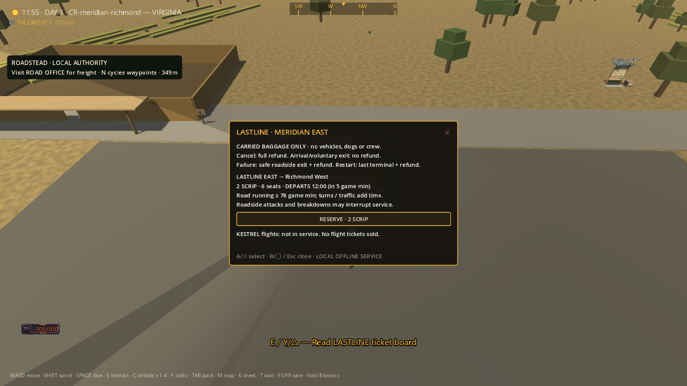

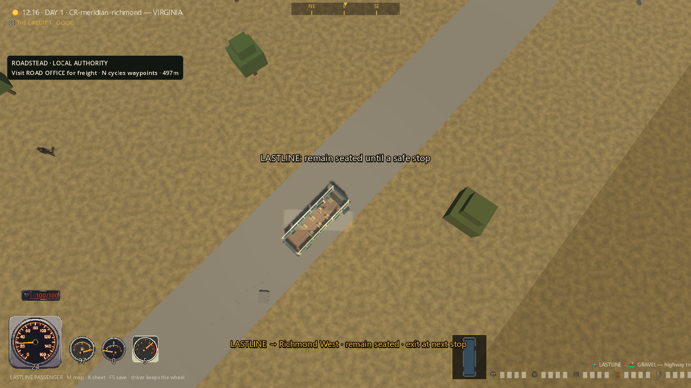

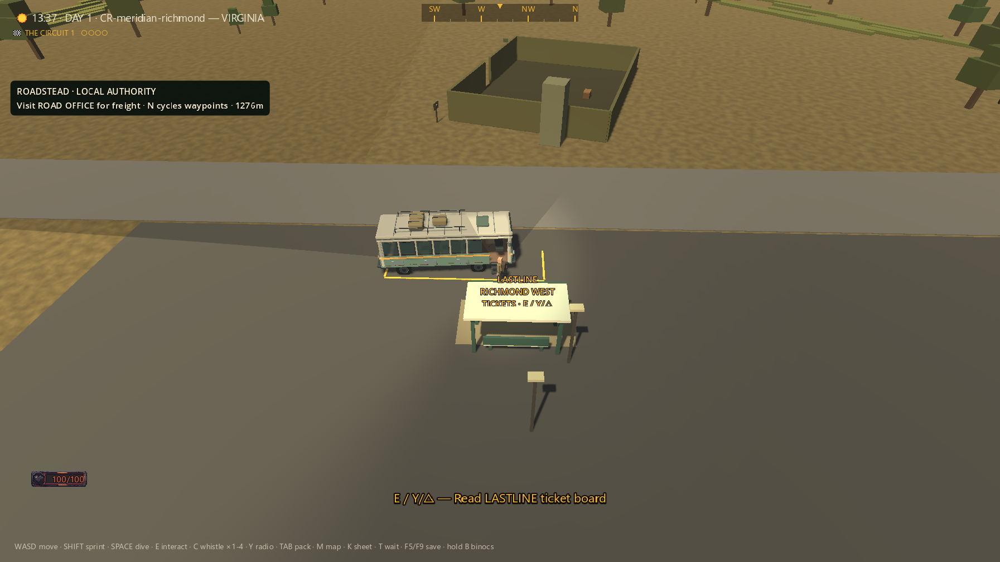

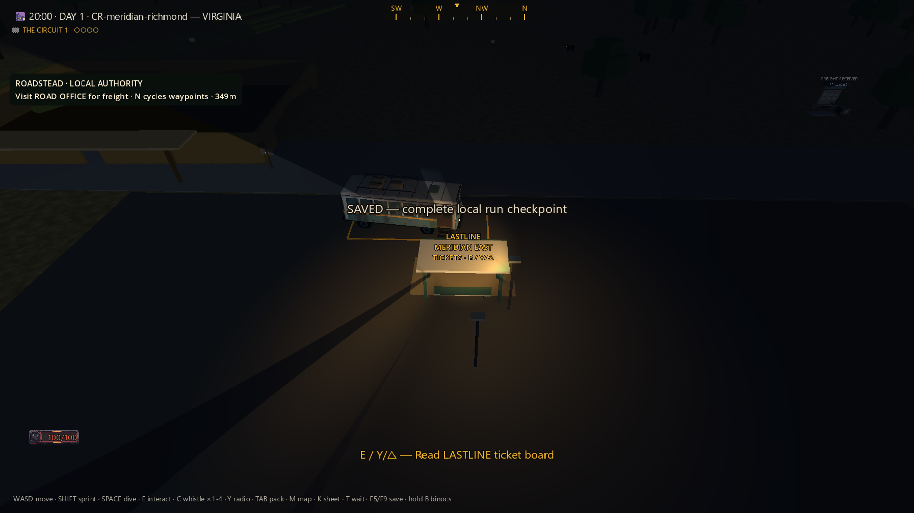

West travel takes 138.640s, reaches 950.139m furthest from the initial bay, and
has maximum physics-frame displacement 0.2263m. East takes 98.827s, reaches 929.502m,
with maximum step 0.1820m. Total process times are 158.464s and 118.331s, both below
the unchanged 180s cap. Both run with isolated APPDATA and LOCALAPPDATA. Their
355-source snapshots remain unchanged during each run.

The [west result](../renders/transit-coach-2026-09-07/west-notice-fixed/result.json)
and [log](../renders/transit-coach-2026-09-07/west-notice-fixed/stdout.log), and
[east result](../renders/transit-coach-2026-09-07/east-notice-fixed/result.json)
and [log](../renders/transit-coach-2026-09-07/east-notice-fixed/stdout.log) sit beside
all twelve unedited images, environment records and stderr files. Each of these
twenty archived files was SHA-256 compared with its original. Source directories:
`build/transit-runtime-coach-capture-1cea3d4c0d864eaca2edfdac4dfb25db` and
`build/transit-runtime-coach-capture-d4e74db17f6642ccbc9931e9cc81fa7b`.

These images precede the later boarding-distance, emergency-parking and initial
boarding-feedback corrections. A source/spec
comparison found the actual Boarding-anchor check allowed 3.5m instead of 3m.
The new 2.99m/3.01m boundary regression reproduces that defect before its
one-condition repair; ticket-counter reading remains a separate 3.5m radius.
Do not describe these earlier screenshots as captures of that later exact
source. Independent implementation review and final regression evidence remain
pending. Safe but visibly diagonal parking, status-line overflow, the night
glyph, terrain seams and visibility-mask presentation still require polish.

Flights, session-authoritative seats and route encounters are later transport
tasks. Full-game stability, national content, authenticated MMO service and the
unrecovered normal save remain separate open gates.

## Review candidate: actual stops, safe recovery, truthful controls

The candidate now enforces the specified 3m boarding range. Emergency egress
waits for actual speed below 0.1m/s and the driver's completed parking transition,
as well as the existing upright/grounded/clear-exit checks. A real-input failure
at 0.4997m/s proved the old gate could release and refund a still-rolling rider;
the new gate refuses that request and retains the original 0.2m post-exit wreck
drift bound. Normal terminal rules are unchanged.

The inherited ordinary-passenger “take the wheel” toast is suppressed only for
public transport. Its ordinary-car counterpart remains tested. Input tests now
allow actual process frames between focus/press/release events; physics ticks
alone had occasionally left GUI events unprocessed. Continuous vehicle movement
is still sampled every physics frame. No timeout, world route or motion bound
was relaxed for these corrections.

The following raw records were read and their source hashes compared with the
candidate working code; each run is unchanged internally, exits0 with empty
stderr, and uses both isolated profile directories. Independent review is still
pending, so this is a candidate checkpoint, not release acceptance.

| Check | Passed / failed | Wall seconds | Raw result |
| --- | ---: | ---: | --- |
| Safety, controls, emergency and save recovery | 63 / 0 | 67.258 | [Result](../renders/transit-coach-2026-09-07/review-candidate-safety/result.json) |
| Ticket/catalog regression | 115 / 0 | 5.680 | [Result](../renders/transit-coach-2026-09-07/review-candidate-ticket/result.json) |
| Shared vehicle regression | 109 / 0 | 33.486 | [Result](../renders/transit-coach-2026-09-07/review-candidate-vehicle/result.json) |
| Existing road-life regression | 71 / 0 | 24.235 | [Result](../renders/transit-coach-2026-09-07/review-candidate-road-life/result.json) |
| Eastbound GPU trip | 36 / 0 | 125.926 | [Result](../renders/transit-coach-2026-09-07/review-candidate-east/result.json) |
| Westbound GPU trip | 37 / 0 | 168.170 | [Result](../renders/transit-coach-2026-09-07/review-candidate-west/result.json) |

The eastbound trip takes 102.737s wall time, reaches 929.514m furthest from origin,
and has maximum physics-frame movement 0.1820m. Final position/heading errors
are 1.202m and 5.455 degrees with full apron containment and clear egress.
All six new eastbound images were personally inspected. They preserve actual
travel and the explicit post-journey night/mask diagnostic distinction.

The matching westbound trip takes 144.218s, reaches 950.140m furthest from origin,
and has maximum physics-frame movement 0.2263m. Final position/heading errors
are 1.279m and 7.072 degrees, with full apron containment and clear egress.
All six westbound images were also personally inspected. These six recorded
runs total 431 passed assertions and zero failed assertions; this is targeted
transport verification, not the full-game suite. All 88 archived evidence files
(including 40 unedited PNGs) are byte-identical to their original run outputs.

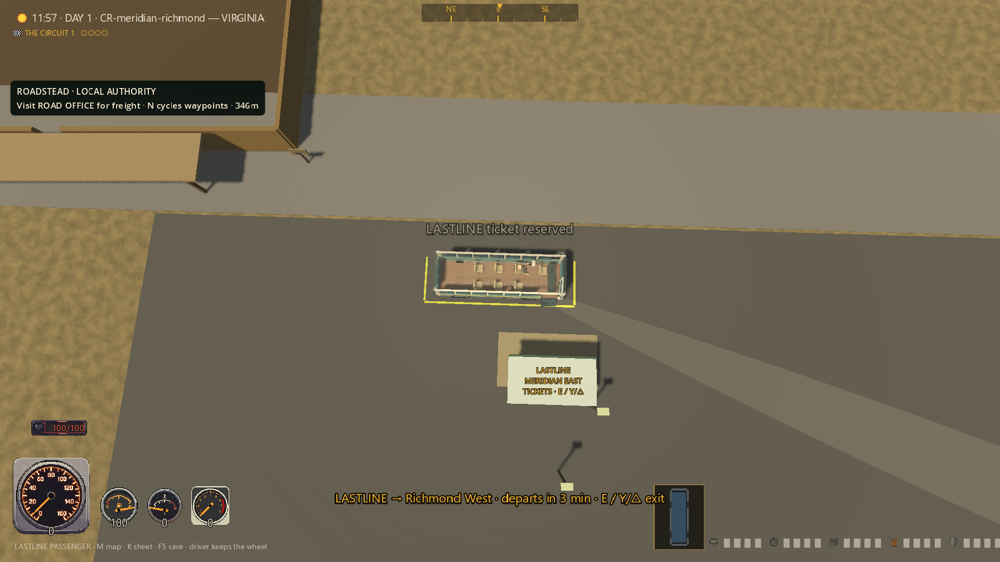

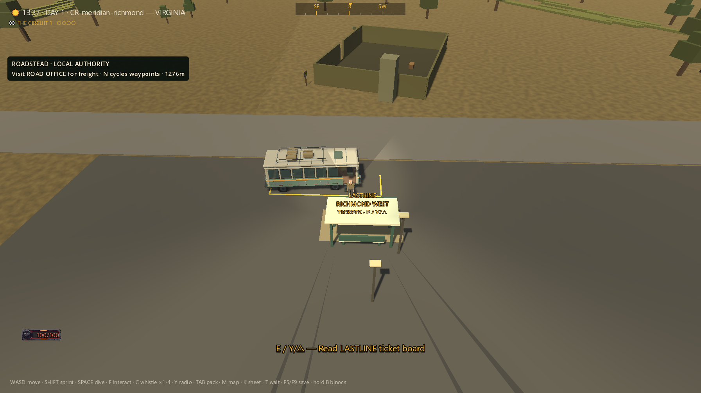

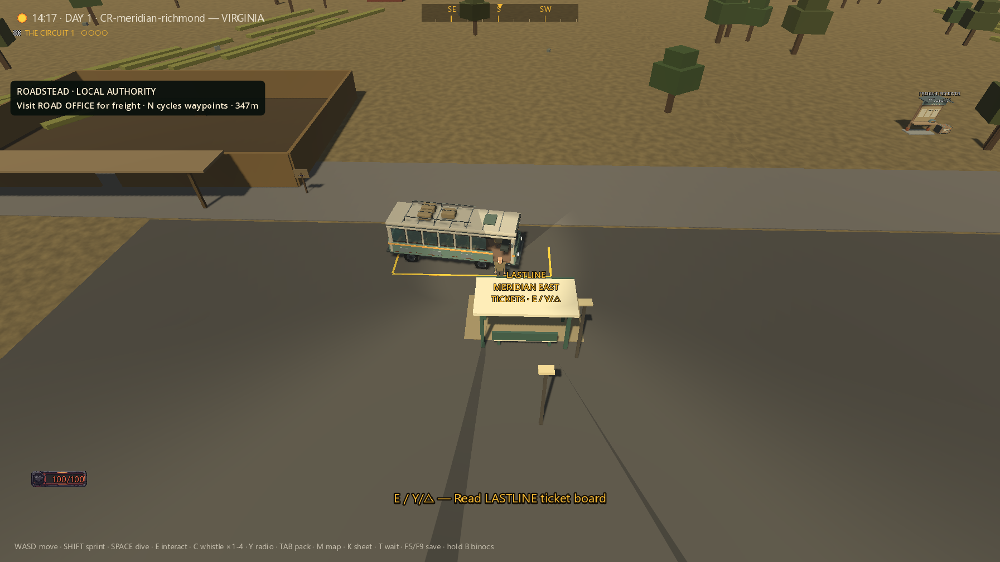

Earlier warning-bearing runs are not erased by clean candidate checks. Two
safety runs emitted an intermittent ObjectDB/resource shutdown warning whose
object was not identified by the clean verbose diagnostic. A separate seven-
failure restore run did not log individual conjuncts, so it cannot establish
that saves mutated; later explicit aboard-precondition and recovery checks pass.
A slower west journey also missed its internal arrival-observation gate before
physically finishing during the later settling interval: it remains a failed
run. Wall-time variation is not attributed to a specific machine/physics cause.
The original 150s observation, 165s scene watchdog and 180s process limits remain.

The matching candidate westbound capture is complete; scoped source review is
still pending. Broader visual, content, flight, requested-stop, network, stability and
release gates remain open even after this coach checkpoint.
