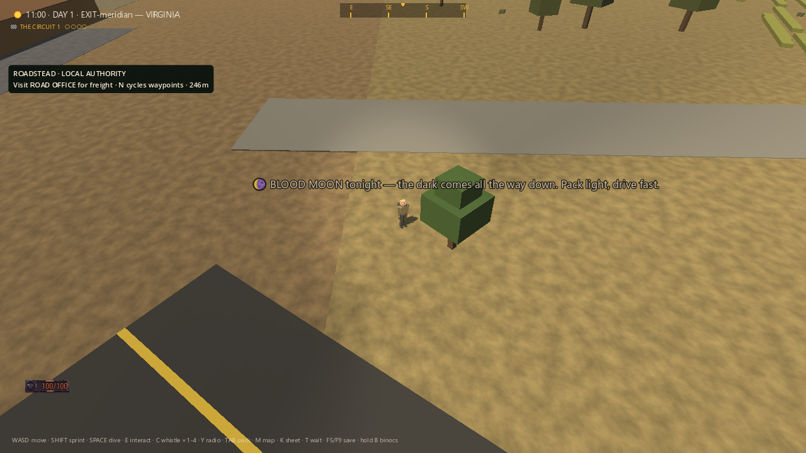
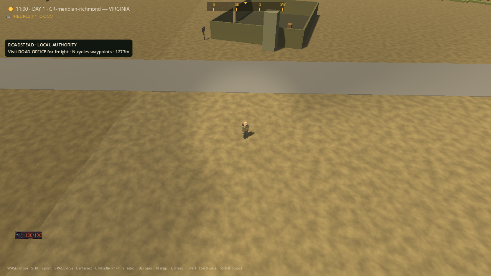
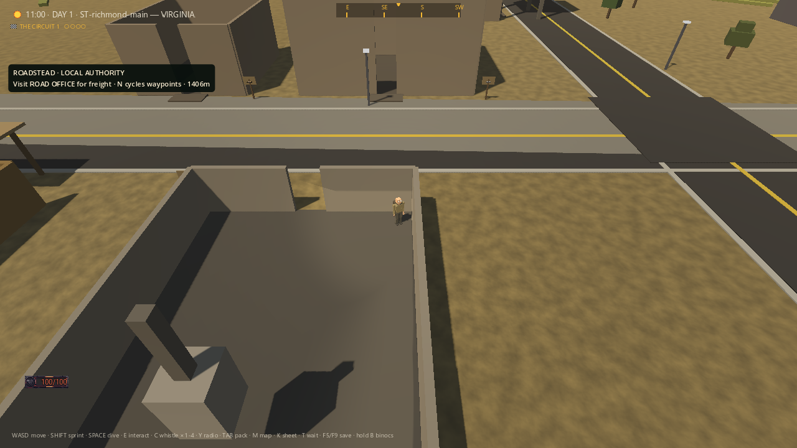
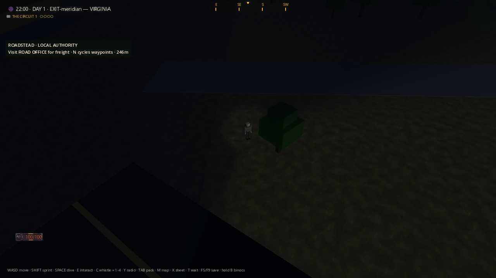

# Transit corridor — main-world baseline inspection

These four **unaltered game screenshots** show existing locations before transit
construction. I inspected all four. They are siting/lighting evidence, **not a
bus journey, flight, building-entry test or final visual acceptance**. The
character and clock were staged for photography; the ordinary world renderer,
camera and HUD remained active. No image-generation or image-editing tool was
used on these captures.

## Meridian East, initial daytime candidate

The waiting point is exposed beside a procedural tree. The diagonal road at the
lower left matters: checking all nearby road polylines found the initial pad
only **3.11m from EXIT-meridian's centreline**, overlapping another road despite
being clear of the service road and authored buildings. Squared terrain-color
seams and sparse dressing remain obvious. The blood-moon notice is an existing
world overlay, not a transit message.

Required correction: move the Meridian stop row from fraction 0.96 to the 0.88
candidate on the same county road, without editing national road points or
building positions. The candidate pad's nearest other road centreline is over
47m away; its standing point is over 22m from authored building footprints.
These are preliminary point distances, **not full footprint clearance**.
Task 3 must verify the complete turning apron, boarding area and rotor disc
against road widths, terrain, structures and physics, and keep procedural trees
out of that real footprint after chunk regeneration. The correction is specified
but is not implemented by this screenshot record.

## Richmond West, revised candidate

Fraction 0.16 is clear of the visible church and provides an open candidate
waiting area. It has no shelter, lamps or wayfinding yet. The building across
the road is visibly an unfinished, sparsely furnished cutaway shell. A
functional stop must not be mistaken for completion of the town's art pass.

## Richmond, rejected church location

The original 0.06 candidate places the character inside the church shell.
This corroborates the footprint calculation that prompted the already-landed
Richmond row correction to 0.16. The image was staged at the rejected point;
it does not prove that the character walked into this building.

## Meridian East, night baseline

The unlit site is almost black. Task 3 needs practical lamps at the shelter and
boarding area, readable destination signage, and a safe pedestrian approach.
Brightening the entire world or hiding obstacles is not a substitute.

## Evidence and limits

Original run:
`build/transit-scout-07d514e961834881856495637c0d81f5`.
Godot 4.5.1, Compatibility renderer, NVIDIA RTX 4090, 1280x720.
Process exited 0 in 13.1632787 seconds, without timeout; stderr is empty.
All four PNG writes succeeded; the isolated save was unchanged. Both APPDATA
and LOCALAPPDATA were under that run's build directory. The seven recorded
source hashes were unchanged during photography. Source HEAD was
`0f529c1c33cd6bb443c8a06c9013be7bbf353fde`; the working source hashes, not that
commit alone, identify the exact source inspected.

[Raw results](../renders/transit-scout-2026-09-07/result.json),
[environment](../renders/transit-scout-2026-09-07/environment.json),
[frame manifest](../renders/transit-scout-2026-09-07/frames.json),
[stdout](../renders/transit-scout-2026-09-07/stdout.log),
[stderr](../renders/transit-scout-2026-09-07/stderr.log), and the
[photography harness](../renders/transit-scout-2026-09-07/capture.gd) /
[isolated launcher](../renders/transit-scout-2026-09-07/capture.ps1)
are preserved byte-for-byte alongside the images. The launcher is an archived
scratch utility with its original build path, not a new supported test command.

World-map SHA256 remained
`04D975429DD544212438B3D9DAEF96D61E08B5551F19B622FF14A73BDF0135B9`.
No normal profile, public service, export or deployment was used. This bounded
capture does not resolve the earlier native crashes, the unrecovered player
save, national world-content debt or authenticated MMO server requirements.
