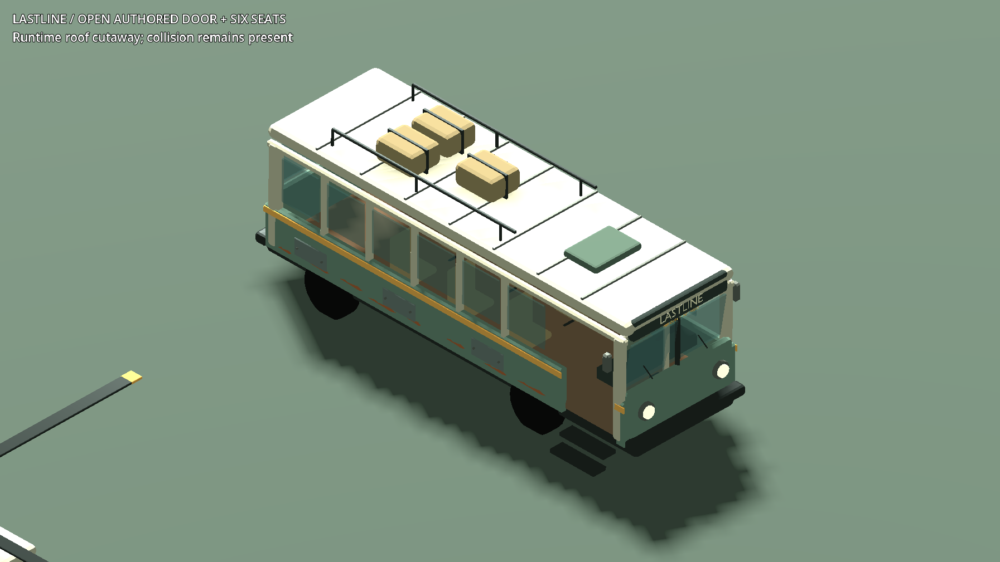
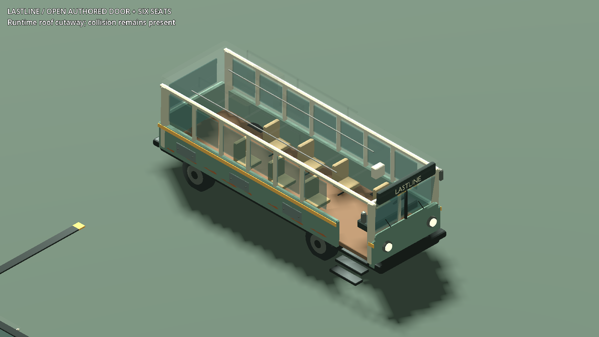
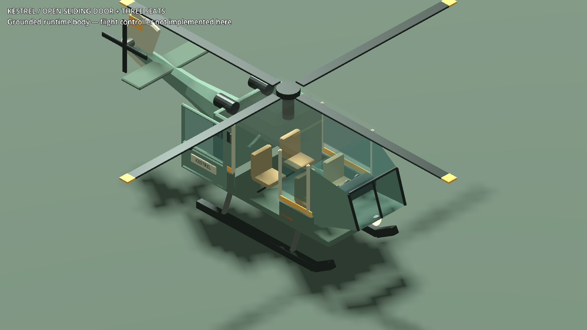
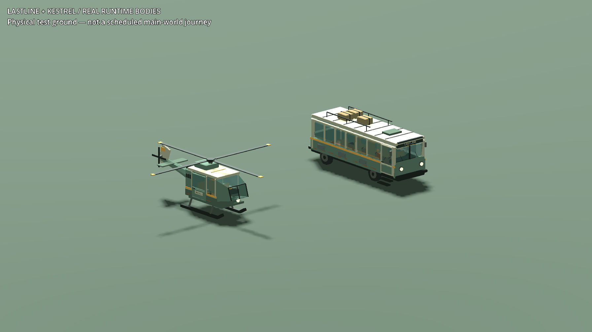
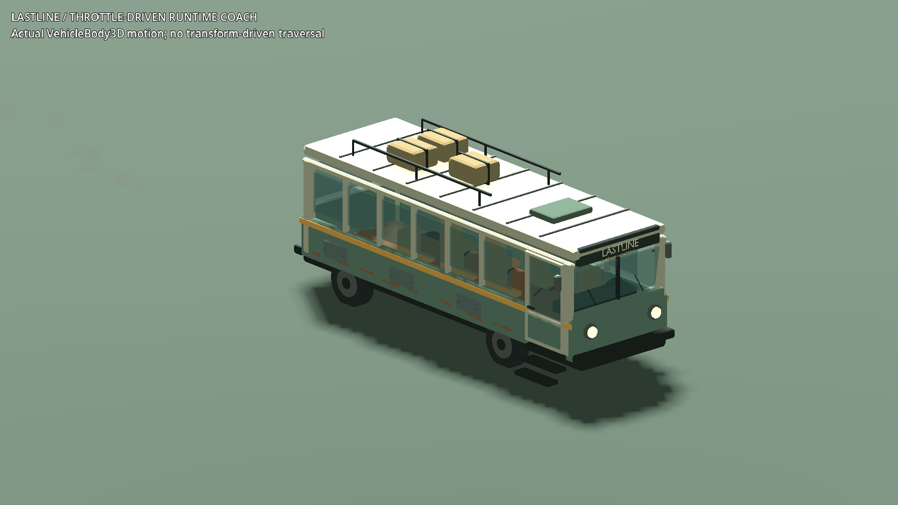

# LASTLINE / KESTREL — screenshot-led runtime corrections

The original Blender assets now instantiate through the real vehicle factory
at commit `e5f83f3`. These are **unaltered Godot screenshots from a physical test
ground**, not conceptual renders and not yet scheduled main-world journeys.
I personally inspected all four initial views, all four intermediate corrected
views, and all four final views. The final four are below.

## Bus cabin: visible failure, then correction

Before: the door opened, but the roof stayed opaque despite the cutaway request.
The stock tire-wear material also overwrote the original rim surfaces to black.

After: per-roof material transparency works in Compatibility rendering. Six
passenger seats, driver space, aisle and entry steps are visible; the roof still
has collision. The original wheel rims retain their material, and the actual
imported wheels now roll, steer and compress with the vehicle suspension.

This fixes a functional visibility defect. It is not final hero-asset quality:
surfaces, weathering and furnishings remain deliberately simple in this kit,
and the integrated passenger pose still needs main-world verification.

## Helicopter cabin

The sliding door and cutaway reveal the two rear seats and front passenger seat
beside the pilot. Door motion and collision opening are tested, including all
three passenger anchors. This helicopter has a physical body but **no flight
controller in this checkpoint**; this grounded image is not evidence of flight.

## Exterior and physical coach motion

The exterior remains intact when the cutaway is not requested, including roof
luggage and rails. Mandatory service artwork no longer disappears when the
legacy generic-art debug option is enabled.

The coach drove using its real throttle, steering and brakes on collision
ground. The screenshot alone cannot prove motion: frame-by-frame displacement,
wheel rotation/contact and stopping measurements are in the raw logs.

The initial brake setting was too weak for the coach's mass. A coach-only brake
row fixes that without changing ordinary cars' default. A second check caught
the chassis sitting low and rolled after indefinitely holding the inherited
low-speed handbrake. The tested parking sequence releases the pedal/handbrake
and uses inactive parking once stopped; suspension retuning and test velocity
overwrites were not used to conceal the problem.

## Verified results and exact evidence

| Check | Result | Evidence |
|---|---:|---|
| Exact-commit physical vehicle | 109 passed / 0 failed | [result](../renders/transit-runtime-2026-09-07/vehicle/result.json), [log](../renders/transit-runtime-2026-09-07/vehicle/stdout.log) |
| Final GPU capture | 113 / 0 | [result](../renders/transit-runtime-2026-09-07/final/result.json), [log](../renders/transit-runtime-2026-09-07/final/stdout.log) |
| Atomic ticket lifecycle | 115 / 0 | [result](../renders/transit-runtime-2026-09-07/ticket/result.json), [log](../renders/transit-runtime-2026-09-07/ticket/stdout.log) |
| Shared data compatibility | 19 / 0 | [result](../renders/transit-runtime-2026-09-07/data/result.json), [log](../renders/transit-runtime-2026-09-07/data/stdout.log) |
| Weapon-grip compatibility | 18 / 0 | [result](../renders/transit-runtime-2026-09-07/grip_ik/result.json), [log](../renders/transit-runtime-2026-09-07/grip_ik/stdout.log) |

All final runs exited 0, had empty stderr, stayed within their original wall
limits, and retained identical before/after source hashes. The controller also
compared the four archived headless runs' recorded hashes with current source.
Both APPDATA and LOCALAPPDATA were fresh worktree build profiles; no normal save
or public service was involved. The two previously recorded Dialogue Manager
icon-UID import warnings remain disclosed, not relabeled as clean import output.

Final headless braking distance: **10.527m** against a 20m limit; maximum sampled
physics-frame step **0.231m**; final speed approximately **0.001m/s**. All four
wheels contact the ground, with body origin Y approximately -0.041m and nearly
zero roll. The GPU run adds real capture frames and stops in **10.905m**.
The initial failed GPU result, **90/1**, is preserved with its
[raw output](../renders/transit-runtime-2026-09-07/before/stdout.log).
The screenshots are original 1793x1009 viewport images, not resized edits.

Source capture run:
`build/transit-runtime-vehicle-capture-3b0cb2179b854d81aab0e769d11ef0fd`.
Exact-commit headless run:
`build/transit-runtime-vehicle-headless-65a7795dc6704305b10a51055d066df1`.
Archived images and raw logs were copied byte-for-byte. Earlier intermediate
and behavioral RED runs remain in build and the task report; not every debug
attempt is represented as a gallery image.

## Still required

Independent task review approves the bounded vehicle layer. Its initial
passenger-integration finding was withdrawn after confirming that production
service spawning and those hooks belong to Task 3 and are not reachable yet.
Two minor findings remain: the authored rubber material-name match does not
yet recolor worn tires, and the known import UID warnings remain. The wear
regression is assigned to the final transport visual pass; rim restoration in
these images is real, but worn-tire recoloring is not claimed as verified.
Main-world
stops, ticket-board interaction, real passenger pose, both-direction journeys,
force-controlled flight, host-session seat authority and encounters are the
remaining transport tasks. The [corridor scout](TRANSIT_CORRIDOR_SCOUT_2026_09_07.md)
records actual siting and night-lighting problems to fix during that work.
The [larger game-piece gallery](MERIDIAN_GAME_GALLERY_2026_09_06.md) remains the
broader world/interface baseline. Native crash risk, incomplete world/content,
unrecovered normal save and authenticated MMO infrastructure remain open.
