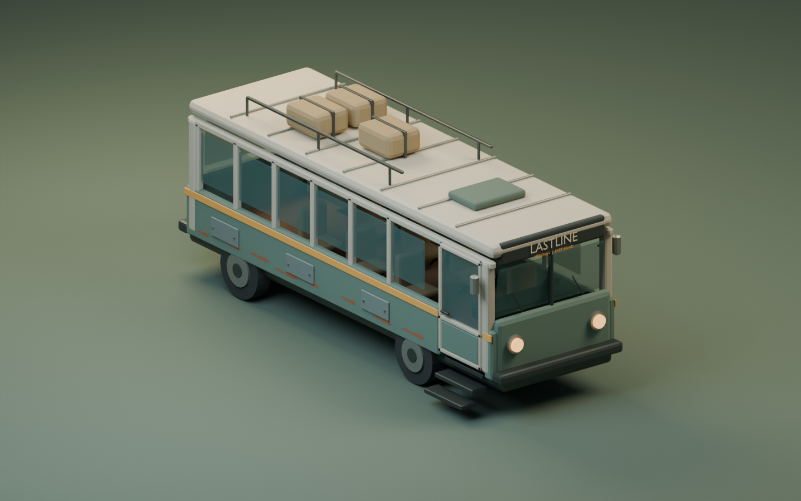
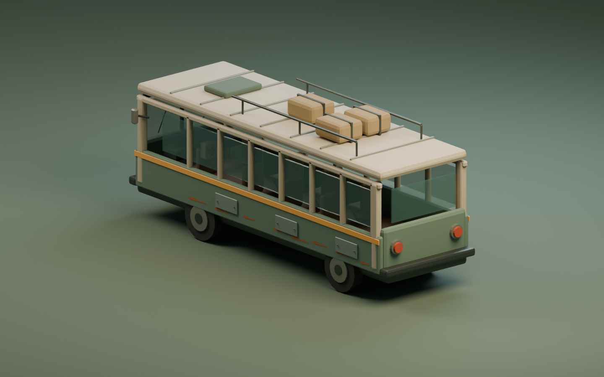
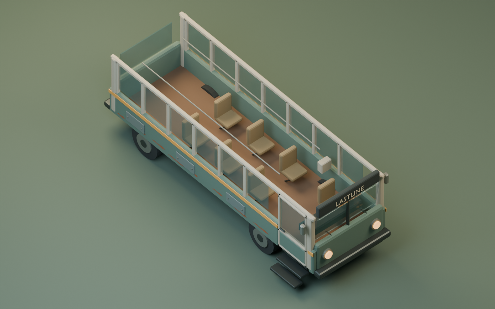
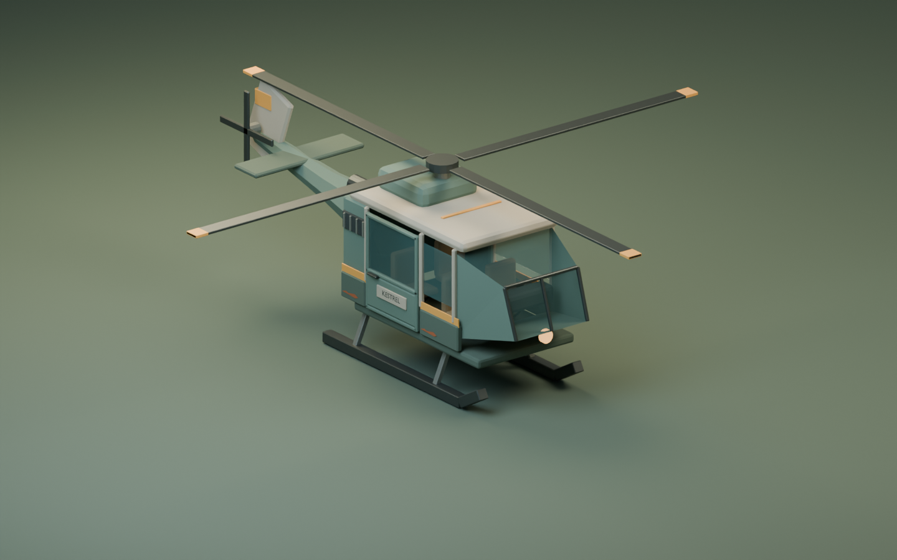
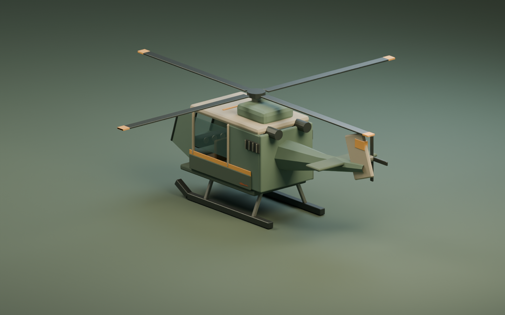
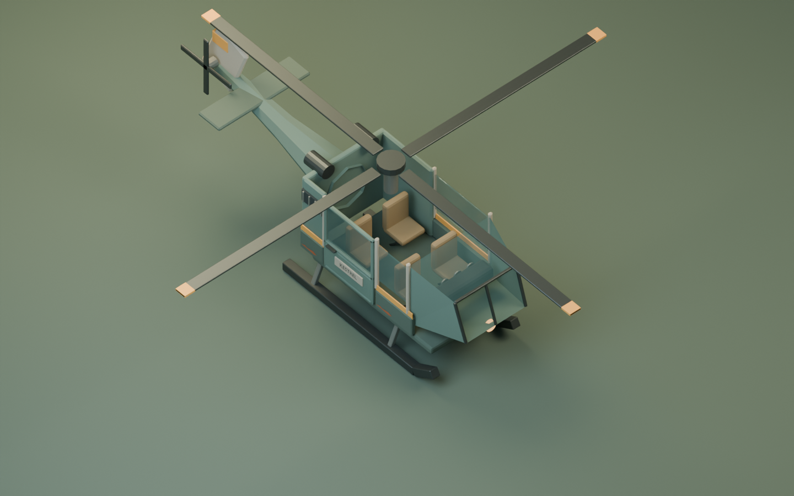
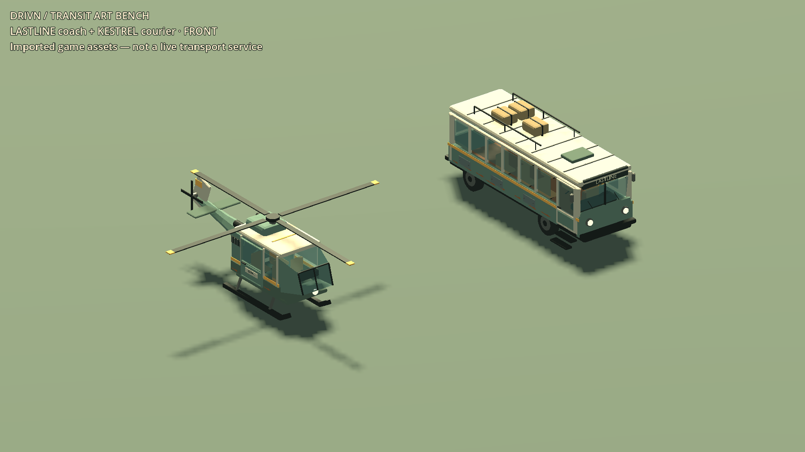
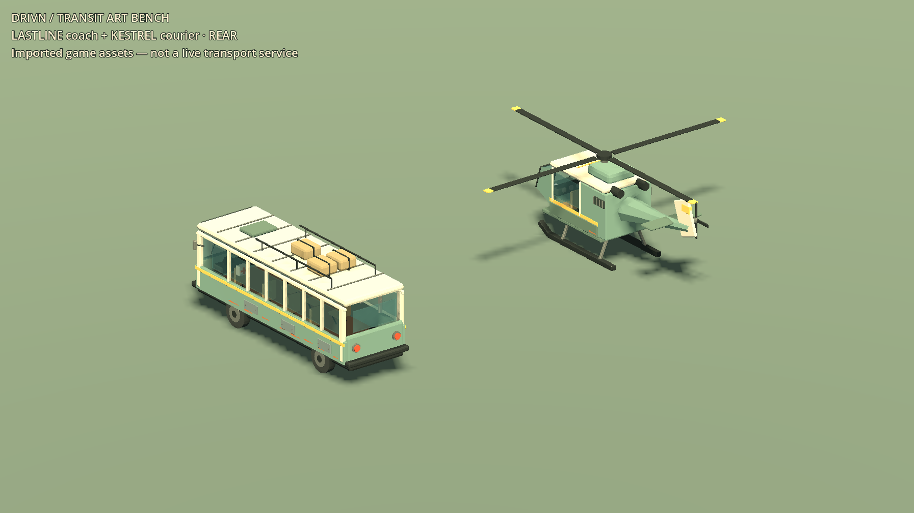
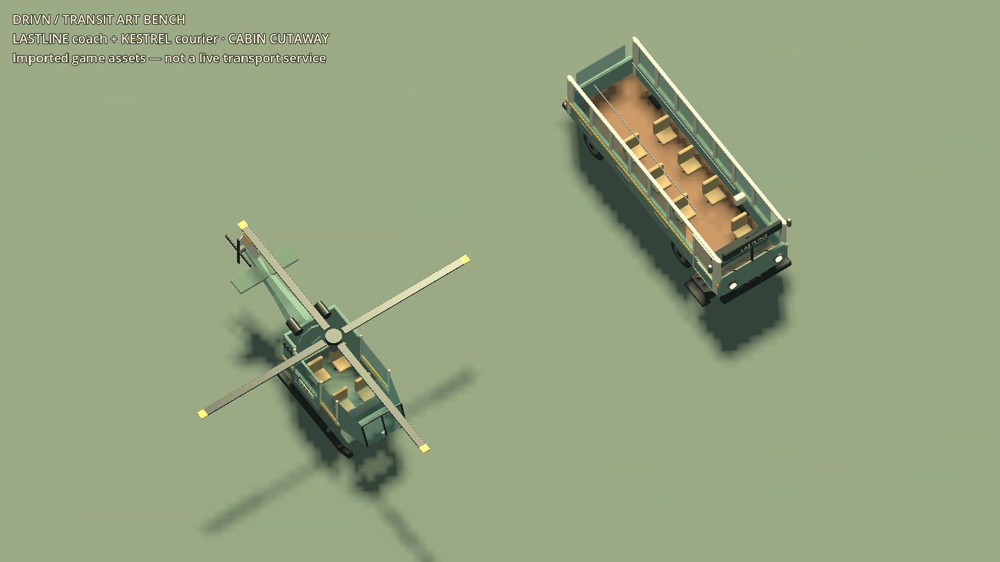

# Transport screenshot review — September 7, 2026

Nine new views: six Blender studio renders and three **actual Godot viewport
captures**. All nine were personally inspected. They show art for LASTLINE
coaches and KESTREL couriers, not live buses or helicopter flights. For other
game pieces, see the existing [20-piece game gallery](MERIDIAN_GAME_GALLERY_2026_09_06.md).

## What the screenshots changed

The first coach had steps crossing the front tire, an unbroken body panel behind
the passenger door and an opaque slab behind its glass. The first helicopter
also had blocked glazing/boarding and a solid aft cabin engulfing the rear seats.
Those were functional art defects, not just presentation preferences.

An expanded regression failed **44 passed / 7 failed** against those exports.
The generator now builds an actual hollow cabin, separate window frames and
doorways; the coach's front axle sits behind its entrance and the fixed steps
belong to the chassis. The same passenger-space test then passed **51/0**.
The first stair correction exceeded the Python 3.2 m width gate (3.225 m); the
stairs were tightened to a 3.165 m full footprint without widening that gate.

The second visual correction darkened the salvage paint/canvas, added irregular
lower-panel chips and a readable KESTREL door plaque. This better suggests a
maintained survivor service. It remains clean and simplified in places: the
helicopter cabin silhouette is boxy, wear is coarse, and the Godot diagnostic
stage has harsh highlights and soft/aliased shadows. These are not approved
hero-quality promotional shots or a final world-lighting pass.

Before-fix evidence: [coach front](../renders/transit-2026-09-07/before/coach_front.png),
[coach interior](../renders/transit-2026-09-07/before/coach_cabin.png),
[blocked helicopter interior](../renders/transit-2026-09-07/before/helicopter_cabin.png),
and [original Godot bench](../renders/transit-2026-09-07/before/01_transit_bench.png).
The earlier export's shared `.001` attachment-name defect was also caught by
Python and corrected before this passenger-space pass.

## LASTLINE — Blender studio views

Original road coach with route board, patched lower panels, baggage rack,
six passenger seats, driver position and a separate cabin roof. All studio
renders are 1440 × 900 and were produced by Blender, not image compositing.







## KESTREL — Blender studio views

Original four-seat utility helicopter: driver plus three passengers, independent
main/tail rotors, skids, sliding-door mesh and a removable cabin roof.







## Actual Godot import — three unedited captures

These are the real exported GLBs in a deliberately labeled asset-test scene.
The requested window size was 1280 × 720; the actual saved viewport images are
**1793 × 1009**. They were copied byte-for-byte from the isolated capture run,
with matching SHA-256 hashes, not resized or retouched.







## Verification record

Code/assets: `c5c2eca8cb00303b92643f200a91965d18cdf90b`. Runs below preceded
the commit at parent `55ce8d0`; their before/after hashes match the committed
source bytes. The Python covering suite passed **4/4**, including the existing
homestead and yard contracts. Actual final geometry is 10,488 coach triangles
and 5,521 helicopter triangles. See the [asset contract](../art/TRANSIT_KIT.md).

| Exact archived run | Result | Wall time | Boundary |
|---|---|---:|---|
| [Passenger-space RED](../renders/transit-2026-09-07/passenger-space-red/result.json) | 44/7, exit 1 | See original record | Before geometry correction |
| [First geometry GREEN](../renders/transit-2026-09-07/passenger-space-first-green/result.json) | 51/0, exit 0 | See original record | Pre-final width/palette correction |
| [Final import](../renders/transit-2026-09-07/import/result.json) | exit 0 | 11.46 s | Both GLBs reimported |
| [Final headless](../renders/transit-2026-09-07/headless/result.json) | 51/0, exit 0 | 3.67 s | Imported geometry/pivots/clearance samples |
| [Final GPU](../renders/transit-2026-09-07/capture/result.json) | 54/0, exit 0 | 7.47 s | Same checks plus 3 saved viewport images |
| [Final scale negative](../renders/transit-2026-09-07/scale-probe/result.json) | 38/4, expected exit 1 | 2.64 s | Two height + two length failures; passenger-space probes omitted |

Each result folder includes the original environment record, stdout and stderr.
Final headless/GPU/negative-control stderr is empty. Import retains two known
`dialogue_manager` invalid-UID warnings falling back to text resource paths;
no new parser/import error was observed. All owned runs completed within their
original 120-second wall limit, with both profile paths isolated and unchanged
five-file source hash sets. No broad game-suite, performance or stability pass
is inferred from these short asset tests.

Capture hashes, in front/rear/cutaway order:

```text
4D3C24BF4332CBD3FA8B81827A6E7936EF4D19E4AC01E64EFC2215FE24899D25
3EAF49AF118B876AF5FB940F18D60638EB77A04E4453F2499E2F9F3ED756647B
F1340181D406E2428DCF235772D09C7BAAE3F32C401B0CA11C60BF25E08A8070
```

## Still required

Actual fares/tickets, timetables, routes, physical boarding, moving passengers,
bus driving, takeoff/flight/landing, interruption/refund rules, controller UI,
Game Deck use while riding and host authority remain unimplemented for these
vehicles. So do moving-door/capsule clearance, collision/LOD/draw-call budgets
and full-world visual acceptance. Existing native-stability and unrecovered-save
gates remain open. The map is unchanged (`04D97542…F0135B9`). No Windows package,
push, merge, deployment or whole-game completion follows from this checkpoint.

## Independent scoped review

A separate read-only reviewer inspected `55ce8d0..c5c2eca`, the actual GLBs and
all six studio previews, independently reran Python **4/4**, and matched the
five recorded source hashes to current files. Verdict: **ready for this
asset-only checkpoint**, no Critical or Important defect found. The parent
separately inspected all three final Godot frames above.

Two nonblocking coverage suggestions remain for the runtime integration pass:
assert/open the coach door around its hinge (the current pivot is correctly
located, but automated motion checks cover wheels/rotors only), and explicitly
assert helicopter passenger anchors `_02` and `_03` (both were confirmed in the
actual GLB, but current Python attachment coverage does not protect both names).
These are acknowledged test gaps, not claims that moving-door or boarding
clearance is already verified. The reviewer did not approve gameplay services,
save recovery, native stability, the whole branch or release readiness.
